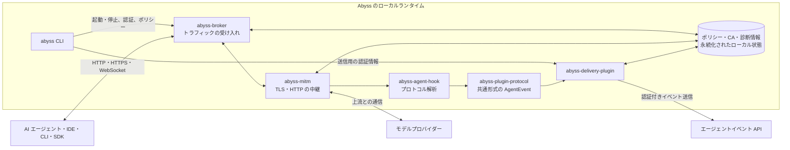

[English](README.md) | [简体中文](README.zh-CN.md) | **日本語**

# Abyss：AI エージェントの動きを、コード変更なしで可視化

<p align="center">
  <picture>
    <source media="(prefers-color-scheme: dark)" srcset="docs/assets/abyss-overview-dark.svg" />
    
  </picture>
</p>

## 概要

Abyss は、AI エージェントの動作を把握するためのオープンソースの可観測性プラットフォームです。エージェントとモデルプロバイダー間の通信をローカルプロキシで観測し、会話の内容、ツールの呼び出し、トークン使用量、通信エラーを確認できます。エージェントのソースコードを変更したり、計測用のコードを追加したりする必要はありません。

Rust で実装されており、次の機能を備えています。

- HTTP/HTTPS の明示的プロキシに対応。macOS Network Extension や Windows WFP のアダプターを介した透過型プロキシも利用できます。
- ポリシーに基づいて TLS の復号とコンテンツの取得を制御し、対応するエージェントの通信を解析します。
- OpenAI Responses API、Chat Completions API、Anthropic Messages API などの通信を、共通のイベント形式に変換します。
- プラグインと Rust・TypeScript・Python SDK を使って、既存システムとの連携や独自のイベント処理を実装できます。

## インストール

Linux x86_64（systemd 環境）と macOS ARM64 では、ビルド済みの CLI をインストールできます。

```bash
curl --proto '=https' --tlsv1.2 -fsSL \
  https://github.com/lexmount/abyss-rs/releases/latest/download/install.sh | sh
```

## クイックスタート

Node.js 22 以上、npm 10 以上、および利用するエージェントをあらかじめインストールしてください。次のコマンドでローカル環境を起動し、Abyss 経由でエージェントを実行します。

```bash
abyss deploy-local start
abyss run -- codex
```

ダッシュボードを開くと、セッション、モデルの呼び出し、トークン使用量を確認できます。

```bash
abyss dashboard
```

設定方法、取得する内容の切り替え、サービスの起動・停止については、[Abyss CLI ガイド](https://abyss.lexmount.com/docs/product/open-source-software/abyss-cli)をご覧ください。

## 対応するエージェントとモデル

| エージェント | デスクトップ | CLI | Web |
| --- | :---: | :---: | :---: |
| <picture><source media="(prefers-color-scheme: dark)" srcset="https://cdn.jsdelivr.net/npm/@lobehub/icons-static-png@2.5.0/dark/openai.png"></picture> ChatGPT | ✅ | ✅ | ❌ |
| <picture><source media="(prefers-color-scheme: dark)" srcset="https://cdn.jsdelivr.net/npm/@lobehub/icons-static-png@2.5.0/dark/claude-color.png"></picture> Claude | ✅ | ✅ | ❌ |
| <picture><source media="(prefers-color-scheme: dark)" srcset="https://cdn.jsdelivr.net/npm/@lobehub/icons-static-png@2.5.0/dark/opencode.png"></picture> [OpenCode](docs/opencode.md) | ✅ | ✅ | ✅ |
| <picture><source media="(prefers-color-scheme: dark)" srcset="https://cdn.jsdelivr.net/npm/@lobehub/icons-static-png@2.5.0/dark/deepseek-color.png"></picture> [DeepSeek Harness](docs/configuration.md) | ✅ | ✅ | ✅ |
| [Hermes](docs/hermes.md) | — | ✅ | — |

| モデルシリーズ | 対応 |
| --- | :---: |
| <picture><source media="(prefers-color-scheme: dark)" srcset="https://cdn.jsdelivr.net/npm/@lobehub/icons-static-png@2.5.0/dark/openai.png"></picture> GPT / o シリーズ | ✅ |
| <picture><source media="(prefers-color-scheme: dark)" srcset="https://cdn.jsdelivr.net/npm/@lobehub/icons-static-png@2.5.0/dark/claude-color.png"></picture> Claude | ✅ |
| <picture><source media="(prefers-color-scheme: dark)" srcset="https://cdn.jsdelivr.net/npm/@lobehub/icons-static-png@2.5.0/dark/deepseek-color.png"></picture> DeepSeek | ✅ |
| <picture><source media="(prefers-color-scheme: dark)" srcset="https://cdn.jsdelivr.net/npm/@lobehub/icons-static-png@2.5.0/dark/zhipu-color.png"></picture> [GLM](docs/glm.md) | ✅ |
| <picture><source media="(prefers-color-scheme: dark)" srcset="https://cdn.jsdelivr.net/npm/@lobehub/icons-static-png@2.5.0/dark/kimi-color.png"></picture> [Kimi](docs/kimi.md) | ✅ |
| <picture><source media="(prefers-color-scheme: dark)" srcset="https://cdn.jsdelivr.net/npm/@lobehub/icons-static-png@2.5.0/dark/qwen-color.png"></picture> [Qwen](docs/qwen.md) | ✅ |
| <picture><source media="(prefers-color-scheme: dark)" srcset="https://cdn.jsdelivr.net/npm/@lobehub/icons-static-png@2.5.0/dark/minimax-color.png"></picture> [MiniMax](docs/minimax.md) | ✅ |

## Broker

`abyss-broker` は、デバイス上で通信を処理する独立したランタイムです。明示的プロキシへの接続や、外部のプラットフォームアダプターから渡された通信を受け入れ、TLS とコンテンツ取得のポリシーを適用します。対応するエージェントの通信を解析し、共通形式のイベントとして出力します。CLI やアプリケーションからは、ローカル REST API を通じて設定の変更、状態の確認、診断情報の取得ができます。

Broker を単独でインストール・設定・起動する手順は、[Broker セットアップガイド](https://abyss.lexmount.com/docs/development/basics/start-abyss-broker)を参照してください。

## プラグイン

Broker のプラグインは独立したプロセスとして動作し、ローカルの Unix ソケットまたは Windows 名前付きパイプを通じて、共通形式の `AgentEvent` を受信します。データのエクスポート、監査システムとの連携、自動化などに利用できます。公式の `abyss-delivery-plugin` は、指定した HTTP エンドポイントへイベントを送信します。送信に失敗したイベントはローカルに保存し、後から再送できます。

Broker はリアルタイムのイベントストリームを提供し、送信先への認証、永続化、再試行はプラグインが担います。連携方法とプロトコルの詳細は、[プラグインの仕組み](https://abyss.lexmount.com/docs/development/basics/abyss-broker-mechanism#plugins)をご覧ください。

## 取得したデータの検索・参照

`abyss-query` を使うと、取得済みのアクティビティを検索し、セッションやイベント、実行履歴、使用量を確認できます。Windows・Linux・macOS に対応し、SaaS またはセルフホストの HTTP バックエンドに接続できます。名前付きプロファイルで接続先を切り替えられるほか、必要に応じて Bearer トークン認証やターミナルからのログインを利用できます。ページ数や取得件数の上限を指定でき、バージョン付きの JSON/JSONL 出力にも対応しているため、エージェントからの利用にも適しています。

詳しくは、[クエリ CLI ガイド](crates/abyss-query-cli/README.md)と [Rust データクライアント](crates/abyss-data-client/README.md)を参照してください。

## SDK

各言語の SDK には、Broker REST API とプラグインのイベントストリームを扱うクライアントが用意されています。ローカルポリシーの管理、診断情報の取得、型定義に沿ったイベント処理に利用できます。

- [Rust SDK](https://abyss.lexmount.com/docs/reference/sdk/rust)
- [TypeScript / Node.js SDK](https://abyss.lexmount.com/docs/reference/sdk/typescript)
- [Python SDK](https://abyss.lexmount.com/docs/reference/sdk/python)

## アーキテクチャ


