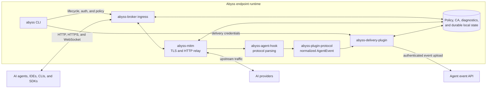

**English** | [简体中文](README.zh-CN.md) | [日本語](README.ja.md)

# Abyss: AI agent observability without code changes

<p align="center">
  
</p>

## Overview

Abyss is an open-source observability platform for AI agents. A local proxy
captures traffic between agents and model providers, giving you visibility into
conversations, tool activity, token usage, and network failures. There is no need
to modify agent source code or add instrumentation.

Built in Rust, Abyss provides:

- Explicit HTTP/HTTPS proxying and transparent proxying through macOS Network
  Extension and Windows WFP adapters.
- Policy-controlled TLS interception and content capture for supported agent protocols.
- Normalized events for model API protocols, including OpenAI's Responses API and
  Chat Completions API, and Anthropic's Messages API.
- Plugins and Rust, TypeScript, and Python SDKs for custom integrations and event delivery.

## Installation

Install the prebuilt CLI on Linux x86_64 (with systemd) or macOS ARM64:

```bash
curl --proto '=https' --tlsv1.2 -fsSL \
  https://github.com/lexmount/abyss-rs/releases/latest/download/install.sh | sh
```

## Quick start

Make sure Node.js 22+, npm 10+, and the agent you want to use are installed.
Then start the local environment and run your agent through Abyss:

```bash
abyss deploy-local start
abyss run -- codex
```

Open the Abyss dashboard to explore sessions, model activity, and token usage:

```bash
abyss dashboard
```

See the [Abyss CLI guide](https://abyss.lexmount.com/docs/product/open-source-software/abyss-cli)
for configuration, capture controls, and lifecycle commands.

## Supported agents and models

| Agent | Desktop | CLI | Web |
| --- | :---: | :---: | :---: |
| <picture><source media="(prefers-color-scheme: dark)" srcset="https://cdn.jsdelivr.net/npm/@lobehub/icons-static-png@2.5.0/dark/openai.png"></picture> ChatGPT | ✅ | ✅ | ❌ |
| <picture><source media="(prefers-color-scheme: dark)" srcset="https://cdn.jsdelivr.net/npm/@lobehub/icons-static-png@2.5.0/dark/claude-color.png"></picture> Claude | ✅ | ✅ | ❌ |
| <picture><source media="(prefers-color-scheme: dark)" srcset="https://cdn.jsdelivr.net/npm/@lobehub/icons-static-png@2.5.0/dark/opencode.png"></picture> [OpenCode](docs/opencode.md) | ✅ | ✅ | ✅ |
| <picture><source media="(prefers-color-scheme: dark)" srcset="https://cdn.jsdelivr.net/npm/@lobehub/icons-static-png@2.5.0/dark/deepseek-color.png"></picture> [DeepSeek Harness](docs/configuration.md) | ✅ | ✅ | ✅ |

| Model family | Supported |
| --- | :---: |
| <picture><source media="(prefers-color-scheme: dark)" srcset="https://cdn.jsdelivr.net/npm/@lobehub/icons-static-png@2.5.0/dark/openai.png"></picture> GPT / o-series | ✅ |
| <picture><source media="(prefers-color-scheme: dark)" srcset="https://cdn.jsdelivr.net/npm/@lobehub/icons-static-png@2.5.0/dark/claude-color.png"></picture> Claude | ✅ |
| <picture><source media="(prefers-color-scheme: dark)" srcset="https://cdn.jsdelivr.net/npm/@lobehub/icons-static-png@2.5.0/dark/deepseek-color.png"></picture> DeepSeek | ✅ |
| <picture><source media="(prefers-color-scheme: dark)" srcset="https://cdn.jsdelivr.net/npm/@lobehub/icons-static-png@2.5.0/dark/zhipu-color.png"></picture> [GLM](docs/glm.md) | ✅ |
| <picture><source media="(prefers-color-scheme: dark)" srcset="https://cdn.jsdelivr.net/npm/@lobehub/icons-static-png@2.5.0/dark/kimi-color.png"></picture> [Kimi](docs/kimi.md) | ✅ |
| <picture><source media="(prefers-color-scheme: dark)" srcset="https://cdn.jsdelivr.net/npm/@lobehub/icons-static-png@2.5.0/dark/qwen-color.png"></picture> [Qwen](docs/qwen.md) | ✅ |
| <picture><source media="(prefers-color-scheme: dark)" srcset="https://cdn.jsdelivr.net/npm/@lobehub/icons-static-png@2.5.0/dark/minimax-color.png"></picture> [MiniMax](docs/minimax.md) | ✅ |

## Broker

`abyss-broker` is the standalone runtime that handles traffic on your device.
It accepts explicit proxy connections or flows from external platform adapters,
applies TLS and capture policies, parses supported agent traffic, and publishes
normalized events. Its local REST API lets CLIs and applications manage runtime
configuration, check status, and retrieve diagnostics.

See the [broker setup guide](https://abyss.lexmount.com/docs/development/basics/start-abyss-broker)
to install, configure, and start it independently.

## Plugins

Broker plugins are separate processes that subscribe to normalized `AgentEvent`
messages over a local Unix socket or Windows Named Pipe. Use them to build
custom exporters, audit integrations, and automation. The official
`abyss-delivery-plugin` uploads events to a configured HTTP endpoint and can
persist events when uploads fail and replay them later.

The broker provides a live event stream; plugins own remote authentication,
persistence, and retries. See the [plugin mechanism](https://abyss.lexmount.com/docs/development/basics/abyss-broker-mechanism#plugins)
for the integration model and protocol details.

## Query captured data

Use `abyss-query` to search captured activity, inspect sessions and events,
retrieve execution trajectories, and review usage. It connects to SaaS or
self-hosted HTTP backends and runs on Windows, Linux, and macOS. Named profiles
let you switch between environments, with optional bearer-token authentication
or terminal login. Pagination limits and versioned JSON/JSONL output make it
suitable for agent workflows. See the [query CLI guide](crates/abyss-query-cli/README.md)
and [Rust data client](crates/abyss-data-client/README.md).

## SDKs

The SDKs provide clients for the broker REST API and plugin event stream, making
it easier to manage local policies, inspect diagnostics, and consume typed events.
Choose the reference for your integration language:

- [Rust SDK](https://abyss.lexmount.com/docs/reference/sdk/rust)
- [TypeScript / Node.js SDK](https://abyss.lexmount.com/docs/reference/sdk/typescript)
- [Python SDK](https://abyss.lexmount.com/docs/reference/sdk/python)

## Architecture


