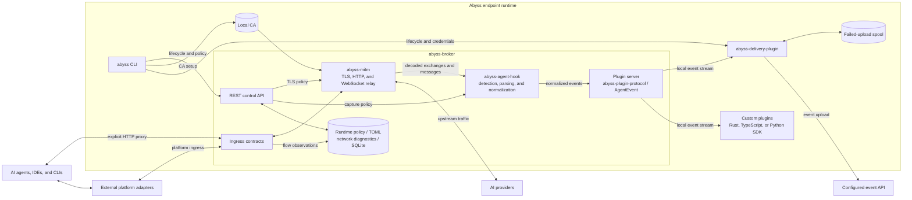

# Abyss: Non-invasive observability platform for AI Agent

## Overview

Abyss is an open-source observability platform for AI agents. It observes
agent-to-provider network traffic through a local proxy, helping developers and
teams understand conversations, tool activity, token usage, and network failures
without modifying agent source code or adding instrumentation to agent applications.

Built in Rust, Abyss provides:

- Explicit HTTP/HTTPS proxying and transparent proxying through macOS Network
  Extension and Windows WFP adapters.
- Policy-controlled TLS interception and content capture for supported agent protocols.
- Normalized events for model API protocols, including OpenAI's Responses API and
  Chat Completions API, and Anthropic's Messages API.
- Plugins and Rust, TypeScript, and Python SDKs for custom integrations and event delivery.

## Install

Install the prebuilt CLI on Linux x86_64 (with systemd) or macOS ARM64:

```bash
curl --proto '=https' --tlsv1.2 -fsSL \
  https://github.com/lexmount/abyss-rs/releases/latest/download/install.sh | sh
```

## Quick Start

With Node.js 22+ and npm 10+ installed, start the local environment and run an
installed agent through Abyss:

```bash
abyss deploy-local start
abyss run -- codex
```

Open the dashboard to review captured activity, or inspect the runtime from your terminal:

```bash
abyss dashboard
abyss status
abyss diagnostics
```

See the [Abyss CLI guide](https://abyss.lexmount.cn/docs/product/open-source-software/abyss-cli)
for configuration, capture controls, and lifecycle commands.

## Broker

`abyss-broker` is Abyss's standalone endpoint runtime. It
accepts explicit proxy connections or flows from external platform adapters,
applies TLS and capture policies, parses supported agent traffic, and publishes
normalized events. Its local REST API exposes runtime configuration, status,
and diagnostics for CLI and application integrations.

See the [broker setup guide](https://abyss.lexmount.cn/docs/development/basics/start-abyss-broker)
to install, configure, and start it independently.

## Plugin

Broker plugins are separate processes that subscribe to normalized `AgentEvent`
messages over a local Unix socket or Windows Named Pipe. Use them to build
custom exporters, audit integrations, and automation. The official
`abyss-delivery-plugin` uploads events to a configured HTTP endpoint and can
persist failed uploads for later replay.

The broker provides a live event stream; plugins own remote authentication,
persistence, and retries. See the [plugin mechanism](https://abyss.lexmount.cn/docs/development/basics/abyss-broker-mechanism#plugins)
for the integration model and protocol details.

## SDK

The SDKs provide clients for the broker REST API and plugin event stream, making
it easier to manage local policies, inspect diagnostics, and consume typed events.
Choose the reference for your integration language:

- [Rust SDK](https://abyss.lexmount.cn/docs/reference/sdk/rust)
- [TypeScript / Node.js SDK](https://abyss.lexmount.cn/docs/reference/sdk/typescript)
- [Python SDK](https://abyss.lexmount.cn/docs/reference/sdk/python)

## Architecture


