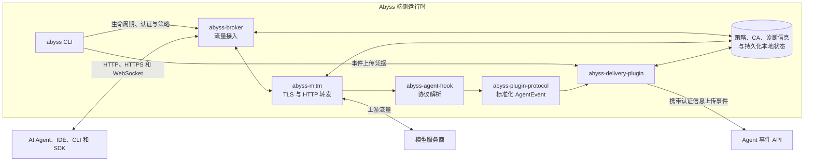

[English](README.md) | **简体中文** | [日本語](README.ja.md)

# Abyss：零侵入式 AI Agent 可观测性平台

<p align="center">
  <picture>
    <source media="(prefers-color-scheme: dark)" srcset="docs/assets/abyss-overview-dark.svg" />
    
  </picture>
</p>

## 概览

Abyss 是一个开源的 AI Agent 可观测平台。通过本地代理，Abyss 接管 Agent 与模型服务商之间的网络流量，对会话内容、工具调用、Token 用量和网络故障进行观测和记录。

Abyss 使用 Rust 构建，提供以下能力：

- 支持 HTTP/HTTPS 显式代理，也可通过 macOS Network Extension 和 Windows WFP 适配器接入透明代理流量。
- 根据策略控制 TLS 解密与内容采集，解析模型协议。
- 将 OpenAI Responses API、Chat Completions API、Anthropic Messages API 等模型接口的流量转换为统一的事件格式。
- 提供插件机制，以及 Rust、TypeScript 和 Python SDK，便于对接现有系统和自定义事件处理流程。

## 安装

Linux x86_64（使用 systemd）和 macOS ARM64 用户可直接安装预编译的 CLI：

```bash
curl --proto '=https' --tlsv1.2 -fsSL \
  https://github.com/lexmount/abyss-rs/releases/latest/download/install.sh | sh
```

## 快速开始

请先安装 Node.js 22+、npm 10+。然后部署本地环境，通过 Abyss 运行 Agent：

```bash
abyss deploy-local start
abyss run -- codex
```

打开 Abyss 控制台，查看会话、模型调用和 Token 用量：

```bash
abyss dashboard
```

配置方法、采集开关和服务管理命令详见 [Abyss CLI 使用指南](https://abyss.lexmount.cn/docs/product/open-source-software/abyss-cli)。

## 支持的 Agent 与模型

| Agent | 桌面端 | 命令行 | 网页端 |
| --- | :---: | :---: | :---: |
| <picture><source media="(prefers-color-scheme: dark)" srcset="https://cdn.jsdelivr.net/npm/@lobehub/icons-static-png@2.5.0/dark/openai.png"></picture> ChatGPT | ✅ | ✅ | ❌ |
| <picture><source media="(prefers-color-scheme: dark)" srcset="https://cdn.jsdelivr.net/npm/@lobehub/icons-static-png@2.5.0/dark/claude-color.png"></picture> Claude | ✅ | ✅ | ❌ |
| <picture><source media="(prefers-color-scheme: dark)" srcset="https://cdn.jsdelivr.net/npm/@lobehub/icons-static-png@2.5.0/dark/opencode.png"></picture> [OpenCode](docs/opencode.md) | ✅ | ✅ | ✅ |
| <picture><source media="(prefers-color-scheme: dark)" srcset="https://cdn.jsdelivr.net/npm/@lobehub/icons-static-png@2.5.0/dark/deepseek-color.png"></picture> [DeepSeek Harness](docs/configuration.md) | ✅ | ✅ | ✅ |
| [Hermes](docs/hermes.md) | — | ✅ | — |

| 模型系列 | 是否支持 |
| --- | :---: |
| <picture><source media="(prefers-color-scheme: dark)" srcset="https://cdn.jsdelivr.net/npm/@lobehub/icons-static-png@2.5.0/dark/openai.png"></picture> GPT / o 系列 | ✅ |
| <picture><source media="(prefers-color-scheme: dark)" srcset="https://cdn.jsdelivr.net/npm/@lobehub/icons-static-png@2.5.0/dark/claude-color.png"></picture> Claude | ✅ |
| <picture><source media="(prefers-color-scheme: dark)" srcset="https://cdn.jsdelivr.net/npm/@lobehub/icons-static-png@2.5.0/dark/deepseek-color.png"></picture> DeepSeek | ✅ |
| <picture><source media="(prefers-color-scheme: dark)" srcset="https://cdn.jsdelivr.net/npm/@lobehub/icons-static-png@2.5.0/dark/zhipu-color.png"></picture> [GLM](docs/glm.md) | ✅ |
| <picture><source media="(prefers-color-scheme: dark)" srcset="https://cdn.jsdelivr.net/npm/@lobehub/icons-static-png@2.5.0/dark/kimi-color.png"></picture> [Kimi](docs/kimi.md) | ✅ |
| <picture><source media="(prefers-color-scheme: dark)" srcset="https://cdn.jsdelivr.net/npm/@lobehub/icons-static-png@2.5.0/dark/qwen-color.png"></picture> [Qwen](docs/qwen.md) | ✅ |
| <picture><source media="(prefers-color-scheme: dark)" srcset="https://cdn.jsdelivr.net/npm/@lobehub/icons-static-png@2.5.0/dark/minimax-color.png"></picture> [MiniMax](docs/minimax.md) | ✅ |

## Broker

`abyss-broker` 是运行在本机的独立运行时，负责处理流量。它接收显式代理连接或外部平台适配器转发的流量，执行 TLS 与内容采集策略，解析受支持的 Agent 通信，并发布标准化事件。CLI 和其他应用可通过其本地 REST API 修改运行配置、查看状态和获取诊断信息。

如需单独安装、配置和启动 Broker，请参阅 [Broker 部署指南](https://abyss.lexmount.cn/docs/development/basics/start-abyss-broker)。

## 插件

Broker 插件以独立进程运行，通过本地 Unix socket 或 Windows 命名管道订阅标准化的 `AgentEvent` 事件。你可以用插件导出数据、对接审计系统或实现自动化。官方提供的 `abyss-delivery-plugin` 可将事件上传到指定的 HTTP 接口，并在上传失败时将事件保存在本地，供后续重放。

Broker 负责提供实时事件流，插件负责远端认证、持久化与重试。集成方式和协议细节详见[插件机制](https://abyss.lexmount.cn/docs/development/basics/abyss-broker-mechanism#plugins)。

## 查询已采集的数据

`abyss-query` 可用于搜索已采集的活动、查看会话与事件、获取执行轨迹，以及统计用量。它支持 Windows、Linux 和 macOS，可连接 SaaS 或自托管的 HTTP 后端。你可以通过命名配置切换环境，并按需使用 Bearer Token 或终端登录完成认证。查询支持分页和结果数量限制，还提供带版本标识的 JSON/JSONL 输出，方便 Agent 调用。

详见[查询 CLI 使用指南](crates/abyss-query-cli/README.md)和 [Rust 数据客户端](crates/abyss-data-client/README.md)。

## SDK

各语言 SDK 封装了 Broker REST API 和插件事件流，便于管理本地策略、获取诊断信息和处理类型化事件。请按所用语言查阅：

- [Rust SDK](https://abyss.lexmount.cn/docs/reference/sdk/rust)
- [TypeScript / Node.js SDK](https://abyss.lexmount.cn/docs/reference/sdk/typescript)
- [Python SDK](https://abyss.lexmount.cn/docs/reference/sdk/python)

## 架构


