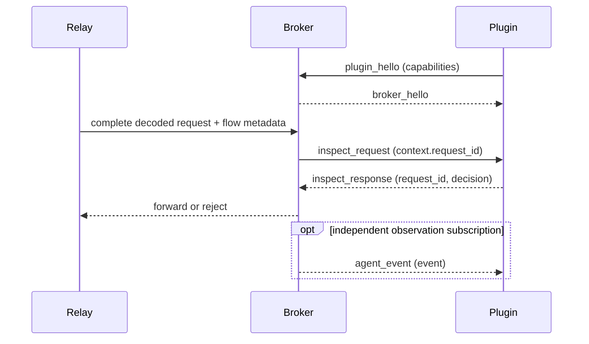

# Abyss Broker Plugin Protocol

The broker uses one local Unix socket or Windows Named Pipe for observation and
request inspection. Delivery, remote destinations and authentication remain plugin
responsibilities. The current wire revision is `protocol_version = 1`; mismatched
builds are rejected. There is no legacy decoder or negotiation fallback.

## Transport and framing

Each frame is a four-byte unsigned big-endian length followed by UTF-8 JSON.
The maximum JSON length is 64 MiB. Every frame has a `type` discriminator.
`messages.schema.json` defines frames; `agent-event.schema.json` defines the
observation payload, and `inspection.schema.json` defines request context.

The endpoint is advertised in broker startup information as `plugin_endpoint`.
SDKs accept an explicit endpoint or discover it using
`ABYSS_BROKER_PLUGIN_ENDPOINT`, `ABYSS_BROKER_STARTUP_INFO`, or
`ABYSS_HOME/runtime/startup-info.json`. Local endpoint permissions determine who
can connect. A plugin ID is a diagnostic label, not an authorization token.

## Connection lifecycle

The plugin first sends:

```json
{"type":"plugin_hello","protocol_version":1,"plugin_id":"example.dlp","capabilities":["agent_request","agent_events"]}
```

Capabilities are independent. `agent_events` subscribes to the bounded observation
stream. `agent_request` makes this connection eligible for pre-forwarding request
decisions. An event-only connection does not enable inspection. No separate broker
configuration, endpoint, inspector list, or persistent registration is needed.
The broker replies with `broker_hello`, or `broker_error` and closes the connection.
A deliberate shutdown sends `broker_close` when the transport remains writable.



## Request decisions

```json
{ "type": "inspect_response", "request_id": "request-123", "decision": { "action": "modify", "actions": [{ "op": "set_auth_token", "value": "allocated-token" }] } }
```

The v1 reply contains exactly one tagged `decision`:

- `{"action":"allow"}` retains the current request.
- `{"action":"block","reason":"safe explanation"}` rejects the request.
- `{"action":"modify","actions":[...]}` applies explicit semantic actions.

Actions are `set_auth_token` / `set_model` / `set_provider` with a string `value`, or
`remove_auth_token` / `remove_model` without a value. Lists execute in order; the
last action for a field wins. An empty list is equivalent to Allow. Invalid edits
reject the pending request before any upstream bytes are written.

The callback context is read-only input. SDKs send the returned decision directly;
they do not compare context snapshots. `auth_token` exposes the selected token only
to request handlers. `auth_token_writable`, `model_writable` and `provider_writable` describe supported
writes, not plugin permissions. Auth binding uses an existing Bearer, `x-api-key`,
or `anthropic-api-key` header. With no such header, `api.openai.com` and
`chatgpt.com` bind Bearer, and `api.anthropic.com` binds `x-api-key`. Unknown or
ambiguous bindings are not writable. Model writers cover OpenAI Responses,
Chat Completions, Anthropic Messages and Responses WebSocket `response.create`,
including its nested `response` form.

`provider` is the selected model provider, represented by its service URL (API
origin and path prefix), or null for an unknown operation. `agent.provider` remains
the provider label inferred by parsing. `set_provider` accepts an HTTP(S) URL with optional port/path and no
userinfo, query or fragment. It replaces the prefix while retaining `/responses`,
`/chat/completions`, or `/messages` and any suboperation and original query.
For example, `/backend-api/codex/responses` becomes `/v1/responses` when the provider URL
is `https://provider.example/v1`. Later plugins see the updated provider URL,
authority, path and provider; physical ingress, destination and client server name
remain original. Host and upstream TLS identity follow the selected URL. Existing
network Block rules apply to the target, and configured next-hop routing is
preserved. This does not convert API dialects or authentication header schemes.
An HTTP WebSocket upgrade can change its URL; established messages cannot.

`inspect_request.context` carries lossless decoded content (`utf8` text or base64
binary), complete JSON when available, request-side Agent projection, Harness
identity/declarations, and available process and destination metadata. Explicit
proxy flows have `source_process: null`. Authorization, Proxy-Authorization, Cookie,
Set-Cookie, provider API-key headers, ChatGPT-Account-Id and headers whose names
contain `token` are omitted using the shared MITM credential-header predicate.
`sequence` is 1 for HTTP and counts client data messages on a WebSocket flow;
`message_type` preserves text/binary framing and is null for HTTP.
Plugins must not echo sensitive content in
reasons: a block reason is returned to the client. Unknown protocols and malformed
model payloads still reach the plugin with complete content and a parsing status.
Attachment/history references are not fetched. The projection contains no invented
response or usage facts.

The projection uses the same `conversation.entries` contract as observation:
one entry per protocol block, with tool arguments and results kept in their
original positions. There are no separate text or tool projections. Audit content
omission does not apply to inspection. Harness declarations contain only the
client-declared `turn_id`, `subagent_id`, `parent_subagent_id` and purpose;
WebSocket declarations combine connection headers with the current message's
`client_metadata`, without inheriting an upgrade request's turn.

The broker snapshots connected inspection sessions in registration order per HTTP
request or complete client WebSocket data message. Plugins run sequentially; each sees prior accepted edits.
The first rejection stops evaluation. Replies are correlated on the same session.
Late replies are ignored. A selected session's disconnect, handler failure, queue
exhaustion or five-second decision deadline rejects the current request with
`inspection_unavailable`. Waiters are removed on cancellation and disconnect.
There are no retries or replay. Later requests select the currently connected
sessions; with none connected, the normal streaming relay remains active.

HTTP inspection retains the complete original wire body within the existing 16 MiB
default HTTP body limit and applies existing content-decoding limits. A client
must finish its inspected HTTP body within 30 seconds, or receives 408
`inspection_body_timeout`. Rejected or
uninspectable requests send no HTTP request head/body bytes to the provider.
Upstream TLS starts after the plugin chain selects its final target. Explicit
ingress may have already prepared the original TCP connection or CONNECT tunnel;
a route change discards that stream before opening the final route. Allowed bodies use their original
wire framing and content encoding when only credentials or provider change. Model edits retain
unrelated JSON values and use identity encoding with a new Content-Length, removing
Transfer-Encoding, Content-Encoding and Trailer. Invalid edits receive 502
`invalid_agent_request_edit`. Oversized bodies receive 413, unsupported encoding
415, invalid encoding/body 400, plugin rejection 403 `agent_request_blocked`, and
inspection failure 503 `inspection_unavailable`. Local errors identify `abyss-broker`.
The HTTP upgrade is inspected before its head is forwarded. After upgrade,
WebSocket inspection runs on complete client data messages; reverse
traffic can continue while a decision is pending. The final upgrade credential
and provider are readable but fixed on subsequent message contexts. Model edits preserve text
or binary message type. Invalid edits close with 1011. Rejection closes with 1008 and
inspection failure with 1011. Control frames are not inspected. Reassembly keeps
the relay's existing 64 MiB message and 16 MiB frame limits; exceeding them with
an inspector connected closes with 1009. These transport limits also apply when
no inspector is connected. A context exceeding the 64 MiB JSON frame limit is
rejected locally before any inspection RPC, without disconnecting the plugin.

Network `Block` is separate: `mitm.tls_decryption` chooses Intercept, Passthrough or
Block using OS/network selectors. Block terminates the flow before any inspection;
Passthrough stays opaque. Plugins never override either outcome. Where no HTTP error
can be delivered (such as transparent TLS), network Block closes the connection and
records its local reason without decrypting it just to return an error.

## Observation frames

```json
{"type":"agent_event","event":{"event_id":"example"}}
```

The abbreviated event above illustrates the envelope; `fixtures/agent-event-frame.json`
contains a complete frame. `fixtures/agent-event.json` remains the reusable event
payload fixture. Slow observation consumers are disconnected with code 101;
normal broker shutdown uses code 100. A rejected prompt is not published through
normal observation or parser-diagnostic delivery.

## Agent Event Contract

Protocol version 1 carries one flat, normalized `AgentEvent` shape with
structured, role-aware conversation content. Consumers read messages directly
without decoding provider transport bodies. Raw transport bytes, decoded
provider documents, and original content blocks are not part of the contract.

```json
{
  "event_id": "evt-123",
  "observed_at": "2026-08-19T10:00:00Z",
  "device": {
    "host_name": "developer-mac",
    "platform": "macos",
    "os_version": "15.6"
  },
  "agent": {
    "name": "codex",
    "version": "1.2.3"
  },
  "session_id": "session-123",
  "response_id": "resp-123",
  "previous_response_id": "resp-122",
  "subagent_id": "agent-2",
  "parent_subagent_id": "agent-1",
  "turn_id": "turn-1",
  "purpose": "session_title",
  "llm": {
    "provider": "openai",
    "model": "gpt-5"
  },
  "side": "response",
  "token_usage": {
    "input_tokens": 0,
    "output_tokens": 12,
    "cache_read_tokens": 0,
    "cache_write_tokens": 0,
    "reasoning_tokens": 4,
    "total_tokens": 12
  },
  "attachments": [
    {
      "position": 0,
      "media_type": "image/png",
      "byte_size": 8,
      "sha256": "0000000000000000000000000000000000000000000000000000000000000000",
      "content_base64": "iVBORw0KGgo="
    }
  ],
  "conversation": {
    "entries": [
      {
        "role": "reasoning",
        "text": "The user wants an overview of the repository.",
        "item_id": "rs-123"
      },
      {
        "role": "assistant",
        "text": "I will inspect the repository.",
        "item_id": "msg-123"
      },
      {
        "role": "tool_call",
        "text": "pwd",
        "call_id": "call-123",
        "name": "exec",
        "item_id": "fc-123"
      }
    ],
    "completeness": "complete"
  },
  "path": "/v1/responses",
  "headers": [
    {
      "name": "content-type",
      "value": "text/event-stream"
    },
    {
      "name": "x-request-id",
      "value": "req-123"
    },
    {
      "name": "set-cookie",
      "value": "<redacted>"
    }
  ]
}
```

There is no event kind discriminator or nested payload enum. `side` identifies
whether content and token usage belong to the Agent request or provider response.
`conversation` entries are the only carrier of the side's content: text,
reasoning, tool calls, and tool results appear in position as entries, with no
flattened text or tool-call summary beside them; images use `attachments`.
The event has no arbitrary `metadata` object.

`token_usage` counters are disjoint regardless of how the provider reports
them. `input_tokens` counts input neither read from nor written into a provider
cache, `cache_read_tokens` and `cache_write_tokens` count the cached input, and
`output_tokens` counts model output including reasoning. `reasoning_tokens` is
the part of `output_tokens` spent on reasoning, and `total_tokens` is
`input_tokens + cache_read_tokens + cache_write_tokens + output_tokens`. Request
events carry the input-side counters and response events carry the output-side
counters, so summing both sides of one exchange never double-counts a token.

## Conversation

`conversation` has two fields:

- `entries`: one entry per protocol block or item, in provider order. Blocks
  are never merged or split.
- `completeness`: whether the captured body was decoded completely
  (`complete`), only partly because capture or decoding was incomplete
  (`partial`), or not at all because no supported structured document was
  found (`unsupported`). It is independent of whether the provider call
  succeeded.

Each entry has:

- `role`: one of the roles below.
- `text`: the visible text. A `tool_call` carries its arguments or input as
  sent; a `tool_result` carries its output.
- `call_id`: on `tool_call` and `tool_result` entries, the identifier that
  pairs a call with its result, when the protocol supplies one.
- `name`: on `tool_call` entries, the tool name, when the protocol supplies
  one.
- `item_id`: the identity of the item the entry belongs to, when the protocol
  supplies one. A model output keeps the identity its provider assigned when a
  later request sends it back as history, so the request entry carries the
  same value as the response entry that produced it.
  - OpenAI Responses: the `id` of the input or output item, verbatim (`msg_…`,
    `rs_…`, `fc_…`, `ctc_…`, and so on). All entries of an item that yields
    several, such as a message with several content parts, carry the same
    value.
  - Anthropic: on a `thinking` block, `thinking:` followed by the lowercase
    hex SHA-256 of the block's `signature` (for a streamed block, its
    `signature_delta` fragments joined in order); on a `redacted_thinking`
    block, the same over its `data`. A block without a signature has none, and
    no other block carries one; tool blocks pair by `call_id`.
  - Chat Completions: none.

The role of an entry follows from the protocol structure alone:

| Role | Anthropic | OpenAI Responses | Chat Completions |
| --- | --- | --- | --- |
| `system` | each block of the top-level `system`; text blocks of a `role: "system"` message | `role: "system"` messages | `system` |
| `developer` | — | `instructions`; each content part of a `role: "developer"` message | `developer` |
| `user` | `text` blocks of user messages | `input_text` of user messages | `user` |
| `assistant` | `text` blocks of assistant messages | `output_text`, `refusal` | assistant `content`, `refusal` |
| `reasoning` | `thinking`, `redacted_thinking` | `reasoning` (its content, else its summary) | assistant `reasoning_content` |
| `tool_call` | `tool_use`, `server_tool_use`, `mcp_tool_use` | every `*_call` item | each assistant `tool_calls[]` |
| `tool_result` | `tool_result`, every `*_tool_result` | every `*_output` item | `tool` |
| `unknown` | — | an item without a recognized `role`, such as `agent_message` | a message without a recognized `role` |

Any other block or content part keeps its visible text in the role of its
enclosing message, and any other Responses item in its own `role`; a tool part
inside message content, such as a `tool_result` part, contributes nothing.
A `thinking` or `redacted_thinking` block or a `reasoning` item produces its
entry even when it carries no readable text, such as a reasoning item with only
`encrypted_content`; the entry's `text` is then empty. A block, part, or item
that carries no text, such as an image or a tool definition, produces no entry;
images are carried by `attachments`. Chat Completions `reasoning_content`
precedes the content of its message.
Responses use the same table: Anthropic response content blocks and OpenAI
output items become entries the same way, after the collector assembles
streamed fragments, so a streamed block appears as one entry with its complete
text. A request event carries the history as the agent sent it; repeated
blocks are not deduplicated.

The leading `system` and `developer` entries of a request are its system
prompt; no separate flag marks them. A tool result pairs with its call by
`call_id`, and model output replayed as history matches the response that
produced it by `item_id`.

## Omitted content

`omitted` lists the content categories the active content policy left out of
the event, in the order `token_usage`, `conversation_text`, `tool_content`,
`images`; it is omitted when everything was kept. An omitted category keeps
the structure and empties the content, so consumers can tell "not present"
from "not retained":

- `conversation_text`: entries other than `tool_call` and `tool_result` keep
  their role and `item_id` with empty `text`.
- `tool_content`: `tool_call` and `tool_result` entries keep their role,
  `call_id`, `name`, and `item_id` with empty `text`.
- `images`: no attachment is carried.
- `token_usage`: every counter is zero.

## Continuation

Two optional fields link one exchange to the responses around it. Both events
of the exchange carry the same values, and each is omitted when the traffic
declares none:

- `response_id`: the provider identity of the response the exchange produced:
  the OpenAI response id (`resp_…`) or the Anthropic message id (`msg_…`).
  Later requests name it to continue after that response.
- `previous_response_id`: the response the request continues after. The
  request then carries only the messages added since that response.
  - Anthropic: `previous_message_id` of a `thread` `continue` request.
  - OpenAI: the request's `previous_response_id`.

## Declared subagent and root turn

Three optional fields carry what a client declares about its subagents and
turns. Each is read only from the request headers (the upgrade request for a
WebSocket connection), taken verbatim, and omitted when the request declares
none; the collector never substitutes a value. Both events of an exchange
carry the same values, and none enters the event id.

| Field | Meaning | Claude Code | Codex |
| --- | --- | --- | --- |
| `subagent_id` | The subagent the exchange belongs to; absent for the main agent and for side requests. | `x-claude-code-agent-id` | `thread-id`, only when the request carries `x-codex-parent-thread-id` |
| `parent_subagent_id` | The subagent that spawned it; absent when the main agent spawned it. | `x-claude-code-parent-agent-id` | `x-codex-parent-thread-id`, unless it equals the `session-id` header, which names the main thread |
| `turn_id` | The root turn the client declares: the user input the exchange ultimately works for. A subagent's exchanges carry the value of the turn that spawned it; an exchange the client makes for no turn carries none. | `x-claude-code-prompt-id` | the `root_turn_id` string of the `x-codex-turn-metadata` JSON object |

A header counts when its value is non-empty and valid UTF-8. A Codex
`turn_id` is read only when `x-codex-turn-metadata` is a JSON object whose
`root_turn_id` is a non-empty string. Cursor, Hermes, WorkBuddy, and OpenCode
declare only `turn_id`, each from one header of the request itself: Cursor
`x-request-id`, Hermes `x-hermes-turn-id`, WorkBuddy
`x-conversation-request-id`, and OpenCode `x-opencode-request`. Other clients
declare none of the fields. The headers themselves remain in `headers`.

## Path

`path` is the exchange's request target: its path and query exactly as the
request line named them, for example `/v1/messages?beta=true`. A WebSocket
connection names its target only on its handshake, so every event of the
connection carries the upgrade request's path. Both events of an exchange
carry it. The value is verbatim: the query is not redacted, and the content
policy does not govern it.

## Headers

`headers` lists the captured headers of the event's side: the request headers
on a request event and the response headers on a response event. A WebSocket
connection has headers only on its handshake, so every request event of the
connection carries the upgrade request's headers, and every response event
carries the `101 Switching Protocols` response's headers.

Each entry is `{"name", "value"}`, or `{"name", "value_base64"}` with the
standard base64 encoding of the bytes when the value is not valid UTF-8;
exactly one of the two is present. Entries follow the order of the captured
header map, which groups repeated names together in first-seen order, and
keep every duplicate. Names are lowercase, as the captured header map stores
them.

The values are verbatim except for credential redaction, applied once by the
collector: the values of `authorization`, `proxy-authorization`, `cookie`,
`set-cookie`, `api-key`, `x-api-key`, `x-goog-api-key`, `anthropic-api-key`,
`chatgpt-account-id`, and of any header whose name contains `token`, become
`<redacted>` and the names are kept. The content policy does not govern
headers. The list is omitted when empty.

## Call purpose

`purpose` states what the Agent made a provider call for, when its traffic
says so. Both events of the call carry it. Values:

- `session_title`: the Agent asks the model to name the session the call
  belongs to.
- `compaction`: the Agent asks the model to summarize the conversation so far,
  to continue from the summary instead of the full history. Codex declares it
  as `request_kind` `compaction` in `x-codex-turn-metadata`, Claude Code as
  `x-claude-code-request-class` `compaction`.
- `prewarm`: an OpenAI Responses WebSocket client explicitly sends
  `response.create` with boolean `generate: false`. The connection is warmed
  without generating output. Both flat and nested `response` payloads are
  supported. Absent, true, or malformed flags do not declare prewarm.

Token counters always retain the provider's observations, including prewarm.
An all-traffic summary includes every event. Comparisons with Codex
`turn.completed.usage` use completed inference only, excluding events explicitly
marked `prewarm` and reporting their usage separately. Do not infer prewarm from
event order, empty replies, missing turn ids, or token differences. For comparison
with Codex, add Abyss's disjoint input/cache-read/cache-write counters to obtain
inclusive input; reasoning is already included in output and is not added again.

The official delivery plugin stores it as `metadata.purpose` in the usage-event
metadata. The broker forwards it unchanged.

## Event identity and emission

Event ids are deterministic. The collector derives an id from the device,
agent, session, event side, provider response identity, and a content digest,
so observing the same exchange again yields the same id and ingestion stays
idempotent. Distinct provider calls produce distinct ids. The content digest
covers the side's conversation entries before the content policy applies, so
the policy does not change an id: every entry's `role`, `text`, `call_id`,
`name`, and `item_id` in order, followed by the digests of the side's
attachments. `completeness`, the declared subagent and root turn ids, the
path, and the headers do not enter the id.

The broker emits events only for exchanges its Agent protocol parser accepted.
An exchange the parser rejects produces no event. Within an exchange that
produces events, a side produces one when its conversation has at least one
entry, even with empty text, when it carries an image, or when it has token
usage.

## Delivery

The official delivery plugin sends `observed_at`, `conversation`,
`response_id`, `previous_response_id`, `subagent_id`, `parent_subagent_id`, and
`turn_id` as top-level fields of the backend usage event, each as the event
carries it and absent where the event omits it, and sends `side` as the
top-level `event_type` (`request` or `response`). It stores the purpose as
`metadata.purpose`, the omitted categories as `metadata.omitted`, the path as
`metadata.path`, and the headers as `metadata.headers`. Backend
trajectories consume these fields without decoding provider bodies. Other plugins may translate the event for their own destinations.

Rust, Python, and TypeScript SDKs all request protocol version 1 and consume this
same event shape with the same 64 MiB JSON frame limit. The broker forwards the
structured event unchanged.

The complete event schema is in
[`agent-event.schema.json`](agent-event.schema.json).
