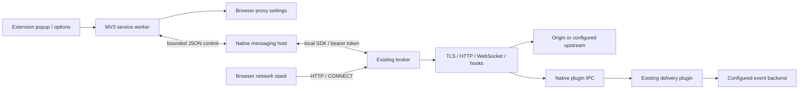

# Browser extension feasibility and reuse design

Task: `browser-plugin.md`. Research scope confirmed on 2026-11-16: feasibility,
implementation alternatives, and minimal validation, not a distributable extension.
Source baseline: `01639cbc10c2dcf705e24d3d75ee5552a15ec3f1` (workspace version
`1.6.0`). Browser documentation was consulted on 2026-11-16/17.

## Decision

An Oxylabs-style proxy manager is feasible. The highest-reuse route is a Manifest
V3 extension controlling browser routing, with the existing native broker doing
traffic processing. **Expose broker capabilities to the browser; do not attempt
to move the whole broker into the extension runtime.** A thin native-messaging
host should bridge lifecycle, authenticated control, and bounded status updates.
The extension is a new client of the endpoint, not a new proxy implementation.

[Oxylabs' documented workflow](https://oxylabs.io/products/chrome-proxy-extension)
is profile creation, profile selection, and one-click connection to a chosen
proxy provider. That interaction model is a useful starting point. It does not
establish that a proxy-manager extension itself decrypts traffic or parses AI
conversations. Abyss should distinguish **routing enabled**, **inspection ready**,
and **supported conversation observed** instead of presenting all three as one
connected indicator.

This PR changes documentation only. It adds no browser permissions, capture,
native host, TLS trust installation, event fields, storage migration, or package
release. The experiments validate existing reuse boundaries; extension store
approval and end-to-end browser conversation collection remain future gates.

## Current code and reusable boundaries

| Capability | Existing implementation | Reuse and remaining work |
| --- | --- | --- |
| Browser HTTP/HTTPS routing | [Explicit ingress](../crates/abyss-broker/src/ingress/explicit.rs), [broker configuration](../crates/abyss-broker/src/config.rs) | Reuse HTTP absolute-form requests and CONNECT. Configure Chrome to use an HTTP proxy even for HTTPS destinations. The ingress is not a SOCKS server. |
| TLS, HTTP, streaming and WebSocket relay | [MITM crate](../crates/abyss-mitm/src/lib.rs) | Keep native. HTTPS content needs broker CA trust in the actual browser trust configuration. Validate negotiated protocols and capture limits; connection success alone proves neither decryption nor complete content. |
| Upstream proxy selection | [Network runtime](../crates/abyss-broker/src/network_config.rs), [upstream design](upstream-proxy-design.md) | Reuse existing outbound routing. Browser points at the local broker; broker points at the selected remote upstream. Keep these endpoints distinct to avoid loops. |
| Inspection and modification | [Request control](../crates/abyss-broker/src/proxy/request_control.rs), [inspection protocol](../crates/abyss-broker/src/plugin/inspection.rs) | Run policy decisions natively. Browser popup/service-worker availability must not become a synchronous request dependency. Preserve native timeout, rejection, and modification semantics. |
| AI detection and normalization | [Hook](../crates/abyss-agent-hook/src/hook.rs), [harness registry](../crates/abyss-agent-hook/src/harness/registry/mod.rs), [protocol parsers](../crates/abyss-agent-hook/src/protocol) | Reuse parsing only after an actual browser request matches supported identity and protocol. Add explicit browser identities and site adapters where needed. |
| Local control and diagnostics | [REST router](../crates/abyss-broker/src/api.rs), [startup discovery](../crates/abyss-broker/src/startup_info.rs), [Rust SDK client](../crates/abyss-sdk/src/broker/client.rs) | Native host can reuse endpoint discovery and authenticated SDK calls. Health/proxy status are public; policy, diagnostics, traffic and shutdown routes require the local bearer token. No browser-native bridge exists today. |
| Events and delivery | [Plugin transport](../crates/abyss-broker/src/plugin), [delivery uploader](../crates/abyss-delivery-plugin/src/uploader.rs) | Keep IPC, destination credentials and spooling native. Existing live publication is best-effort; upload spooling cannot recover events dropped before delivery receives them. |
| TypeScript clients | [REST client](../sdks/typescript/src/broker/client.ts), [plugin transport](../sdks/typescript/src/plugin/transport.ts), [event types](../sdks/typescript/src/event.ts) | Types and pure decoding logic are candidates for reuse. The shipped clients import Node filesystem/network APIs; they are not drop-in browser modules. Prefer the Rust SDK in the native host. |

### Routing does not imply browser conversation support

`HarnessUsageHook::http_events` first requires harness detection, then protocol
detection. The current Claude web completion parser is used for recognized
traffic, but `ClaudeDesktopDetector` requires desktop process metadata or desktop
request markers. The regression test
`claude_web_route_alone_does_not_identify_claude_desktop` explicitly rejects
URL-only attribution. Likewise, a request to a Codex backend does not identify
the caller as Codex. A provider name in the README is not a promise that the
provider's consumer website protocol is supported.

Explicit ingress constructs flow metadata without a source process. Configured
[harness matchers](../crates/abyss-agent-hook/src/harness/matcher.rs) use process
names/application IDs, so a custom Chrome process matcher cannot fix explicit
proxy attribution as currently implemented. Native interception can supply a
browser process identity, but that still does not identify a tab or conversation.

A follow-up should introduce an explicit, opt-in browser capture identity, scoped
to supported host/path/protocol combinations and a dedicated browser endpoint or
equivalent authenticated association. Do not spoof desktop/Codex headers to pass
existing detectors. Treat extension-provided tab metadata as untrusted context,
never backend ownership. Preserve server-provided conversation/response IDs when
available; represent missing identities honestly. Cross-tab concurrency, reloads,
retries and multiple browser profiles need deterministic isolation tests. Any
new event fields require a separate coordinated producer/consumer design.

## Browser constraints and alternatives

The following conclusions combine official API contracts with the source
inspection above. They are engineering assessments, not store certification.

| Path | What works | Reuse | Principal limitation | Position |
| --- | --- | --- | --- | --- |
| MV3 proxy manager + local broker + native host | Profile switching, selected-site routing, native control and native inspection | Highest: existing broker, MITM, parsers, policies, delivery | Native installation and browser CA trust; browser identity work | Recommended |
| Proxy manager + remote broker | Browser routes to a remote endpoint; native data plane runs remotely | High server-side reuse | Current explicit ingress lacks authenticated multi-user proxy admission; remote TLS interception moves sensitive data and trust to a server | Separate deployment project, not expose the current listener publicly |
| Pure Chromium MV3 (`webRequest` + declarative rules) | Metadata, some request-body observation, rule-based block/redirect/header edits | Event contracts and selected pure helpers | No general response-body stream API in `webRequest`; no arbitrary broker policy callback | Useful limited telemetry/control product |
| Explicit debugger/DevTools capture | Target-scoped body/network inspection; CDP includes Network and Fetch | Parsers after adaptation | Debugger attachment and target lifecycle, DevTools conflicts, intrusive permission/UX, buffering and stream behavior | Optional diagnostic mode, not default background capture |
| Firefox response filters | HTTP response-stream observation/transformation, per-request proxy choice | Parser extraction possible | Firefox-specific permissions and stream lifecycle; does not replace native broker/IPC | Possible later adapter |
| Page instrumentation + parser WASM | Selected fetch/XHR/WebSocket observations in instrumented pages | Pure protocol parsing after extraction | Page/worker coverage, tampering, injection timing and protocol drift; no network enforcement | Narrow site integration only |
| Full Rust broker compiled to WASM | Selected computation could compile after refactoring | Poor whole-runtime reuse | Native sockets, TLS engine integration, files, SQLite/IPC and daemon lifecycle are not ordinary extension facilities | Reject as the first route |

### Chromium and Firefox details

- [Chrome proxy settings](https://developer.chrome.com/docs/extensions/reference/api/proxy)
  support fixed servers and PAC rules. Proxy configuration is profile-scoped,
  not a tab-specific tunnel. A domain allowlist can route selected destinations;
  it cannot distinguish two tabs using the same destination. Inspect
  `levelOfControl` before changing settings. On disconnect, clear this extension's
  override rather than force `direct` or overwrite another controller's policy.
- [Chrome webRequest](https://developer.chrome.com/docs/extensions/reference/api/webRequest)
  exposes request lifecycle metadata and optional request bodies. Most MV3
  extensions cannot use blocking listeners; policy-installed extensions are an
  exception. It observes WebSocket handshakes, not the subsequent messages, and
  does not expose a general response-body reader. A static rule engine is not
  the broker's arbitrary content-aware inspection pipeline.
- [Declarative Net Request](https://developer.chrome.com/docs/extensions/reference/api/declarativeNetRequest)
  provides browser-evaluated rules, not response-body parsing or a native
  asynchronous decision service. Its rules must be designed separately from
  broker plugin rules instead of silently translating unsupported semantics.
- [Debugger](https://developer.chrome.com/docs/extensions/reference/api/debugger)
  and [DevTools network](https://developer.chrome.com/docs/extensions/reference/api/devtools/network)
  are exceptions to a blanket claim that extensions cannot obtain response
  bodies. They require inspected/attached targets. Validate SSE, WebSocket
  frames, worker targets, navigation, detach, and partial bodies before making
  completeness claims.
- [Firefox `filterResponseData`](https://developer.mozilla.org/en-US/docs/Mozilla/Add-ons/WebExtensions/API/webRequest/filterResponseData)
  can read/change response streams, with `webRequest`, `webRequestBlocking`,
  relevant host access and (MV3, Firefox 110+) `webRequestFilterResponse`.
  Every filter must forward/close/disconnect correctly or it can stall the page.
  [Firefox `proxy.onRequest`](https://developer.mozilla.org/en-US/docs/Mozilla/Add-ons/WebExtensions/API/proxy/onRequest)
  uses a different routing API and failover contract from Chromium.
- MV3 [service workers](https://developer.chrome.com/docs/extensions/develop/concepts/service-workers/lifecycle)
  can terminate after idle periods. Native messaging can extend lifetime, but
  browser shutdown and host crashes still exist. Persist desired settings and
  reconcile observed state on wake. Native enforcement and durable upload must
  continue independently.
- Packaged WASM is allowed with the appropriate
  [extension CSP](https://developer.chrome.com/docs/extensions/reference/manifest/content-security-policy),
  but it does not grant OS privileges. `abyss-agent-hook` currently depends on
  `abyss-mitm`; extracting a portable parser library would be prerequisite work,
  not a compiler-target change. Chrome's
  [Direct Sockets](https://developer.chrome.com/docs/iwa/direct-sockets) is an
  Isolated Web Apps facility, not a general MV3 extension socket API.

Start with desktop Chromium. Edge shares much of the model but needs its own
policy, store and native-host registration tests. Firefox needs an API adapter.
Safari/mobile parity is outside this recommendation and must not be inferred
from Chromium results.

## Recommended architecture



The native messaging host is a new adapter, not an already available broker
feature. [Chrome's native messaging contract](https://developer.chrome.com/docs/extensions/develop/concepts/native-messaging)
uses length-prefixed JSON over stdin/stdout and an installed host manifest with
explicit allowed extension origins. Broker plugin IPC is a different protocol;
neither framing nor endpoints should be connected directly. Limit status
messages well below the host-to-browser 1 MB maximum. Send counters and bounded
summaries, not full conversation bodies or bulk event streams.

The host discovers the existing broker through its startup information, retains
the local bearer token and invokes typed SDK operations. Define a versioned
bridge with request IDs and explicit operations such as `getStatus`,
`getProfiles`, `selectProfile`, and `getDiagnosticsSummary`. Return capability
and runtime version information so the extension can reject unsupported actions.
Do not provide arbitrary URL fetch, shell execution, filesystem access or generic
REST forwarding to page scripts. Validate origin, operation and payload at the
host boundary; keep credentials out of extension storage and page messages.

Direct extension-to-loopback REST is technically another possibility:
[host permissions allow extension-origin cross-origin requests](https://developer.chrome.com/docs/extensions/develop/concepts/network-requests?authuser=0000).
The absence of a broker CORS layer alone does not prove such requests impossible.
However, a browser cannot read the startup/token files, so secure pairing,
credential scope, restart rotation and browser local-network behavior would need
new work. Native messaging better matches existing discovery and IPC boundaries.

### Connection state and failure behavior

1. Discover the installed host and supported broker version. If missing, offer
   installation instructions without altering the browser's routing.
2. Confirm an explicit loopback listener and browser-trust readiness. A listener
   health response does not certify CA trust; use a controlled HTTPS probe with
   an expected payload and verified certificate chain during setup.
3. Apply the selected route only when proxy settings are controllable. Keep
   local control endpoints and unrelated destinations outside interception.
   A dedicated broker instance is preferable when changing a profile would
   otherwise change upstream routing for unrelated native clients.
4. Record desired state; compare it with effective proxy control and broker
   health on startup, worker wake and settings changes. Show conflicts, missing
   trust, unavailable broker, and unsupported capture separately.
5. For selected audited destinations, recommend no automatic `DIRECT` fallback.
   A broker outage should be visible. Outside the selected scope, use the
   declared normal route. Explicit disconnect clears the extension override.
   Releasing the setting is different from changing the OS proxy.

[Chromium proxy behavior](https://chromium.googlesource.com/chromium/src/+/HEAD/net/docs/proxy.md)
includes implicit loopback bypass, HTTPS CONNECT handling, PAC and proxy failover
rules. An experiment that deliberately proxies loopback must record its special
bypass override; that override is not a shipping default. Test proxy conflicts,
IPv4/IPv6, DNS resolution, WebSocket routing, and existing connections. Do not
promise a VPN or complete UDP/WebRTC/HTTP3 coverage from an HTTP proxy setting.

CA installation remains a native/user/administrator action. An extension should
never disable certificate validation. Scope capture to chosen AI destinations;
unrelated browsing should not become content telemetry. Store submission needs
clear user-visible purpose, collection disclosure and permission justification
under the [Chrome Web Store data policies](https://developer.chrome.com/docs/webstore/program-policies/policies?hl=en).

## Delivery phases and integration boundaries

| Phase | Work and owners | Exit evidence |
| --- | --- | --- |
| 0: this research | Public endpoint design and tests of existing behavior | Source trace, unit results, real broker proxy/control black-box results and isolated browser transport probe; documented gaps |
| 1: routing/control prototype | Extension client and generic native host; public SDK reuse | Real extension install; connect/disconnect; effective proxy ownership; worker restart; native host absent/crash; authenticated control denial; HTTPS trust success/failure |
| 2: browser capture | Endpoint harness/identity and selected site adapters; keep parsers native | Actual chosen web clients through broker, SSE/WS, tab/profile isolation, reload/retry, missing-token semantics, privacy scope and complete upload/query correlation |
| 3: product distribution | Platform-owned native-host registration, trust UX, extension packaging and upgrades | macOS/Windows installers, upgrade/uninstall restoration, browser store review and browser/OS matrix |

Choose the Phase 2 sites explicitly (for example Claude web and ChatGPT web)
before implementation. Do not estimate browser support by provider count.
Routing/control is the smaller workstream; site protocol compatibility, identity
and native distribution are the largest uncertainties. Fixed delivery dates
would need prototype results first.

The open endpoint repository should own generic broker changes, portable bridge
contracts and parser tests. Product-native packaging and authentication remain
with the native product; web/service stacks only change if their presentation or
data contracts change. A new extension repository/location is a follow-up
ownership decision. This research requires no companion repository PR.

Release order for implementation is: additive endpoint/SDK support, pinned native
host distribution, then a compatible extension. Adjacent source changes do not
update packaged binaries. Inspect the product's actual runtime/library pins at
implementation time, and use an explicit local artifact override for pre-release
validation. Native host protocol negotiation must cover upgrades in either order.

## Validation and limits of this research

The task PR links the persistent HTML report and logs, including tested commit,
tool versions and exact commands. Existing tests are the appropriate regression
suite for this documentation-only change; no artificial document-shape tests are
added. Core reproducible commands from the repository root are:

```sh
cargo +nightly fmt --all -- --check
cargo build --locked --workspace --all-features
cargo test --locked --workspace --all-features
cargo clippy --locked --workspace --all-targets --all-features -- -D warnings
make test-blackbox-broker-explicit
make test-blackbox-broker-config-api
```

The unit suite exercises identity rejection, protocol parsing, explicit ingress,
and authorization. Existing black-box scripts start the real broker and verify
payload transit, invalid requests, routing-loop rejection and protected API
behavior. An additional isolated Chromium process can test the browser network
stack against the same explicit listener using only a synthetic local page.
That command-line routing experiment does **not** validate `chrome.proxy`, a
native messaging host, CA installation or production web conversation capture.

No running product/standalone stack, native installer or live Codex/DSH workload
is claimed: this task changes no application, skill, traffic handling, parser or
delivery implementation. Those checks become mandatory in the implementation
phases above. Any failed required research check remains a reported blocker;
future implementation gates are not counted as passed research tests.
