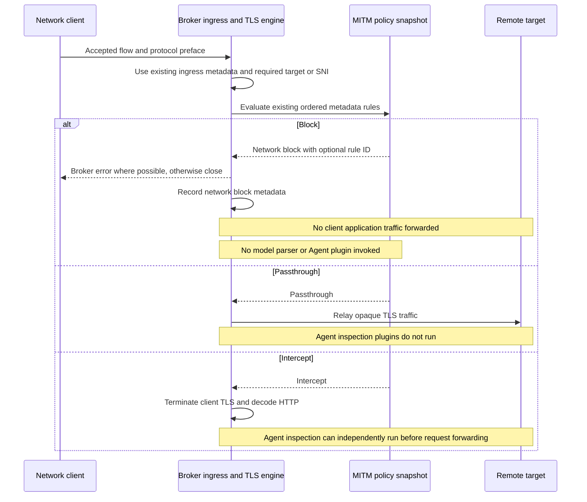
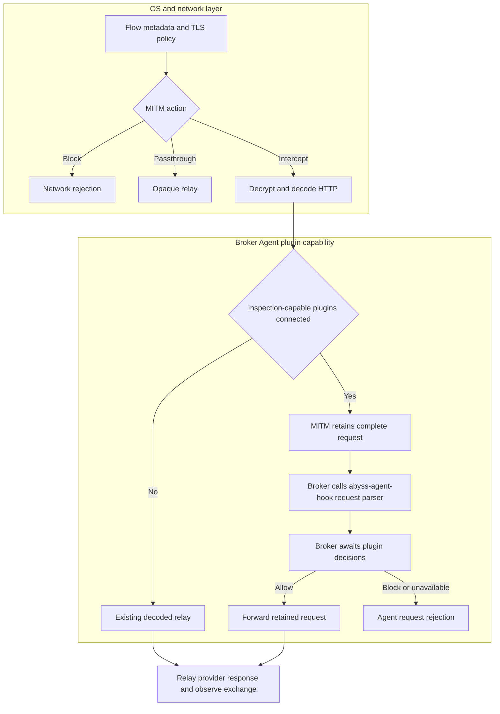
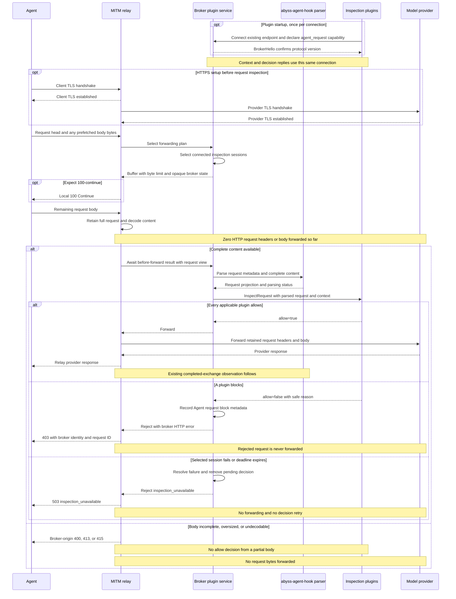
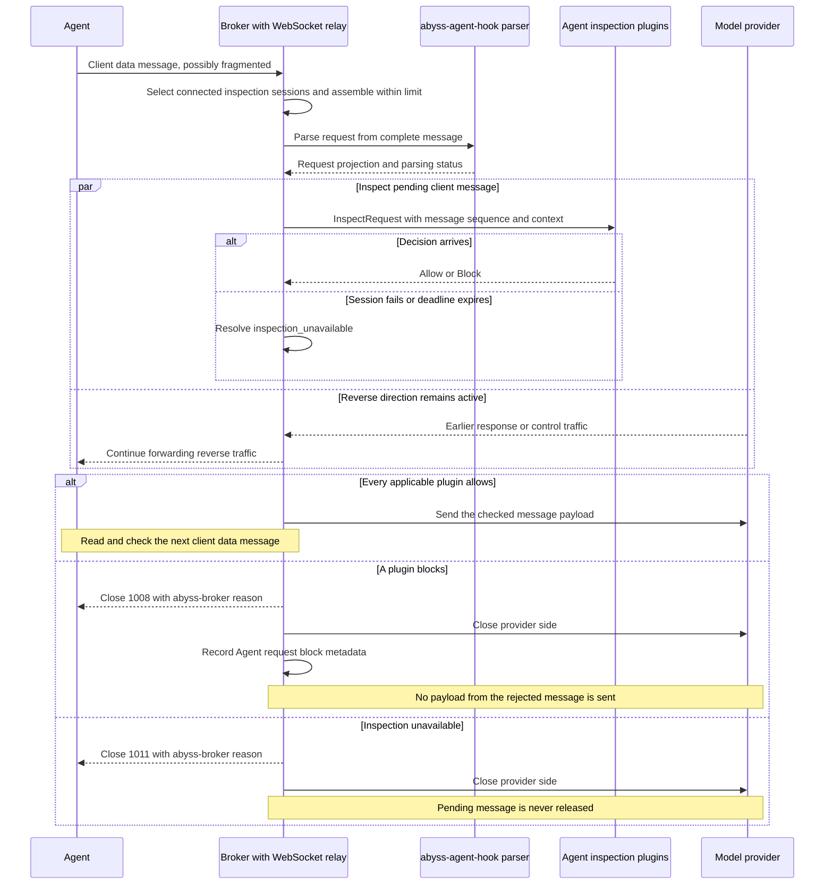

# Broker network blocking and Agent request inspection

Status: proposed. This document describes a design; the configuration, APIs,
and protocol additions below are not implemented. The source review is based on
commit `57c29ef`.

Implement two independent capabilities at different layers:

- **Network blocking** extends the existing TLS MITM policy with `Block`. It
  disables network flows using OS identity and destination metadata, regardless
  of whether the caller is an Agent. It requires no model parsing or plugin.
- **Agent request inspection** lets plugins inspect a decrypted model request
  before it is forwarded, for example to reject a prompt containing a private
  key. It is a broker plugin capability built on request parsing from
  `abyss-agent-hook`. Connected plugins declare the capability and the broker
  asks them for a decision over their existing connections.

The capabilities share flow metadata and transport utilities, but do not share
one rule list, action enum, or decision lifecycle. Network blocking uses the
existing MITM configuration; Agent inspection follows connected plugin capabilities.
Existing asynchronous observation hooks remain a third, independent concern.

The downstream customization point belongs to `abyss-broker`'s plugin API.
`abyss-agent-hook` supplies the shared Agent parsing and request projection;
`abyss-mitm` supplies only the transport boundary needed to wait before forwarding.
An inspection plugin does not implement or register an `abyss-mitm::MitmHook`.

**Client** means any network caller. **Agent** refers to a client in the request
inspection path; **provider** means its upstream model service. Network blocking
returns an error to the client when the transport permits one. Agent request
blocking returns an error through the already decoded application transport.

## Required behavior

1. The existing MITM policy can block by process name, destination host,
   application ID, executable path, or runtime entry point where the existing
   ingress provides those fields. Its decision uses available OS/network
   metadata, without reading model input or adding process attribution.
2. Independently, a custom plugin receives available flow identity, HTTP or
   WebSocket request metadata, complete decoded content, and a model-request
   projection. It can reject a prompt containing a private key before that
   request reaches the provider.
3. In the Agent inspection path, until all applicable plugins allow a request,
   none of its HTTP request headers or body, or its WebSocket data message, is
   forwarded. A rejected request is never partially forwarded.
4. The client receives an identifiable broker-generated rejection whenever the
   active transport can carry one. TLS establishment failures have the limitation
   described below.
5. Network blocking works with no inspection plugins connected. Agent inspection
   works with no network `block` rules configured and needs no inspector list in
   the broker configuration file.
6. TLS `Passthrough` retains its meaning: opaque traffic is relayed without
   invoking Agent inspection. Connecting an inspection plugin does not change that
   action.
7. Request buffering, model parsing, and plugin RPC are paid for only on the
   Agent inspection path. The network policy stays a concrete metadata matcher.
8. Agent inspection preserves the existing upstream connection and TLS handshake
   order. The awaited hook gates application request writes, not connection setup.

The Agent inspection guarantee concerns the request being checked. Upstream TCP
and TLS setup may already be complete, explicit CONNECT may already have
established a tunnel, and a WebSocket may already have an upgraded provider
connection. None establishes permission to send the pending model input.
Previously allowed requests cannot be recalled.

## Current implementation and change points

| Existing component | Current behavior | Required change |
| --- | --- | --- |
| [TLS policy:18](../crates/abyss-mitm/src/transparent/decrypt_policy.rs#L18) | `Intercept` or `Passthrough`; source and destination selectors already exist. | Add `Block` to this policy, preserving ordered rule evaluation and metadata-only decisions. |
| [Explicit ingress:146](../crates/abyss-broker/src/ingress/explicit.rs#L146) | Prepares upstream before acknowledging CONNECT; source process is absent. | Preserve the existing metadata; enforce the MITM policy, including `Block`, before releasing client application traffic. |
| [HTTP request forwarding:639](../crates/abyss-mitm/src/transparent/relay.rs#L639) | Writes the request head, then streams and captures the body. | Add a buffered inspection branch before the first upstream request write. |
| [TLS HTTP handling:123](../crates/abyss-mitm/src/transparent/tls_http.rs#L123) | Establishes provider TLS before decoding the client HTTP request. | Preserve the handshake order; gate HTTP request writes in the relay after decoding and inspection. |
| [WebSocket relay:212](../crates/abyss-mitm/src/transparent/websocket.rs#L212) | Submits an observation and forwards each client message immediately. | Await inspection before forwarding client data messages. |
| [Agent Hook coordinator:58](../crates/abyss-agent-hook/src/hook.rs#L58) | Detects and parses a completed exchange. | Refactor the existing parsing pipeline to expose request-only results shared by inspection and observation. |
| [Broker plugin server:65](../crates/abyss-broker/src/plugin/mod.rs#L65) | Owns local plugin sessions and broadcasts completed Agent events. | Extend this service with the request-inspection capability and broker-owned decision orchestration. |
| [Plugin protocol v1:79](../specs/broker-plugin-protocol/v1/README.md#L79) | Best-effort, one-way live event stream; no decision replies. | Extend version negotiation and the existing connection with capability declaration and request/reply messages. |

An asynchronous `MitmHook` callback cannot enforce Agent request blocking. The
current dispatcher may drop observations under pressure, and HTTP callbacks run
after the exchange has already been relayed.

## Network blocking in the existing MITM policy

Add `Block` to `TlsDecryptionAction` and `TlsDecryptionDecision`, along with a
typed network-blocked flow outcome. Keep the existing
`mitm.tls_decryption` configuration and `GET`/`PUT /v1/mitm/config` API. A
network block is terminal at this layer: it does not decrypt the body, detect a
Harness, parse a model protocol, or wait for a plugin.

The proposed additions use the existing rule format:

```toml
[mitm.tls_decryption]
default_action = "passthrough"
missing_sni_action = "passthrough"

[[mitm.tls_decryption.rules]]
id = "deny-client-restricted-destination"
action = "block"
process_names = ["restricted-client"]
destination_hosts = ["restricted.example", "*.restricted.example"]

[[mitm.tls_decryption.rules]]
id = "deny-application"
action = "block"
application_ids = ["com.example.restricted-client"]

[[mitm.tls_decryption.rules]]
id = "deny-runtime-entry"
action = "block"
process_entry_points = ["/opt/example-client/main.js"]

[[mitm.tls_decryption.rules]]
id = "deny-executable"
action = "block"
executable_paths = ["/opt/example-client/bin/client"]

# Existing intercept and passthrough rules remain in the same ordered list.
[[mitm.tls_decryption.rules]]
id = "decrypt-model-api-traffic"
action = "intercept"
destination_hosts = ["api.openai.com", "api.anthropic.com"]
```

Preserve the current TLS policy semantics:

- Different populated dimensions within a rule are ANDed; values within one
  dimension are ORed. Separate rules provide alternatives.
- Host matching supports exact names and leading `*.` suffix patterns. Normalize
  hosts with the existing implementation and preserve its apex/subdomain rules.
- Process names and application IDs use exact matching. Executable paths and
  runtime entry points are distinct normalized absolute-path fields. Reuse the
  platform's path comparison rules; do not infer identity from a basename.
- An unavailable source field does not match a populated selector. An empty
  dimension is unconstrained. Keep the existing requirement for a populated
  selector on an individual rule; `default_action = "block"` expresses a default
  denial. After no rule matches, `missing_sni_action` still takes precedence when
  neither SNI nor the destination-host fallback supplies a domain. Configure
  that fallback as `block` too when a default denial must cover those flows.
- The first enabled matching rule wins across **all three actions**. A preceding
  passthrough or intercept rule can match before a later block rule. There is no
  separate deny-list priority or plugin override. Put rules in the intended order.

Reuse the current matcher and validation code, adding an executable-path selector
alongside the existing runtime-entry-point selector. Do not introduce a second
access policy or a generic policy framework.

Explicit ingress retains `source_process = None`. Rules requiring process name,
application ID, executable path, or entry point do not match that ingress;
evaluation continues to later rules and the configured fallback. Destination-only
rules and fallback actions can still select `Block` using the existing metadata.
This change does not add local process discovery for explicit proxy clients.

Evaluate at the existing flow policy boundary, after reading any required
ClientHello metadata and before forwarding client application traffic. Keep the
existing preference for TLS SNI and destination-host fallback, plus ingress
target-consistency checks. An early CONNECT rejection is valid only when the
same final decision is already established: it must not skip an earlier rule
whose SNI-dependent match is unresolved. Otherwise wait for ClientHello. No
decrypted model request is needed to decide `Block`.

Update the no-SNI-peek fast path in
[TLS routing:31](../crates/abyss-mitm/src/transparent/tls.rs#L31) as well: it
currently enters interception directly. A default-block policy must reach a
terminal network decision even when no ClientHello inspection is required.

For plain HTTP handled by the broker, apply the same ordered metadata matcher
using the validated HTTP authority/Host: a `Block` outcome denies the flow; a
non-block outcome retains the existing plain-HTTP relay behavior. The legacy
TLS configuration name stays compatible; this does not introduce TLS semantics
into plaintext or add a second rule list. Scope is traffic handled by the
broker's HTTP/TLS ingress, not OS-wide UDP, QUIC, file, or process control.

The following actions belong exclusively to network routing, before Agent plugin
inspection is considered:

| Network MITM action | Network routing outcome |
| --- | --- |
| `Block` | End the flow without model parsing or inspection RPC. |
| `Passthrough` | Relay opaque TLS bytes; this flow never enters Agent plugin inspection. |
| `Intercept` | Terminate TLS and decode requests. The broker can then inspect those requests through connected plugins. |

Plain HTTP that passes network policy is already readable and can enter the same
decoded request path. HTTPS inspection requires an explicit `Intercept` decision.
Connecting a plugin does not change network routing or enable TLS decryption.

The network-layer sequence is independent of Agent parsing and plugin state:



## Agent inspection through connected plugins

This stage starts with decoded HTTP or WebSocket content. Before invoking a
plugin, the broker uses `abyss-agent-hook` to parse the request and combines the
request-side Agent projection, complete decoded content, and available metadata
into context. Opaque TLS traffic never reaches this stage. Plugins return only
allow/block decisions; they do not choose `Intercept` or `Passthrough`.

Use the existing plugin connection lifecycle. A plugin connects to the broker
and declares `agent_request` support during protocol negotiation. The SDK can
derive that declaration from registration of an `on_agent_request` handler.
The broker then sends request context over that connection and receives an
allow/block decision with a reason. Event-only plugins keep their existing role.

No inspector list, enable flag, new runtime-policy section, or plugin management
REST API is needed. The active participants are the connected sessions that
declared this capability. A plugin's ID remains diagnostic metadata; it is not
a name the operator must duplicate in broker configuration. Custom inspection
rules belong to the plugin itself.

For each decoded HTTP request or client WebSocket data message, the broker takes
a snapshot of those sessions before choosing whether to buffer:

- With no inspection-capable sessions, use the existing forwarding path without
  request inspection, model parsing for inspection, or decision RPC.
- Otherwise, retain the complete request, parse it through `abyss-agent-hook`,
  and ask the selected sessions in connection-registration order. The first
  `Block` ends the check; all selected sessions must return `Allow` to forward.
- A plugin connected after that selection participates in subsequent requests.
  A selected plugin that disconnects before answering causes the pending request
  to fail. Future requests use the remaining connected sessions; with none left,
  they return to the ordinary forwarding path.

There is no persisted expectation that a disconnected plugin must be present.
Ordinary event consumers do not enable blocking by connecting. Plugins receive
the complete available context and implement their own model, Harness, content,
or contextual applicability logic. Unknown Harnesses/protocols still reach
selected inspection plugins with explicit parsing status.

Reuse existing body/decode and plugin frame limits as the initial bounds. Full
content must fit; an observation prefix is not a valid inspection payload.
The serialized context and request projection must also fit the existing IPC
frame limit; do not omit content to make a decision request fit.
Use a finite broker-side default decision deadline so a lost reply cannot leave
a request waiting indefinitely. These are transport implementation limits, not
a new set of per-plugin configuration options.

Keep `/v1/mitm/config` and its durable policy transaction for network decisions,
and `/v1/hooks/config` for observation. Neither stores inspection plugin membership.
Network decisions retain their existing per-flow snapshot. Plugin membership is
selected per request/message, so a newly connected plugin can inspect subsequent
messages on an already intercepted WebSocket. Opaque flows still require a new
connection and a network `Intercept` decision before inspection is possible.

Old configuration keeps its existing behavior; existing v1 event-only plugins
do not enable inspection. Old binaries reject the new `block` action or an
unsupported plugin protocol version rather than silently accepting them.

## Network routing and Agent request forwarding



### HTTP and HTTPS

Introduce a prepared request representation containing the parsed head, retained
wire bytes needed for forwarding, and the decoded inspection view. Only the
inspection branch constructs it.

1. Decode and validate the request head after the network decision permits this
   decoded flow. Select the connected inspection sessions before writing any
   request bytes upstream; do not re-evaluate TLS rules inside this request gate.
2. If inspection is unnecessary, use the existing streaming relay.
3. Otherwise, read the complete request body into a bounded buffer. Preserve
   Content-Length/chunked framing and already-prefetched bytes. Extract the
   framing reader from the current relay so both branches use the same parser.
4. For `Expect: 100-continue`, send the interim response locally to obtain the
   body. This is permission to upload to the broker, not permission to forward.
   Keep the existing removal of the locally handled `Expect` header upstream.
5. Decode content encodings and pass the complete request to the broker. The
   broker calls `abyss-agent-hook` to parse it, invokes inspection plugins, and
   returns a forwarding or rejection result to the relay.
6. On allow, replay the retained request using the existing forwarding rules.
   Preserve its body and content encoding; do not serialize the normalized model
   projection back into a provider request. Continue normal response forwarding
   and asynchronous observation.
7. On block, send a local error and close the request connection. Do not create a
   fabricated provider response or token-usage event.

Preserve the existing TCP connection, CONNECT tunnel, and TLS handshake order.
For intercepted HTTPS, the broker still completes client TLS and provider TLS
before decoding the HTTP request. Buffer and inspect the request before the
relay's first upstream request write; an established provider TLS stream does
not imply that any HTTP headers or body have been forwarded. Do not move
provider TLS setup behind the plugin decision or add deferred connection
machinery for Agent inspection. This keeps connection setup out of the work
that must run after the hook allows the request.

Network blocks whose final decision is already established at CONNECT time run
before `prepare_upstream()`, subject to the rule-order constraint above. This is
a network-policy optimization, independent of the Agent gate.

The current `CapturedBody` may hold only an observation prefix. That is not an
acceptable inspection result. A request exceeding the inspection limit, an
incomplete body, or an unsupported/corrupt content encoding must terminate the
protected request before any part is forwarded. Reuse body-read/decode deadlines
where available and add a finite request-body read deadline for this branch.
There is no spill-to-disk inspection queue in the initial implementation.

For an HTTP request with inspection-capable plugins connected, the sequence is
below. The HTTPS setup illustrates the existing handshake order, which remains unchanged.
The plugin interaction represents all selected sessions in registration order;
a block or failure stops that sequence.



### WebSocket

The HTTP upgrade and subsequent client data messages are separate Agent decision
points on a flow already allowed by the network policy. Apply the Agent request
gate to the upgrade request when an inspection plugin is connected. Once
upgraded, select connected inspection sessions for each complete client text or
binary message before sending it to the provider, including messages that do not
produce a model response. A Responses prewarm message can still carry sensitive
input. Do not reinterpret TLS rules for each message.

Use the WebSocket implementation's message reassembly for fragmented frames and
apply the inspection limit during assembly. Inspect the resulting payload once;
do not forward fragments while accumulating it. Ping, Pong, and Close remain
transport control messages rather than model-input checks.

Awaiting a plugin must not stop provider-to-Agent response/control traffic. Split
the two relay directions so the client-to-provider path waits for its current
decision while the other direction continues. Preserve client message order and
allow at most one pending inspected message per connection. A block cancels the
pending forwarding operation, closes the Agent connection with an identifiable
policy reason, and closes the provider side.
Submit the client message to observation hooks only after it is allowed; a
blocked message must not enter the normal response accumulator.

A connection already in opaque TLS passthrough cannot expose WebSocket messages.
Inspecting it requires a new connection selected for `Intercept` by network
policy. Plugin connections do not reject or reclassify opaque flows.

The following sequence starts after a successful upgrade. Provider messages in
the parallel branch may belong to an earlier allowed request; they do not imply
that the pending client message has been released.



## Request-only Agent parsing and plugin context

Refactor `abyss-agent-hook` to expose its existing parsing capability at the
request stage. An illustrative `AgentRequestParser` accepts decoded HTTP
requests or client WebSocket messages and produces a `ParsedAgentRequest`
without requiring an `HttpExchange` or a provider response. Both names describe
APIs within the existing crate, not a second Agent parsing implementation in the
broker or MITM crate. Reuse the existing request projections, including
[ResponsesRequest:24](../crates/abyss-agent-hook/src/protocol/openai/responses/request.rs#L24),
[ChatRequest:18](../crates/abyss-agent-hook/src/protocol/openai/chat_completions/request.rs#L18),
and the Anthropic request parser currently called by
[exchange parsing:42](../crates/abyss-agent-hook/src/protocol/anthropic/messages/exchange.rs#L42).

Extract protocol detection to operate on request metadata/body, and let completed
exchange parsing call the same request functions. Cover the existing Responses,
Chat Completions, Anthropic Messages, and Claude Web completion request dialects,
plus Responses client WebSocket messages. Preserve raw content for other routes.

The current
[ProtocolDetector:36](../crates/abyss-agent-hook/src/protocol/detection.rs#L36)
accepts an exchange even though its HTTP selection uses request fields. Extract
that input boundary, along with request-side Harness declarations, provider/model
identification, conversation projection, and tool/image extraction. For
WebSocket, reuse the request branch of the existing frame parser without waiting
for the response accumulator to complete a turn.

Reuse the event model's request-side primitives, such as `Conversation`, tool
calls/results, and attachment representations, wherever their semantics match.
The completed audit `AgentEvent` is not the inspection input: normalization can
depend on response-derived identity, usage, and audit retention settings. The
request projection contains only facts known before forwarding; it does not
invent a response, token usage, or a completed event to fit that existing schema.
The broker combines this projection with raw content and flow context for the
inspection protocol. Later observation continues to produce normal Agent events
from the same underlying parsing functions.

Harness detection enriches the context but does not gate inspection. An unknown,
disabled-for-audit, or ambiguously identified Harness must still reach the
selected request inspector. Likewise, `hooks.harness_usage.enabled` and content
retention switches govern audit output, not the content visible to a connected
plugin that declared request inspection support.
Separate Harness evidence matching from the current audit-enabled filtering in
[HarnessRegistry:36](../crates/abyss-agent-hook/src/harness/registry/mod.rs#L36)
so reusing detection does not make inspection depend on an audit switch. Keep
this refactoring inside `abyss-agent-hook`; the broker does not duplicate
protocol detection or normalize model payloads itself.

The proposed inspection context contains:

| Group | Fields and semantics |
| --- | --- |
| Correlation | Decision request ID, flow ID, HTTP request or WebSocket message sequence. IDs identify the broker operation, not an invented Agent turn. |
| Source | Existing ingress metadata where available: PID and process incarnation, process name, executable path, application ID, runtime entry point, working directory, and attribution source. Explicit ingress keeps source-process fields absent. |
| Destination | Original destination address, logical target authority, TLS SNI, HTTP authority/Host, ingress type, and configured upstream route metadata without credentials. |
| Request | Method, URI/path, business headers, transport, WebSocket message type and sequence, and upgrade metadata when applicable. |
| Content | Complete content-decoded bytes, an optional complete JSON value, and explicit decoding/parsing status. Binary bytes have a defined wire encoding. Original encoding metadata describes the retained encoded representation, not the decoded view. |
| Model input | Detected protocol, provider, requested model, ordered conversation/instructions, tool definitions, tool calls/results, and attachment references or inline content present in this request. |
| Agent declarations | Optional Harness identity/evidence/version and declared session, turn, stream, or previous-response IDs available before a response. |

Provide the decoded body together with the structured model projection. The
projection is convenience data, not a complete substitute for the provider
payload: unknown JSON fields, tool schemas, historical tool output, and system
instructions can also carry secrets. Reuse decoded buffers and JSON values;
materialize the IPC representation only for selected plugins. Do not repeatedly
copy the body for each selected inspection session.

Keep provider Authorization, Cookie, and proxy credentials out of the default
plugin context. Preserve request content needed for inspection, and make any
header omissions explicit in the contract. A plugin response contains a safe
reason code/message, not a copy of the matched secret.

Use typed parsing states such as `Parsed`, `UnsupportedProtocol`, and
`InvalidModelRequest`. If the full content is available but the model protocol
cannot be recognized, still call the plugin with the complete body and status.
The plugin can scan it or explicitly reject it. Failure to obtain complete
content is a broker inspection failure and cannot become an implicit allow.

A `file_id`, external URL, or `previous_response_id` is a reference rather than
the referenced content. Include it as such. Do not reconstruct remote history or
download attachments as part of the broker gate. DLP implementations must account
for this scope when choosing what they claim to inspect.

## Shared source metadata, separate policy consumers

The existing [SourceProcess:228](../crates/abyss-mitm/src/transparent/hook.rs#L228)
already distinguishes executable path, application ID, and runtime entry point.
Reuse it and keep native process identity separate from Agent-supplied HTTP
declarations. The network matcher consumes OS metadata directly; the broker also
includes that metadata in Agent plugin context. This shared data does not imply
a shared policy or dependency on Agent parsing in the network matcher.

Preserve each ingress's current metadata capabilities. macOS/Windows transparent
ingress already supplies source metadata; explicit ingress keeps
`source_process = None`, including for local clients and `abyss run`. No
socket-owner lookup or new platform process-context provider is part of either
blocking capability.

Network rules requiring an unavailable source field continue not to match, as
they do today. Other matching rules or fallback actions still decide the flow.
Agent plugins receive the same absent source fields alongside available target,
request, and model content; absent process identity alone is not an inspection
failure. A plugin can inspect the content without process identity. Keep any
Agent-declared identity separate from OS source metadata.

## Agent inspection plugin protocol

Extend the existing broker
[PluginServer:65](../crates/abyss-broker/src/plugin/mod.rs#L65) and SDK with an
Agent request-inspection capability. The downstream extension point is an SDK
handler such as `on_agent_request(context) -> Allow | Block`; the broker calls
it through the plugin protocol. It is not a Rust `MitmHook` implementation loaded
into the transport engine. Connection membership, dispatch, pending replies,
and decision aggregation belong to the broker plugin service.

Keep the existing Unix socket/Named Pipe endpoint and length-prefixed JSON
framing. Extend protocol negotiation on that same connection with version 2 and
capability declaration. A plugin declares `agent_request` when it supplies an
inspection handler, and may also declare `agent_events` to receive observations.
It does not need a second connection or a separate inspection endpoint.

The current
[PluginSession handshake:149](../crates/abyss-broker/src/plugin/session.rs#L149)
uses a strict v1 hello. Dispatch hello decoding by protocol version before
validating version-specific fields. Preserve the v1 hello and direct event
payloads for existing SDKs. Version 2 uses a message discriminator to distinguish
events, inspection requests/replies, and close/error messages on one connection.
Keep the current local endpoint access model; this feature adds no plugin token
files, allowlist, or authorization configuration. `plugin_id` remains a diagnostic
label, while request/reply routing is tied to the actual connected session.

The minimal inspection exchange is:

```text
Plugin -> Broker: PluginHello(protocol_version=2, plugin_id, capabilities=[agent_request])
Broker -> Plugin: BrokerHello(protocol_version=2)
Broker -> Plugin: InspectRequest(request_id, context)
Plugin -> Broker: InspectResponse(request_id, allow, reason?)
```

`allow = true` permits forwarding; `allow = false` rejects with the supplied
safe reason, or a generic broker rejection if no reason is supplied. The SDK can
expose a typed `Allow` / `Block { reason }` enum while
the wire carries the boolean and optional reason. The broker owns the stable
`agent_request_blocked` error code and response envelope. A missing or invalid
decision is not an implicit `true`. `Passthrough` and `Intercept` are not plugin
response values; request content has already been decoded and parsed before
this exchange, with explicit parsing status for unsupported or invalid protocols.

The existing [PluginSession:69](../crates/abyss-broker/src/plugin/session.rs#L69)
enters a write-only event loop after its handshake. Add a reply-reading path for
v2 sessions and one serialized writer for outbound events and inspection
requests. Reuse event delivery for observations, but send live decision requests
through a bounded session channel instead of the best-effort event broadcast.
Associate each pending request with a oneshot reply and its session. This permits
concurrent request IDs without holding a mutex across I/O or a decision await.

The internal default deadline covers queueing, transmission, and the reply. A
selected session's full queue, disconnect, timeout, malformed reply, or handler
error rejects its pending request as `inspection_unavailable`. Remove pending
entries on completion or cancellation; late replies are ignored. Disconnecting
removes the session from future participant selection and resolves its outstanding
waiters. A reconnect creates a new session, not a replacement answer source for
old requests. There is no retry or persisted replay of a live decision.

With no inspection-capable session selected, there is no inspection RPC and no
missing-plugin failure. A plugin's answer controls only the request being checked;
it does not change TLS policy or install broker network rules. These connection
and reply rules are sufficient for the initial capability; no separate plugin
configuration or lifecycle management service is required.

## Rust boundaries and zero-cost abstractions

Keep the existing concrete TLS policy matcher and its `Block` branch in
`abyss-mitm`, with network rejection handling at the relevant ingress/transport
boundary. This path has no request-inspection trait, plugin dispatch, or Agent
dependency. `TlsDecryptionAction` and `TlsDecryptionDecision` remain network
types with `Intercept`, `Passthrough`, and `Block` outcomes.

Separately, keep request transport gating in `abyss-mitm`, parsing in
`abyss-agent-hook`, plugin orchestration in `abyss-broker`, and language-neutral
inspection messages in `abyss-plugin-protocol`:

| Owner | Responsibility |
| --- | --- |
| `abyss-agent-hook` | Shared Harness/protocol detection and request parsing, with both pre-forward request projections and existing observation consumers. |
| `abyss-broker` | Connected plugin capabilities, parser invocation, request/reply dispatch, decision aggregation, and broker error mapping. |
| `abyss-plugin-protocol` and SDKs | Typed inspection context/replies and the downstream custom handler contract. |
| `abyss-mitm` | Existing TLS/network decisions, HTTP/WS framing, request retention, and the mechanical wait/forward/reject boundary. |

MITM must not import broker, Agent parsing, or plugin protocol types. It does not
know which model or plugin is being inspected. The broker's concrete
`AgentRequestInspector` connects transport input to `abyss-agent-hook` and the
plugin service, then maps the plugin decision into a transport result.

The relay still needs a point at which its caller can await a result before
writing upstream. Keep that a narrow transport integration interface, separate
from `MitmHook` and its asynchronous observation dispatcher. Do not add an Agent
plugin registry or a blocking callback to the existing MITM hook chain.

The transport interface can have the following shape; names are illustrative:

```rust
enum ForwardingPlan<P> {
    Stream,
    Buffer { max_bytes: usize, state: P },
}

enum ForwardingDecision {
    Forward,
    Reject(LocalRejection),
}

trait RequestForwardingControl: Send + Sync {
    type Plan: Send;

    fn plan(&self, flow: &FlowContext, head: &Request<()>)
        -> ForwardingPlan<Self::Plan>;

    fn before_forward<'a>(
        &'a self,
        plan: Self::Plan,
        request: RequestView<'a>,
    ) -> impl Future<Output = Result<ForwardingDecision, ForwardingError>> + Send + 'a;
}
```

`RequestView` borrows flow metadata and complete decoded content. The associated
plan carries the snapshot of selected connected plugin handles
without exposing those types to MITM. The WebSocket entry uses the same decision types
with a message view and upgrade metadata. `LocalRejection` contains only the
transport response/close information needed by the relay; the broker owns the
Agent rejection code and message. The transport plan chooses streaming or
buffering, without Agent concepts, network block rules, or plugin IDs.

`AgentRequestInspector::before_forward` calls the shared Agent request parser,
builds plugin context, awaits the selected plugin sessions, and maps their
`Allow`/`Block` result to `Forward`/`Reject`. It does not call the observer's
`on_http_exchange` with a fabricated response. An Agent `Allow` authorizes this
request within an already intercepted/decoded flow and never overrides a network
decision.

Pass `G: RequestForwardingControl` through the relevant engine/relay methods so
Rust monomorphizes the calls and futures. Keep the engine and unrelated control API
structures concrete; they do not all need a new generic parameter. Preserve the
existing public engine entry point by delegating to a streaming-only control.

Use a concrete `Vec<InspectionPluginClient>` for connected inspection sessions.
They all use the same IPC implementation; their custom logic runs in
separate processes. Avoid a new `Vec<Box<dyn BlockHook>>`, boxed per-call futures,
an `Any` extension bag, or a callback on every body chunk.

The streaming-only implementation can inline to the existing relay. The broker
still checks connected inspection sessions and retains the selected handles;
zero-cost abstraction does not eliminate that work. Active inspection pays for complete
request buffering, parsing, serialization, IPC, and plugin execution. Reuse
`Bytes` and borrowed views, decode once, and share request parsing functions with
the observer. Do not add a global parsed-request cache merely to avoid repeating
a projection in later asynchronous observation; measure that cost before adding
cross-task ownership machinery.

## Rejection responses and recording

Keep network and Agent outcomes distinct. The broker owns both response
envelopes and may reuse HTTP formatting helpers. Plugins return `Allow` or an
Agent inspection block reason, not network actions, arbitrary HTTP responses,
or modified provider requests.

When an HTTP transport is available, return `403 Forbidden`,
`Content-Type: application/json`, `Server: abyss-broker`,
`X-Abyss-Blocked: true`, `Cache-Control: no-store`, a correct Content-Length,
and `Connection: close`. A network rejection before CONNECT succeeds, or on
plain HTTP, identifies the flow and the matched network rule:

```json
{
  "error": {
    "type": "abyss_network_policy",
    "code": "network_blocked",
    "message": "Network connection blocked by abyss-broker",
    "flow_id": "flow-example",
    "rule_id": "deny-application"
  }
}
```

Omit the rule ID when `default_action` or `missing_sni_action` selected the block.
An Agent plugin rejection uses request correlation and a separate error code:

```json
{
  "error": {
    "type": "abyss_agent_policy",
    "code": "agent_request_blocked",
    "message": "Request blocked by abyss-broker: private key detected",
    "request_id": "req-example"
  }
}
```

Within the Agent path, distinguish a policy rejection from inability to inspect.
Failure of a selected plugin call returns broker-origin `503` with `inspection_unavailable`;
an oversized inspected request returns `413` with `inspection_limit_exceeded`.
Invalid framing/content encoding uses an appropriate `400`/`415` error with the
same broker identity and request correlation. None of these outcomes forwards
the protected request.

| Rejection point | Client-visible behavior |
| --- | --- |
| Network block at explicit CONNECT, before success | Return `403 network_blocked`; do not establish the target tunnel. Some clients display only the status. |
| Network block on plain HTTP | Return `403 network_blocked` before forwarding application bytes. |
| Network block after ClientHello, including transparent TLS and acknowledged CONNECT | Terminate before forwarding client application traffic. The client sees a TLS/socket failure, not a JSON body. Expose the typed reason through broker diagnostics and ingress control messages where available. |
| Agent block on plain HTTP or successfully intercepted HTTPS | Return `403 agent_request_blocked` through the decoded client stream; no bytes of that provider request are sent. |
| Failed TLS interception, including untrusted MITM CA or pinning | Agent inspection never runs. Report the transport failure; do not label it an Agent plugin rejection. |
| Agent block before WebSocket upgrade | Return an HTTP Agent rejection. |
| Agent block after WebSocket upgrade | Send Close code `1008` with a short reason such as `abyss-broker: agent_request_blocked <id>`, then terminate the provider side. Use `1011` for inspection infrastructure failure. |

A network `Block` must not perform MITM solely to synthesize an HTTP error.
There is no application error channel inside a TLS connection the broker has
not established. For platform ingress, propagate `network_blocked` with flow
correlation through existing flow-close/control facilities, such as
[macOS FlowClosePayload:463](../crates/abyss-broker/src/ingress/macos/framed_protocol.rs#L463),
in addition to local diagnostics. This makes the reason explicit to the adapter;
arbitrary applications may still present only a connection error.

WebSocket close reasons must fit the control-frame limit. Do not invent provider
application events to carry a rejection. A later protocol-specific error encoder
can improve individual Agent UX, but the initial contract guarantees an explicit
broker reason on decoded application transports, not identical UI presentation
in every client.

Represent `NetworkBlocked` and `AgentRequestBlocked` as distinct typed outcomes,
separate from provider failures. Network records contain flow ID, MITM rule ID
or fallback source, and available OS/target metadata. Agent records contain flow
and request/message IDs, plugin ID, safe reason code, and inspection timing.
Neither record depends on the other capability being active. Record that the
blocked flow/request's application payload was not forwarded.
Keep transport byte counters accurate: TCP/TLS/tunnel setup traffic is distinct
from the rejected application's request bytes.
Reuse the existing storage and diagnostics surfaces. Do not publish a rejected
prompt as an ordinary completed usage event, upload its sensitive content through
delivery, or attach secret excerpts to diagnostic messages. A separate security
event export can be added if a consumer requires it.

## Implementation sequence and acceptance criteria

Implement the network extension independently; it can ship without Agent
inspection. For the Agent capability, HTTP and WebSocket protection are both
required parts of the final feature.

1. **Network policy block.** Extend the existing TLS action/decision enums,
   selectors, validation, config/API contracts, and SDK representations. Add the
   terminal block branch, update routing fast paths, and implement ingress errors
   and flow-close reasons. Preserve existing rule order and durable MITM updates.
   Preserve existing ingress metadata, including absent explicit-proxy process
   information; add no process discovery.
   No Agent parser or plugin change is needed to enable this capability.
2. **Shared Agent parsing and HTTP forwarding boundary.** Refactor request-side
   detection and projection in `abyss-agent-hook` for use by both inspection and
   completed-exchange observation. Extract reusable body framing, add the buffered
   branch and local rejection writer before the first upstream request write.
   Preserve the existing upstream connection and TLS handshake order. Use a
   concrete in-process transport control to verify the forwarding boundary.
3. **Broker plugin inspection.** Extend the existing endpoint with v2 capability
   negotiation, connection membership, request/reply messages, protocol fixtures,
   and SDK handlers. Implement the broker's `AgentRequestInspector` using the
   shared parser and selected connected sessions. Add no plugin configuration
   section or management API.
   Add a minimal DLP plugin example; private-key detection belongs in that custom
   plugin rather than a broker or MITM security-rule catalog.
4. **Agent WebSocket inspection and integration.** Gate decoded client data
   messages, preserve reverse-direction progress, add cancellation/close handling,
   and run the same plugin through real broker traffic.

Acceptance tests should prove the boundary, not merely check decision enums:

- Block a non-Agent network client with no inspection plugins connected.
  Exercise all three TLS actions in one ordered rule list, including
  an earlier passthrough/intercept rule before a later block. Test default block,
  missing-SNI fallback, destination-host fallback, and the no-SNI-peek fast path.
  An early CONNECT optimization must not skip an unresolved earlier rule.
- Connect an inspection-capable plugin with no network block rules and verify a
  private-key request is rejected on an intercepted flow. With the same plugin
  connected, verify passthrough flows still relay opaque bytes without Agent
  parsing or RPC. Neither capability changes the other's role.
- With no inspection-capable plugin, verify ordinary forwarding with no inspection
  buffering or RPC. Event-only plugin connections must not enable inspection.
  Verify that connecting a plugin requires no broker configuration edit.
- Use a mock provider that records bytes received. For a blocked HTTP request,
  assert zero provider HTTP request bytes, including the head and any prefetched
  body. Cover explicit HTTP/CONNECT and platform ingress, direct and configured
  upstream routing. Separately account for permitted TCP/TLS/tunnel handshakes.
- For intercepted HTTPS, verify provider TLS still completes before Agent
  inspection runs. While the hook is pending and after a rejection, the provider
  must receive zero HTTP request bytes even though its TLS connection exists.
- Reuse Agent parser fixtures to compare request conversation, instructions,
  tools, model identity, and attachments between the request-only parser and
  completed-exchange parsing. Verify inspection needs no fabricated response or
  completed usage event, and its custom handler registers with the broker plugin
  service rather than the MITM observation hook chain.
- Place a private-key-shaped fixture near the end of a request, across chunk
  boundaries, in compressed JSON, instructions, tool output, and unknown JSON
  fields. The inspector must see the full relevant content before any forwarding.
- Check Content-Length, chunked bodies, prefetch, `Expect: 100-continue`, empty
  bodies, decode failures, read deadlines, and inspection limits. An oversized
  request must never be allowed using a truncated prefix.
- For allowed requests, verify the provider receives the original payload under
  the existing relay transformations and the Agent receives its normal response.
  Existing capture/token-usage behavior must remain valid.
- For WebSocket, block a fragmented data message and a later request on an
  already-used connection. Assert no bytes from that message reach the provider,
  earlier allowed messages remain accounted for, prewarm input is checked, and
  provider responses/control traffic progress during a pending inspection.
- Exercise unknown Harness/protocol cases and disabled audit-content settings.
  None may silently bypass selected inspection sessions on decoded traffic.
- Exercise timeout, disconnect, queue saturation, malformed and late replies,
  and Agent cancellation for selected sessions. Assert a terminal result,
  pending-state cleanup, and zero rejected-request forwarding. After the last
  inspector disconnects, verify later requests use ordinary forwarding; the
  failed in-flight request must not become allowed by dropping its waiter.
- Test selector AND/OR semantics, unavailable source metadata, executable versus
  entry-point identity, SNI/Host/CONNECT consistency, and next-hop versus target
  hostname. Verify process rules against metadata already supplied by platform
  ingress. For explicit ingress, verify source-process fields remain absent,
  process-dependent rules do not match, and destination-only or fallback blocks
  still work. Verify Agent plugins can inspect decoded requests with absent
  source-process fields.
- Keep v1 SDK event consumers interoperable on the same endpoint. Validate v2
  negotiation and replies across Rust, TypeScript, and Python, including a
  session receiving events and inspection requests on one connection. Verify
  replies are matched to their request and session, including reconnects and
  concurrent requests. Keep existing MITM/observation policy update tests;
  plugin membership changes apply to subsequent requests/messages and cannot
  reclassify passthrough flows.

Measure throughput and allocation changes with no inspectors connected,
network block rules active, and inspectors connected. With no inspectors,
network decisions must not allocate inspection buffers, serialize
model requests, or start decision workers. Report active inspection
latency separately from relay overhead. These measurements validate the intended
abstraction cost without expanding this change into a new performance framework.
