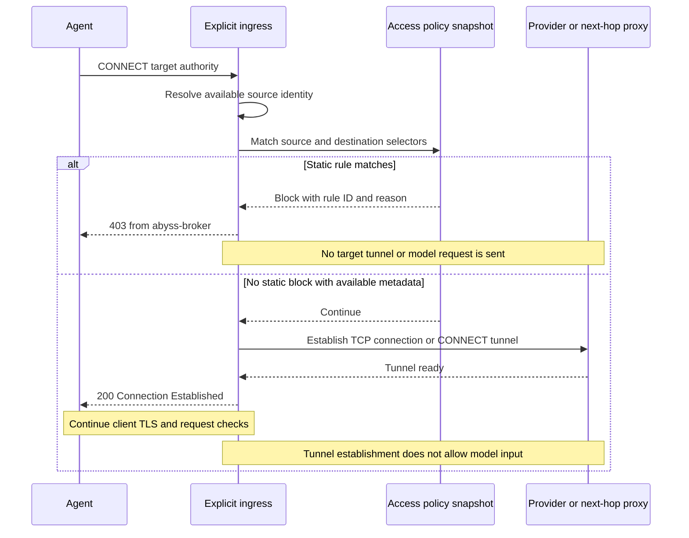
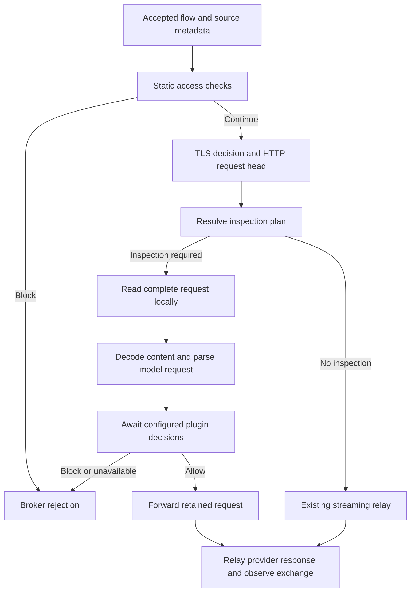
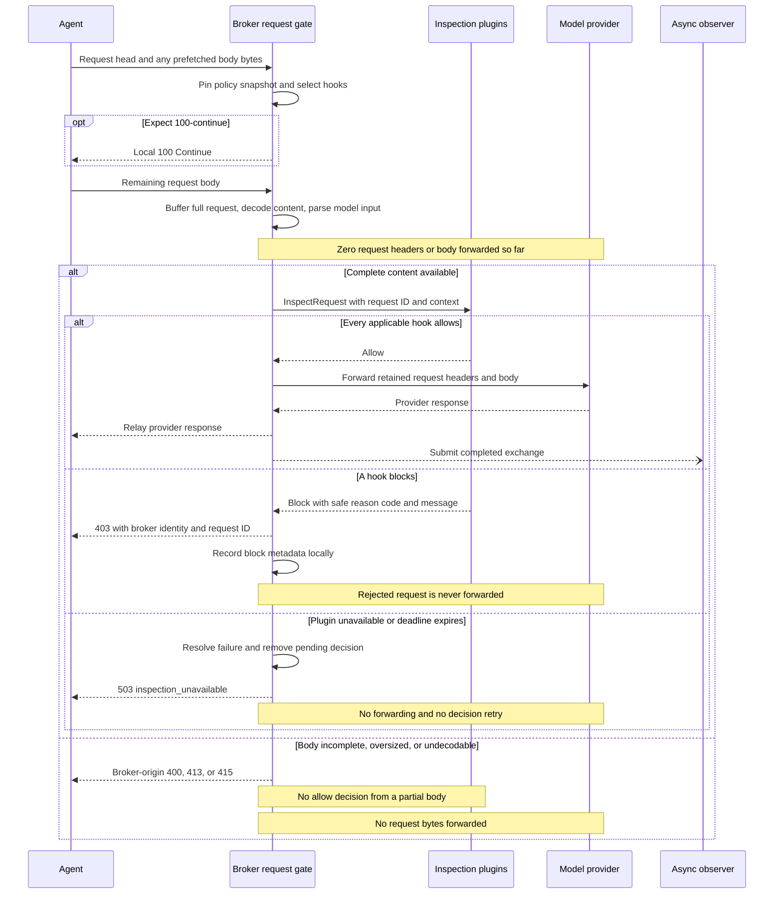
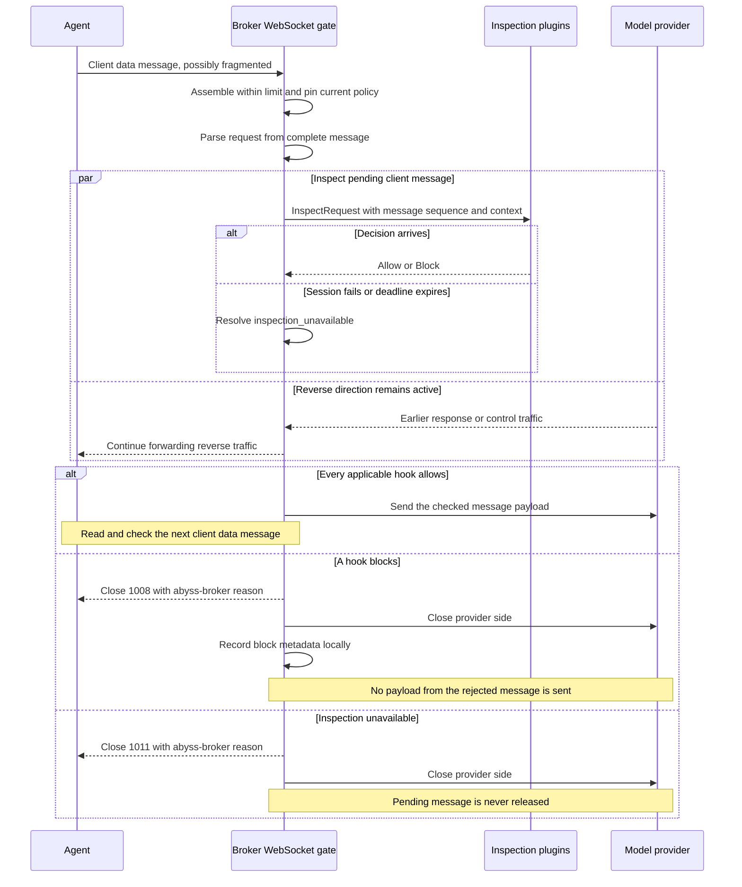

# Broker request blocking and inspection plugins

Status: proposed. This document describes a design; the configuration, APIs,
and protocol additions below are not implemented. The source review is based on
commit `57c29ef`.

Add a synchronous decision boundary before the broker sends a request to a model
provider. Configuration rules can reject traffic using source and destination
metadata. Configured plugins can additionally inspect the decrypted request and
its parsed model input, then allow or block it. Existing asynchronous observation
hooks continue to process completed exchanges.

Use separate access and TLS-decryption decisions: access determines whether a
request may proceed; TLS policy determines whether permitted traffic is decrypted
or passed through. Request inspection requires decryption. This avoids making
HTTP and WebSocket blocking depend on a TLS-only action enum.

Throughout this document, **Agent** means the calling client and **provider**
means the upstream model service. A block response goes back to the Agent.

## Required behavior

1. Configuration can block by process name, destination host, application ID,
   executable path, or runtime entry point, including combinations of selectors.
2. A custom plugin receives available flow identity, HTTP or WebSocket request
   metadata, complete decoded content, and a model-request projection. It can
   reject a prompt containing a private key before that request reaches the
   provider.
3. Until all applicable checks allow a request, none of its HTTP request headers
   or body, or its WebSocket data message, is forwarded. A rejected request is
   never partially forwarded.
4. The Agent receives an identifiable broker-generated rejection whenever the
   active transport can carry one. TLS establishment failures have the limitation
   described below.
5. Traffic outside inspection scope retains the existing streaming path. Request
   buffering, model parsing, and plugin RPC are paid for only when needed.

The guarantee concerns the request being checked. Explicit CONNECT may already
have established an upstream TCP tunnel, and a WebSocket may already have an
upgraded provider connection. Neither establishes permission to send the pending
model input. Previously allowed requests cannot be recalled.

## Current implementation and change points

| Existing component | Current behavior | Required change |
| --- | --- | --- |
| [TLS policy:18](../crates/abyss-mitm/src/transparent/decrypt_policy.rs#L18) | `Intercept` or `Passthrough`; source and destination selectors already exist. | Reuse selector semantics for a separate access policy. |
| [Explicit ingress:146](../crates/abyss-broker/src/ingress/explicit.rs#L146) | Prepares upstream before acknowledging CONNECT; source process is absent. | Check available static metadata before upstream preparation; add local process attribution. |
| [HTTP request forwarding:639](../crates/abyss-mitm/src/transparent/relay.rs#L639) | Writes the request head, then streams and captures the body. | Add a buffered inspection branch before the first upstream request write. |
| [TLS HTTP handling:123](../crates/abyss-mitm/src/transparent/tls_http.rs#L123) | Establishes provider TLS before decoding the client HTTP request. | Move provider TLS establishment after the request decision for inspected traffic. |
| [WebSocket relay:212](../crates/abyss-mitm/src/transparent/websocket.rs#L212) | Submits an observation and forwards each client message immediately. | Await inspection before forwarding client data messages. |
| [Agent Hook coordinator:58](../crates/abyss-agent-hook/src/hook.rs#L58) | Detects and parses a completed exchange. | Expose request-only parsing independently of response processing and audit settings. |
| [Plugin protocol v1:79](../specs/broker-plugin-protocol/v1/README.md#L79) | Best-effort, one-way live event stream; no decision replies. | Add a separate request/reply inspection session. |

An asynchronous `MitmHook` callback cannot enforce this feature. The current
dispatcher may drop observations under pressure, and HTTP callbacks run after
the exchange has already been relayed.

## Policy and configuration

Add an optional `enforcement` section to `runtime-policy.toml`. Its absence means
no access blocking and no inspection plugins. Keep the existing TLS actions.

The proposed configuration shape is:

```toml
[enforcement]
max_inspection_bytes = 16777216

[[enforcement.block_rules]]
id = "deny-codex-restricted-provider"
process_names = ["codex"]
destination_hosts = ["restricted.example", "*.restricted.example"]

[[enforcement.block_rules]]
id = "deny-application"
application_ids = ["com.example.restricted-agent"]

[[enforcement.block_rules]]
id = "deny-runtime-entry"
process_entry_points = ["/opt/example-agent/main.js"]

[[enforcement.block_rules]]
id = "deny-executable"
executable_paths = ["/opt/example-agent/bin/agent"]

[[enforcement.request_hooks]]
id = "private-key-inspection"
plugin_id = "example.dlp"
destination_hosts = ["api.openai.com", "api.anthropic.com"]
timeout_ms = 1000

# Request hooks require an intercept decision for their TLS traffic.
# Merge this rule with the deployment's existing TLS rules.
[[mitm.tls_decryption.rules]]
id = "decrypt-inspected-providers"
action = "intercept"
destination_hosts = ["api.openai.com", "api.anthropic.com"]
```

The hook timeout is a configurable local-inspection budget; the example value is
not a measured latency requirement. The inspection size limit applies separately
to encoded body data and decoded content. Existing protocol framing limits also
apply.

Selector semantics follow the current TLS policy:

- Different populated dimensions within a rule are ANDed; values within one
  dimension are ORed. Separate block rules provide alternatives.
- Host matching supports exact names and leading `*.` suffix patterns. Normalize
  hosts with the existing implementation and preserve its apex/subdomain rules.
- Process names and application IDs use exact matching. Executable paths and
  runtime entry points are distinct normalized absolute-path fields. Reuse the
  platform's path comparison rules; do not infer identity from a basename.
- An unavailable source field does not match a populated selector. An empty
  dimension is unconstrained. Require at least one selector per configured rule
  or hook scope so a global policy is explicit in a future extension.
- Block rules only deny. The first matching block rule supplies the reason.
  Applicable request hooks run in configuration order; the first block ends the
  check, and all must allow before forwarding. A plugin cannot override a static
  block or another plugin's rejection.

Use one shared selector implementation for TLS and access rules without changing
the existing TLS configuration representation. No expression language, regex
engine, priority system, or general rule-composition framework is required.

Evaluate static rules as soon as the required metadata is available and before
releasing application bytes. An early non-match with an unavailable hostname is
not a final allow: evaluate again when the authoritative target is known. Use
CONNECT authority for explicit target identity, SNI for TLS identity, and the
validated request authority/Host for HTTP. Preserve existing target-consistency
checks and retain these distinct fields in the context. Do not use reverse DNS
or the configured next-hop proxy hostname as the logical target.

A matching request hook requires a readable plaintext request. If TLS policy
selects passthrough for that protected flow, reject it as
`inspection_unavailable`; do not bypass the hook or silently override the TLS
policy. Unprotected passthrough traffic retains its existing behavior.

The following sequence shows a static block at explicit CONNECT, where the
target is already known. Transparent ingress performs the equivalent check when
its required metadata becomes available; its error transport depends on whether
client TLS can be terminated.



Persist enforcement with the existing runtime-policy transaction and expose
authenticated `GET`/`PUT /v1/enforcement/config`. Configuration files remain
startup inputs rather than watched files. Validate, persist, then publish a
snapshot through the existing transaction mechanism. New binaries accept old
configuration with enforcement disabled; old strict decoders reject the new
section instead of silently ignoring protection.

Pin the enforcement snapshot for an HTTP flow from its first policy check through
its decision. For an intercepted WebSocket, take a fresh snapshot for each client
data message and retain it through that decision. Updates do not retroactively
change an outstanding check. Existing opaque passthrough connections need to be
reopened for new inspection policy to take effect; there is no midstream TLS
conversion or forced connection sweep in this design.

## Request handling



### HTTP and HTTPS

Introduce a prepared request representation containing the parsed head, retained
wire bytes needed for forwarding, and the decoded inspection view. Only the
inspection branch constructs it.

1. Decode and validate the request head. Resolve static blocks and the matching
   inspection scope before writing any request bytes upstream.
2. If inspection is unnecessary, use the existing streaming relay.
3. Otherwise, read the complete request body into a bounded buffer. Preserve
   Content-Length/chunked framing and already-prefetched bytes. Extract the
   framing reader from the current relay so both branches use the same parser.
4. For `Expect: 100-continue`, send the interim response locally to obtain the
   body. This is permission to upload to the broker, not permission to forward.
   Keep the existing removal of the locally handled `Expect` header upstream.
5. Decode content encodings, parse the request, and await the decision.
6. On allow, replay the retained request using the existing forwarding rules.
   Preserve its body and content encoding; do not serialize the normalized model
   projection back into a provider request. Continue normal response forwarding
   and asynchronous observation.
7. On block, send a local error and close the request connection. Do not create a
   fabricated provider response or token-usage event.

Move provider TLS establishment and deferred upstream connection work after the
decision wherever the flow lifecycle already permits it. Preserve the current
CONNECT establishment contract for allowed explicit tunnels: a pre-established
TCP tunnel is acceptable, but request bytes remain gated. Static blocks whose
metadata is available at CONNECT time run before `prepare_upstream()`.

The current `CapturedBody` may hold only an observation prefix. That is not an
acceptable inspection result. A request exceeding the inspection limit, an
incomplete body, or an unsupported/corrupt content encoding must terminate the
protected request before any part is forwarded. Reuse body-read/decode deadlines
where available and add a finite request-body read deadline for this branch.
There is no spill-to-disk inspection queue in the initial implementation.

For a scoped HTTP request, the decision sequence is below. HTTPS has already
completed Agent-side TLS at this point. The plugin interaction represents all
matching hooks in configuration order; a block or failure stops that sequence.



### WebSocket

The HTTP upgrade and subsequent client data messages are separate decision
points. Check static access policy before forwarding an upgrade. Once upgraded,
inspect each complete client text or binary message before sending it to the
provider, including messages that do not produce a model response. A Responses
prewarm message can still carry sensitive input.

Use the WebSocket implementation's message reassembly for fragmented frames and
apply the inspection limit during assembly. Inspect the resulting payload once;
do not forward fragments while accumulating it. Ping, Pong, and Close remain
transport control messages rather than model-input checks.

Awaiting a plugin must not stop provider-to-Agent response/control traffic. Split
the two relay directions so the client-to-provider path waits for its current
decision while the other direction continues. Preserve client message order and
allow at most one pending inspected message per connection. A block cancels the
pending forwarding operation, closes the Agent connection with an identifiable
policy reason, and closes the provider side.
Submit the client message to observation hooks only after it is allowed; a
blocked message must not enter the normal response accumulator.

A connection already in opaque TLS passthrough cannot expose WebSocket messages.
The flow-level requirement for plaintext inspection prevents protected traffic
from entering that mode.

The following sequence starts after a successful upgrade. Provider messages in
the parallel branch may belong to an earlier allowed request; they do not imply
that the pending client message has been released.



## Request-only Agent parsing and plugin context

Expose a public request parser from `abyss-agent-hook` that accepts decoded HTTP
requests or client WebSocket messages without requiring an `HttpExchange` or a
provider response. Reuse the existing request projections, including
[ResponsesRequest:24](../crates/abyss-agent-hook/src/protocol/openai/responses/request.rs#L24),
[ChatRequest:18](../crates/abyss-agent-hook/src/protocol/openai/chat_completions/request.rs#L18),
and the Anthropic request parser currently called by
[exchange parsing:42](../crates/abyss-agent-hook/src/protocol/anthropic/messages/exchange.rs#L42).

Extract protocol detection to operate on request metadata/body, and let completed
exchange parsing call the same request functions. Cover the existing Responses,
Chat Completions, Anthropic Messages, and Claude Web completion request dialects,
plus Responses client WebSocket messages. Preserve raw content for other routes.

Harness detection enriches the context but does not gate inspection. An unknown,
disabled-for-audit, or ambiguously identified Harness must still reach the
configured request inspector. Likewise, `hooks.harness_usage.enabled` and content
retention switches govern audit output, not the content visible to an explicitly
configured enforcement plugin.

The proposed inspection context contains:

| Group | Fields and semantics |
| --- | --- |
| Correlation | Decision request ID, flow ID, HTTP request or WebSocket message sequence. IDs identify the broker operation, not an invented Agent turn. |
| Source | PID and process incarnation where available, process name, executable path, application ID, runtime entry point, working directory, and attribution source. |
| Destination | Original destination address, logical target authority, TLS SNI, HTTP authority/Host, ingress type, and configured upstream route metadata without credentials. |
| Request | Method, URI/path, business headers, transport, WebSocket message type and sequence, and upgrade metadata when applicable. |
| Content | Complete content-decoded bytes, an optional complete JSON value, and explicit decoding/parsing status. Binary bytes have a defined wire encoding. Original encoding metadata describes the retained encoded representation, not the decoded view. |
| Model input | Detected protocol, provider, requested model, ordered conversation/instructions, tool definitions, tool calls/results, and attachment references or inline content present in this request. |
| Agent declarations | Optional Harness identity/evidence/version and declared session, turn, stream, or previous-response IDs available before a response. |

Provide the decoded body together with the structured model projection. The
projection is convenience data, not a complete substitute for the provider
payload: unknown JSON fields, tool schemas, historical tool output, and system
instructions can also carry secrets. Reuse decoded buffers and JSON values;
materialize the IPC representation only for selected plugins. Do not repeatedly
copy the body for each matching hook.

Keep provider Authorization, Cookie, and proxy credentials out of the default
plugin context. Preserve request content needed for inspection, and make any
header omissions explicit in the contract. A plugin response contains a safe
reason code/message, not a copy of the matched secret.

Use typed parsing states such as `Parsed`, `UnsupportedProtocol`, and
`InvalidModelRequest`. If the full content is available but the model protocol
cannot be recognized, still call the plugin with the complete body and status.
The plugin can scan it or explicitly reject it. Failure to obtain complete
content is a broker inspection failure and cannot become an implicit allow.

A `file_id`, external URL, or `previous_response_id` is a reference rather than
the referenced content. Include it as such. Do not reconstruct remote history or
download attachments as part of the broker gate. DLP implementations must account
for this scope when choosing what they claim to inspect.

### Process attribution

The existing [SourceProcess:228](../crates/abyss-mitm/src/transparent/hook.rs#L228)
already distinguishes executable path, application ID, and runtime entry point.
Reuse it and keep native process identity separate from Agent-supplied HTTP
declarations.

macOS/Windows transparent ingress already supplies source metadata. Explicit
ingress currently sets `source_process` to `None`; merely adding process
selectors would leave those rules ineffective for `abyss run`.

Include local socket-owner attribution in the implementation scope for explicit
ingress: resolve the accepted connection's local tuple to its originating
process, then enrich the result through platform process APIs. Resolve once per
connection and preserve process-incarnation information where available. Put
native lookup behind `sys/` and ingress/process-context modules, with static
platform selection. Linux also needs a native process-context provider; its
current fallback does not provide that metadata.

Run this lookup when enforcement needs source identity or a selected plugin
requests the full context. Do not walk the process table per HTTP chunk. Failed
or ambiguous attribution remains explicitly unavailable; never guess a process
from User-Agent or from the CLI's parent PID. Fields the platform does not
provide, including an application ID, remain absent. Process-specific coverage
must be validated on each supported ingress/platform before it is advertised.

## Inspection plugin protocol

Keep existing v1 event consumers unchanged. Add a v2 inspection session over the
same Unix socket/Named Pipe transport abstractions and length-prefixed JSON
framing. Use a separate endpoint and connection for inspection, advertised in
startup info and SDK discovery. Existing v1 endpoint names and event framing stay
valid. A plugin may open both connections if it also consumes audit events.

The broker binds the inspection endpoint when inspection hooks are configured
and keeps its lifecycle independent of event subscribers. The v2 handshake
declares the inspection role and plugin ID. Broker startup configuration binds
each permitted inspection plugin ID to a local registration-token file; the
plugin presents that token during registration. Reuse the existing local token
and file-permission patterns. The v1 `plugin_id`, which is only diagnostic text,
is not sufficient authorization to answer enforcement requests. This remains a
trusted local-plugin boundary, not isolation from arbitrary same-user processes.

After registration, the session exchanges typed messages:

```text
Plugin -> Broker: InspectionHello(version=2, plugin_id, registration_token)
Broker -> Plugin: InspectionReady(version=2) | RegistrationError
Broker -> Plugin: InspectRequest(request_id, context)
Plugin -> Broker: InspectResponse(request_id, Allow | Block { code, message })
Broker -> Plugin: Close(reason)
```

Use an explicit message discriminator in v2. Keep request IDs scoped to a
registered session so a late reply from a replaced connection cannot resolve a
new request. A response is terminal for exactly one pending request.

The broker maintains one active inspection session per configured plugin ID,
a bounded outgoing queue, and pending request-to-oneshot mappings. Independent
read/write tasks allow concurrent request IDs on the session. No mutex is held
across socket I/O or a decision await. SDK handlers may evaluate independent
requests concurrently, within a bounded concurrency setting.

The decision deadline covers queueing, transmission, and the reply. Missing
plugins, a full queue, disconnects, timeout, malformed replies, and handler errors
all fail the applicable request as `inspection_unavailable`. Remove pending
entries on completion or cancellation; late replies are ignored. There is no
retry or persisted replay of a live decision. A reconnect serves new requests;
it does not resurrect an already rejected operation. Duplicate registrations are
rejected rather than introducing implicit load balancing.

These are the required lifecycle rules for a synchronous gate. No remote plugin
deployment service, policy-language runtime, circuit breaker, or distributed
consensus mechanism is part of this change.

## Rust boundaries and zero-cost abstractions

Keep transport gating in `abyss-mitm`, parsing in `abyss-agent-hook`, policy/plugin
orchestration in `abyss-broker`, and language-neutral inspection messages in
`abyss-plugin-protocol`. MITM must not import broker, Agent parsing, or a remote
destination API. The broker supplies a concrete implementation of the gate.

The request-phase interface can have the following shape; names are illustrative:

```rust
enum RequestPlan<P> {
    Forward,
    Block(BlockReason),
    Inspect(P),
}

enum RequestDecision {
    Allow,
    Block(BlockReason),
}

trait RequestGate: Send + Sync {
    type Plan: Send;

    fn plan(&self, flow: &FlowContext, head: &Request<()>)
        -> RequestPlan<Self::Plan>;

    fn inspect<'a>(
        &'a self,
        plan: Self::Plan,
        request: RequestView<'a>,
    ) -> impl Future<Output = Result<RequestDecision, InspectionError>> + Send + 'a;
}
```

`RequestView` borrows flow metadata and complete decoded content. The associated
plan carries the broker's policy snapshot and selected plugin handles without
exposing those types to MITM. The WebSocket entry uses the same decision types
with a message view and upgrade metadata. Metadata-only flow decisions use the
shared concrete access-policy types before this request phase.

Pass `G: RequestGate` through the relevant engine/relay methods so Rust
monomorphizes the calls and futures. Keep the engine and unrelated control API
structures concrete; they do not all need a new generic parameter. Preserve the
existing public engine entry point by delegating to a no-inspection gate.

Use a concrete `Vec<InspectionPluginClient>` for runtime-configured external
plugins. They all use the same IPC implementation; their custom logic runs in
separate processes. Avoid a new `Vec<Box<dyn BlockHook>>`, boxed per-call futures,
an `Any` extension bag, or a callback on every body chunk.

The no-inspection implementation can inline to the existing relay. A broker with
runtime-editable policy still pays a scope/snapshot check; zero-cost abstraction
does not eliminate that work. Active inspection necessarily pays for complete
request buffering, parsing, serialization, IPC, and plugin execution. Reuse
`Bytes` and borrowed views, decode once, and share request parsing functions with
the observer. Do not add a global parsed-request cache merely to avoid repeating
a projection in later asynchronous observation; measure that cost before adding
cross-task ownership machinery.

## Rejection responses and recording

The broker owns the response envelope. Plugins return `Allow` or a block reason,
not arbitrary HTTP responses or modified provider requests.

For an HTTP-level policy rejection, return `403 Forbidden`,
`Content-Type: application/json`, `Server: abyss-broker`,
`X-Abyss-Blocked: true`, `Cache-Control: no-store`, a correct Content-Length,
and `Connection: close`. An example body is:

```json
{
  "error": {
    "type": "abyss_policy_violation",
    "code": "request_blocked",
    "message": "Request blocked by abyss-broker: private key detected",
    "request_id": "req-example"
  }
}
```

Distinguish a policy rejection from inability to inspect. An unavailable plugin
returns broker-origin `503` with `inspection_unavailable`; an oversized inspected
request returns `413` with `inspection_limit_exceeded`. Invalid framing/content
encoding uses an appropriate `400`/`415` error with the same broker identity and
request correlation. None of these outcomes forwards the protected request.

| Rejection point | Agent-visible behavior |
| --- | --- |
| Explicit CONNECT, before success | Return a CONNECT failure with the broker's HTTP error body; do not establish the target tunnel. Some clients display only the status. |
| Plain HTTP or successfully decrypted HTTPS | Return the JSON error through the Agent-side stream, before contacting the provider with this request. |
| Transparent TLS blocked by metadata | When TLS policy permits interception, complete Agent-side TLS locally and return the HTTP error after reading the request head; no provider request is needed. Opaque passthrough flows are terminated without an HTTP body. |
| TLS that cannot be terminated, including untrusted MITM CA or pinning | Terminate without forwarding. A custom HTTP error cannot be delivered inside a TLS session the Agent refuses to establish. Record the block reason locally. |
| WebSocket before upgrade | Return an HTTP rejection. |
| WebSocket after upgrade | Send Close code `1008` for policy rejection, with a short reason such as `abyss-broker: request_blocked <id>`, then terminate the provider side. Use `1011` for inspection infrastructure failure. |

WebSocket close reasons must fit the control-frame limit. Do not invent provider
application events to carry a rejection. A later protocol-specific error encoder
can improve individual Agent UX, but the initial contract guarantees an explicit
broker reason on the wire, not identical UI presentation in every client.

Represent blocking as a typed flow/request outcome, distinct from provider
failure. Extend local network observations with decision source, rule/hook ID,
request ID, reason code, and timing. Record that no request payload was sent.
Keep transport byte counters accurate: TCP/TLS/tunnel setup traffic is distinct
from the rejected application's request bytes.
Reuse the existing storage and diagnostics surfaces. Do not publish a rejected
prompt as an ordinary completed usage event, upload its sensitive content through
delivery, or attach secret excerpts to diagnostic messages. A separate security
event export can be added if a consumer requires it.

## Implementation sequence and acceptance criteria

Implement this as a sequence of reviewable changes, while treating HTTP and
WebSocket protection as required parts of the final feature.

1. **Policy and metadata rejection.** Extract shared selectors, add access-policy
   configuration and durable updates, implement typed block outcomes and local
   error responses, and wire early checks into explicit and transparent ingress.
   Add explicit-proxy socket-owner attribution and platform capability tests.
2. **Request parsing and HTTP gate.** Expose response-independent Agent request
   parsing, extract reusable body framing, add the buffered branch and local
   rejection writer, and move applicable provider connection/TLS work behind the
   decision. Use a concrete in-process test gate to verify the boundary.
3. **Inspection plugin sessions.** Add v2 protocol/schema fixtures, registration,
   request/reply dispatch, SDK clients, and a minimal example DLP plugin. Keep
   private-key detection in the example/custom plugin rather than embedding a
   security-rule catalog in the broker.
4. **WebSocket enforcement and integration.** Gate all scoped client data
   messages, preserve reverse-direction progress, add cancellation/close handling,
   and run the same plugin through real broker traffic.

Acceptance tests should prove the boundary, not merely check decision enums:

- Use a mock provider that records bytes received. For a blocked HTTP request,
  assert zero provider HTTP request bytes, including the head and any prefetched
  body. Cover explicit HTTP/CONNECT and platform ingress, direct and configured
  upstream routing. Separately account for permitted TCP/TLS/tunnel handshakes.
- Place a private-key-shaped fixture near the end of a request, across chunk
  boundaries, in compressed JSON, instructions, tool output, and unknown JSON
  fields. The inspector must see the full relevant content before any forwarding.
- Check Content-Length, chunked bodies, prefetch, `Expect: 100-continue`, empty
  bodies, decode failures, read deadlines, and inspection limits. An oversized
  request must never be allowed using a truncated prefix.
- For allowed requests, verify the provider receives the original payload under
  the existing relay transformations and the Agent receives its normal response.
  Existing capture/token-usage behavior must remain valid.
- For WebSocket, block a fragmented data message and a later request on an
  already-used connection. Assert no bytes from that message reach the provider,
  earlier allowed messages remain accounted for, prewarm input is checked, and
  provider responses/control traffic progress during a pending inspection.
- Exercise unknown Harness/protocol cases and disabled audit-content settings.
  None may silently bypass a matching inspection hook.
- Exercise missing plugins, timeout, disconnect, queue saturation, malformed and
  late replies, duplicate registration, and Agent cancellation. Assert a terminal
  result, pending-state cleanup, and zero rejected-request forwarding.
- Test selector AND/OR semantics, unavailable source metadata, executable versus
  entry-point identity, SNI/Host/CONNECT consistency, and next-hop versus target
  hostname. Verify process attribution using real local child processes on each
  supported platform.
- Keep v1 SDK event consumers interoperable. Validate new v2 fixtures across Rust,
  TypeScript, and Python. Check policy persistence failure and request snapshots
  during hot updates, including the documented passthrough-connection limitation.

Measure throughput and allocation changes for enforcement disabled, metadata-only
rules, and active inspection. The disabled path should not allocate inspection
buffers, serialize requests, or start decision workers. Report active inspection
latency separately from relay overhead. These measurements validate the intended
abstraction cost without expanding this change into a new performance framework.
