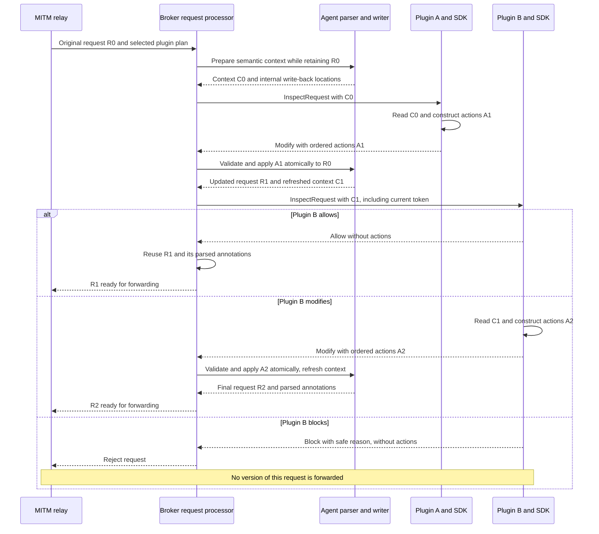
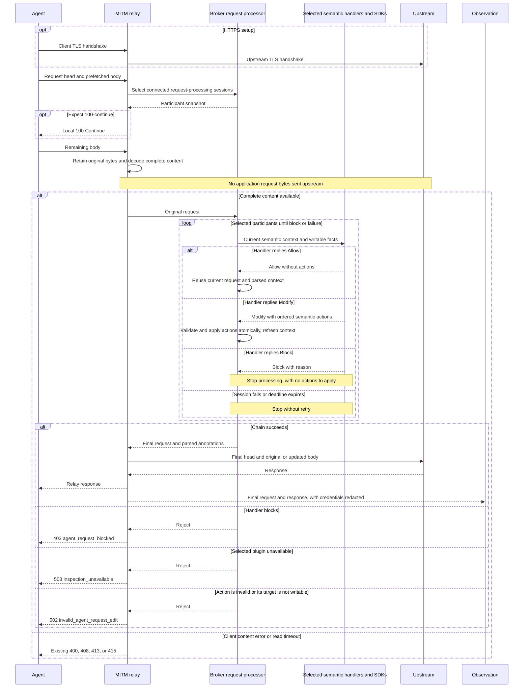
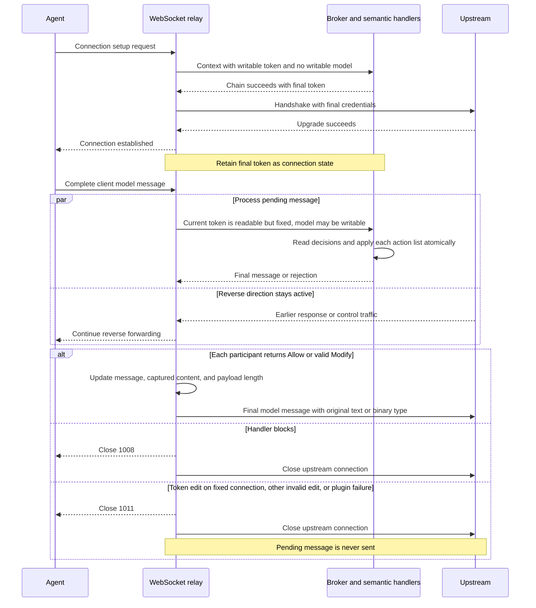

# Agent request editing through broker plugins

Status: implemented with plugin protocol v1. Initial source analysis used commit `2e1824a`.

Extend `agent_request` so a plugin reads a semantic Agent request context and
returns Allow, Block, or Modify with an explicit list of semantic actions. The SDK
serializes that result. Abyss validates and applies the actions to the retained
original request, updates context for subsequent plugins, and forwards only when
the selected chain succeeds. Neither the SDK nor the broker computes a context diff.

The public API describes Agent requests. HTTP headers, JSON locations, WebSocket
messages, and framing are internal implementation details. API key allocation is
one application; allocation policy and credential storage belong to the plugin.

This design builds on the [request inspection design](request-blocking-design.md).
The [v1 plugin contract](../specs/broker-plugin-protocol/v1/README.md) describes the implemented wire format.

## Scope and required behavior

The first release provides actions for two semantic values. Both are read from
context; edits are expressed only through returned actions.

| Read-only value | Allowed actions | Write-back behavior |
| --- | --- | --- |
| `context.auth_token` | `SetAuthToken`, `RemoveAuthToken` | Update or remove the credential selected by the target's authentication adapter; the token excludes header names and scheme prefixes |
| `context.agent.model`, when an Agent projection exists | `SetModel`, `RemoveModel` | Update or remove the model field selected by the recognized request protocol |

Plugins also receive already parsed conversation, tools, attachments, protocol,
provider, and Harness information. These views remain read-only in this release.
Adding conversation or tool editing requires an explicit mapping back to the
original protocol structure; it is not enabled by making an observation object
mutable. Raw headers, JSON, and decoded bytes, if exposed for inspection, remain
read-only diagnostic views.

The implementation must preserve these properties:

1. Selected plugins finish successfully before any pending application request
   head/body or client data-message payload is sent upstream.
2. Plugins run sequentially. Each sees the accepted edits from earlier plugins,
   including the current authentication token.
3. The final semantic context, forwarded request, and observed request describe
   the same content. Credential values remain excluded from observation output.
4. Source identity, request/flow IDs, destination, method, path/query, Host, SNI,
   and outbound route remain read-only. Editing a model does not reroute a request.
5. No selected request plugins means the existing streaming path, without extra
   mutation buffering or RPC. Network Block/Passthrough/Intercept behavior stays
   unchanged; connecting a plugin does not enable TLS decryption.
6. Reuse the existing inspection boundary, parsers, plugin connection, and relay.
   Plugins do not parse provider JSON or construct transport-level mutations.

There is no public header-operation list, whole-body replacement, or
`RequestMutation::Http / WebSocket` enum. Response editing, arbitrary traffic
rewriting, JSON Patch, and a universal protocol conversion framework are outside
this design. Internal transport code still handles HTTP and WebSocket correctly.

## Current implementation and change points

Abyss already pauses before forwarding to ask plugins whether to allow or block
a request. Modify adds an explicit list of actions such as setting a token or a
model. Plugins continue to read context without modifying it. The processing path
has four steps:

1. **Receive and hold the request.** The relay already collects complete content
   when request plugins participate. Keep that boundary and the original bytes;
   extend the result so it can carry the final request as well as parsed facts.
2. **Prepare context and run plugins.** The broker currently sends the same
   immutable context to every participant. It will instead own the current request,
   apply each accepted edit, and prepare the next participant's updated context.
3. **Write changes back and refresh parsing.** The parser already extracts model,
   conversation, and tools. Add narrowly scoped write-back functions beside the
   relevant protocol parsers. A change from `model-a` to `model-b` must update the
   original request and the parsed model seen by the next plugin.
4. **Forward and observe the final content.** Existing HTTP and WebSocket writers
   send the resulting request. Captured content and parsing caches must follow
   the same version, so observation cannot report a change that was never sent.

The plugin chooses semantic actions. The broker owns execution order and current
state. Agent protocol code maps those actions to their original request locations. MITM owns
transport validation, encoding, framing, and actual writes. The plugin service
continues to own sessions, IPC, reply correlation, and deadlines.

| Work | Existing entry point |
| --- | --- |
| Waiting before forwarding and returning processing results | [forwarding.rs:39](../crates/abyss-mitm/src/transparent/forwarding.rs#L39) |
| Holding and sending HTTP request bytes | [relay.rs:636](../crates/abyss-mitm/src/transparent/relay.rs#L636) |
| Preparing request context and coordinating plugin processing | [request_control.rs:31](../crates/abyss-broker/src/proxy/request_control.rs#L31) |
| Calling selected plugins and waiting for replies | [inspection.rs:235](../crates/abyss-broker/src/plugin/inspection.rs#L235) |
| Shared semantic request parsing | [request.rs:37](../crates/abyss-agent-hook/src/request.rs#L37) |
| Existing inspection context and Agent projection | [inspection.rs:87](../crates/abyss-plugin-protocol/src/inspection.rs#L87) |
| Waiting for and forwarding complete client messages | [websocket.rs:286](../crates/abyss-mitm/src/transparent/websocket.rs#L286) |

Asynchronous `MitmHook` callbacks remain observers: forwarding does not wait for
them and their queue can drop notifications. Editing belongs in the synchronous
inspection path. `abyss-mitm` must not depend on plugin protocol or Agent parsing
crates; the broker connects those layers using transport-neutral request values.

## Semantic context and plugin API

Keep the `agent_request` capability and the read-only callback context. Retain the
existing request metadata and Agent projection, adding the current token and two
facts describing which action targets are writable. This is an API sketch;
existing context fields and asynchronous callback details are abbreviated:

```rust
struct AgentRequestContext {
    pub auth_token: Option<String>,
    pub auth_token_writable: bool,
    pub model_writable: bool,
    pub agent: Option<AgentRequestProjection>,
    // Existing request metadata and diagnostic views are omitted.
}

enum RequestDecision {
    Allow,
    Block(String),
    Modify(Box<[ModifyAction]>),
}

enum ModifyAction {
    SetAuthToken(String),
    RemoveAuthToken,
    SetModel(String),
    RemoveModel,
}

fn agent_request(context: &AgentRequestContext) -> RequestDecision {
    if !context.auth_token_writable {
        return RequestDecision::Allow;
    }

    RequestDecision::Modify(
        vec![ModifyAction::SetAuthToken("allocated-token".into())]
            .into_boxed_slice(),
    )
}
```

The entire context is an input view: identities, target information, parsing
status, token, model, conversation, tools, attachments, and diagnostic content.
`context.agent` remains optional for unknown content or connection setup without
a model body. There is no mutable request object and no second editable model
value. Broker updates become visible in the next plugin's context.

`auth_token_writable` and `model_writable` indicate whether the corresponding
Set/Remove actions are supported for this invocation. They describe write-back
availability, not plugin permissions. On an established authenticated connection,
the token is readable but auth actions are unavailable. If no authentication
binding is recognized, a null token does not prove the request has no credentials.

`ModifyAction` defines the complete public editing surface. Plugins cannot select
arbitrary headers, JSON paths, or context members. A new editing capability needs
an explicit enum variant, wire contract, and write-back rule. Keep the action list
as `Box<[ModifyAction]>`: its length is fixed after the handler returns. A plugin
can build a `Vec` and finish with `into_boxed_slice()`.

The processing result has these semantics:

| Result | SDK reply | Broker behavior |
| --- | --- | --- |
| Allow | Result only | Preserve the current request and continue to the next plugin |
| Modify(actions) | Result and the ordered action list | Validate and apply the list, then continue to the next plugin |
| Block(reason) | Result and safe reason | Stop without forwarding the pending request |

The actions themselves specify the requested changes:

- Set writes the supplied string to the selected semantic field. It does not ask
  the broker to infer whether a context member was edited.
- Remove deletes the field, including an explicitly null model member. Removing
  an absent field has no effect when that action target is supported.
- A field with no action retains its original representation, including missing
  versus null JSON members. Not listing an action never means deletion.
- Apply actions in array order. Later actions on the same field determine its
  final value; for example, SetModel followed by RemoveModel removes the model.
- Validate the whole list and commit its result atomically. Any invalid action
  rejects the pending request, even if another action later overwrites that field.
  No plugin or upstream sees a partially applied list.
- An action targeting a field whose writable flag is false is rejected, even if
  its supplied value happens to match the current value.
- An empty action list is valid and behaves like Allow. Repeating a Set with the
  current value is also valid; explicit body actions do not promise byte-for-byte
  preservation of the original JSON formatting.

Modify permits continued processing, not immediate forwarding or bypassing later
plugins. Only actions in the returned result are authoritative. The SDK does not
inspect local copies of context or infer actions from changes to them.

Unknown protocols still receive the inspection callback and can be allowed or
blocked. Model actions require a supported parser and writer. Authentication
actions can be available independently when the target's binding is known,
including setup without a model body. Unsupported targets remain read-only.

## SDK and wire contract

The SDK receives a read-only context, invokes the handler, and serializes its
`RequestDecision`. The existing Rust `Arc<AgentRequestContext>` callback can remain;
the borrowed reference above illustrates the same read-only contract. TypeScript
and Python expose the equivalent read-only context and typed action variants.
There is no mutable-context round trip, old-context copy, dirty tracking, or diff
calculation in the SDK. The reply is constructed only from the returned result.

Use a tagged result in the v1 `inspect_response`:

```json
{
  "type": "inspect_response",
  "request_id": "request-123",
  "decision": {
    "action": "allow"
  }
}
```

```json
{
  "type": "inspect_response",
  "request_id": "request-123",
  "decision": {
    "action": "modify",
    "actions": [
      {"op": "set_auth_token", "value": "allocated-token"},
      {"op": "set_model", "value": "model-b"}
    ]
  }
}
```

```json
{
  "type": "inspect_response",
  "request_id": "request-123",
  "decision": {
    "action": "block",
    "reason": "Request blocked by plugin policy"
  }
}
```

Each `ModifyAction` has one wire form:

| Rust variant | Action object |
| --- | --- |
| `SetAuthToken(token)` | `{"op":"set_auth_token","value":"allocated-token"}` |
| `RemoveAuthToken` | `{"op":"remove_auth_token"}` |
| `SetModel(model)` | `{"op":"set_model","value":"model-b"}` |
| `RemoveModel` | `{"op":"remove_model"}` |

Set requires a string value; Remove has no value. There is no null sentinel,
complete request snapshot, or raw JSON patch. A token-only modification sends
only a token action, without echoing the model or any other context value.
`Box<[ModifyAction]>` serializes as an array, preserving order. The SDK must not
sort, merge, or drop actions.

Allow and Block carry no action list. Modify requires an `actions` array, which
may be empty. Tagged variants prevent a reply from both blocking and submitting
edits. Unknown variants and malformed action objects follow the strict protocol
validation rules rather than being silently ignored.

The broker dispatches each action directly to its known writer. It does not
compare before/after context snapshots to discover edits. Allow skips write-back
and parsing refresh; an empty list does the same. This reduces reply payloads and
comparison work, while retaining initial context parsing and the plugin RPC.

Extend the existing `protocol_version = 1` contract in place with credential
visibility and typed modification actions. Update the broker, official delivery
plugin, Rust/TypeScript/Python SDKs, schemas, and fixtures together. Keep one v1
contract and decoder, without a new protocol version or compatibility layer.
`AgentEvent` does not gain a token field.

## Sequential execution and state ownership

Snapshot participating sessions in registration order for each pending request
or client data message. New sessions join later requests; a reconnect cannot
replace a disconnected participant in an existing plan.

The broker owns the original transport request, its current JSON document where
available, and the semantic state throughout processing:

1. Build current context and invoke one selected participant through `PluginClient`.
2. On Allow, reuse the current request and context. On Modify, read the explicit
   action list; no old/new context comparison is needed.
3. Validate the list, then apply its actions in order through the semantic writers
   and transport operations as one committed result. Refresh affected parsed views.
4. Invoke the next participant with that updated request, including the new token.
5. On Block or failure, stop without forwarding any intermediate version. Otherwise,
   return the final request and parsed annotations to the relay.

Move the aggregation loop out of `InspectionTask::decide` into the broker request
processor. The plugin service provides invocation of one participant in the
selected plan while retaining private session ownership. It does not parse model
requests or decide how a semantic field maps to a header or JSON location.



The Modify paths assume valid edits. Invalid edits stop before the next invocation.
Later edits to the same field take precedence. Each Allow or Modify accepts that
stage's result, not changes made by later plugins. Do not rerun the chain to seek
a fixed point. A plugin checking final content must run last.

Registration order changes across restarts and reconnects. Keep the existing
ordering mechanism; do not add priorities or a dependency graph. Fixed composition
can live inside one plugin, or a deployment can coordinate handshake order,
without treating connection order as a permanent policy guarantee.

Retain the five-second budget per plugin, including invocation queueing time,
and avoid automatic retries or a new configurable whole-chain deadline. Rejection
does not roll back plugin side effects such as credential leases; their cleanup
belongs to the plugin.

## Writing semantic edits back to the original request

The current Agent projection is not a reversible representation of the complete
provider request. For example, [conversation entries](../crates/abyss-plugin-protocol/src/event/conversation.rs#L19)
retain roles, visible text, and correlation IDs rather than every original content
block property. Never generate a complete provider request by serializing that
projection.

Keep the original request and make targeted updates:

- **Model:** the protocol parser/writer identifies the model location in the
  retained JSON document, including any message envelope. Change or remove only
  that member. Preserve unrelated settings, images, unknown fields, and envelope
  properties. A model edit can change JSON formatting, but not unrelated values.
- **Authentication:** a target-aware authentication adapter identifies the token
  carrier and its scheme. It extracts the token for context and writes the new
  token back in the correct form. A missing initial token must still be injectable
  when that binding is known. A JSON dialect alone is not enough to infer a target's
  authentication scheme. Use an existing supported credential header, or the known
  host mappings below. No new configuration surface is introduced.
- **No action for a field:** preserve that field as it appeared in the retained
  request. Allow and empty action lists reuse the current representation.
  The action enum identifies exactly which writers to invoke; no context diff,
  dirty-tracking object graph, or universal request representation is needed.

Initial model writers cover OpenAI Responses, OpenAI Chat Completions, and
Anthropic Messages, including recognized Responses client request messages on
WebSocket. Claude Web and other formats remain inspection-only until their own
write-back rules are defined. Start authentication editing with supported
single-token bindings: Bearer, `x-api-key`, and `anthropic-api-key`. Existing
headers identify compatible gateways. Without a credential header, `api.openai.com`
and `chatgpt.com` use Bearer; `api.anthropic.com` uses `x-api-key`. A parser for observation
does not automatically establish write support. Unsupported or ambiguous bindings
remain read-only. Cookie sessions and multi-field authentication
need their own write-back contract before actions are enabled.

When setting a header-based token, replace all values of the adapter-selected
credential header, using its defined scheme. Removing the token removes that
credential. Do not rebuild every header from the filtered diagnostic view, and do
not expose a plugin-selected header name. Unrelated headers are preserved.

Validate action availability and value encodability before committing a list.
Keep action application private until the entire list succeeds; only then publish the next context or return a forwardable request. This does not require
copying the whole context or a rollback framework: a failure terminates and
discards the pending request. Refresh affected derived data after an accepted
list and reuse it on Allow or an empty list. The broker may reparse after actions
for simplicity, without comparing context versions. Plugins never need to parse
or re-encode provider payloads themselves.

Conversation and tool editing can add semantic action variants later. Each addition
must define supported operations, the mapping to original items, and preservation of
unmodified content. Adding, deleting, or reordering normalized conversation entries
cannot be implemented safely just by serializing today's observation projection.

## Internal forwarding and connection authentication

HTTP and WebSocket distinctions remain inside the relay and write-back code.
Read-only context facts tell a plugin what can be edited without requiring it
to choose a transport-specific mutation variant.

| Internal processing point | Authentication token | Model |
| --- | --- | --- |
| Ordinary model request | Writable when a supported credential binding exists | Writable when a supported request parser/writer identifies the location |
| Connection setup, including WebSocket upgrade | Writable before the handshake is forwarded | Not writable when no model request body exists |
| Model message on an established authenticated connection | Current connection token is readable but fixed | Writable when the message is a supported model request |
| Unknown content or unsupported binding | Writable only if independently recognized for this request | Read-only without a supported model writer |

Run the same `agent_request` callback during connection setup, even if no Agent
body projection is available. That invocation can allocate credentials from target
and available source context. The final handshake token is retained as connection
state and exposed on later message contexts with `auth_token_writable = false`.
Returning SetAuthToken or RemoveAuthToken at that point rejects the pending
message. Do not silently reopen or reauthenticate the connection. A plugin can
skip allocation when the flag is false. Model-dependent allocation cannot wait
for a later message on a connection
that must authenticate first.

For HTTP, preserve the existing upstream connection/TLS order and local
`100 Continue` handling. The gate controls application request writes. Keep the
original wire body unless semantic editing changes its content:

| Accepted change | Internal forwarding behavior |
| --- | --- |
| Token only | Encode the updated head; retain original body bytes, compression, chunk framing, and trailers |
| Model in the body | Serialize the updated original JSON document; remove old Content-Encoding, Transfer-Encoding, and Trailer; set one Content-Length from the replacement bytes |
| Allow or empty action list | Reuse the current forwarding representation |

Body edits send uncompressed replacement bytes without old trailers. Preserve
Content-Type and protocol envelopes. Never send both Content-Length and
Transfer-Encoding; see [RFC 9112 sections 6.2 and 6.3](https://www.rfc-editor.org/rfc/rfc9112.html#section-6.2).
Rebuild `CapturedBody` raw/decoded bytes, decoding state, and caches together.
Encode the final request head after processing and update `DecodedClientFlow` too.



For WebSocket messages, keep existing reassembly, text/binary type, framing, and
masking through tungstenite. The semantic writer updates a recognized model
request inside the message; there is no arbitrary payload replacement callback.
Control frames and server messages are not editable. Process one pending client
data message at a time while continuing reverse traffic.



The diagram assumes a recognized, editable handshake binding; an unsupported
binding remains read-only. Handshake rejection uses the HTTP errors above.
Successful Allow or Modify does not imply the upstream has received the request;
preserve existing completion/failure observation behavior. Ingress byte counters
measure original bytes, while upstream counters measure what was actually sent.

## Credential visibility and observation

This design intentionally changes the v1 inspection credential boundary.
Request-processing plugins can read the selected model-service token through
`context.auth_token`, including a token set by an earlier plugin. This supports
preserving existing credentials as well as replacing them. Event-only plugins
do not gain token access.

Continue filtering sensitive raw headers from diagnostic header views; expose
only the credential covered by the selected binding through the semantic field.
Do not add token values to `AgentEvent`, audit records, mutation logs, or errors.
Avoid automatic Debug output of secret-bearing context/reply values. SDK error
paths must not dump the complete IPC frame. No new permission system is added;
v1 request handlers operate under the existing local plugin endpoint boundary.

Observation uses the final forwarded request and corresponding response with
existing redaction. If the model changed, both request content and observed model
reflect that change. Refresh cached `ParsedAgentRequest` values after body edits.
Do not persist original/modified conversation pairs or body diffs in this release.
Logs may record request ID, plugin ID, processing result, and action kinds/counts.

Read-only process, Harness, and session facts remain context for policy, not proof
of authorization. Header redaction also does not identify arbitrary secrets in
request bodies; existing body observation policy continues to apply.

## Failure behavior and resource limits

| Condition | Outcome |
| --- | --- |
| No selected request plugins | Existing streaming behavior |
| Explicit Block | HTTP 403 / WebSocket 1008; no pending request sent |
| Selected plugin disconnects, times out, or fails its handler | HTTP 503 / WebSocket 1011 |
| Action target is not writable or the credential cannot be encoded | HTTP 502 `invalid_agent_request_edit` / WebSocket 1011; no fallback to the original request |
| Original client body is invalid, too large, or read times out | Existing 400/413/415/408 handling |

A reply that cannot be decoded follows the existing session failure path. Invalid
plugin actions are not client input errors. Validate and apply each list as a unit;
never forward a partial result.

Existing request retention, read deadlines, WebSocket decoding, and IPC framing
keep their limits at those boundaries. Request editing adds no separate body or
header size checks, and `RequestView` carries no size-limit metadata. Even
token-only editing initially uses existing complete request processing. A separate
early header stage needs a concrete latency or large-request requirement, not a
speculative callback framework.

No-plugin forwarding remains the existing behavior. Requiring a particular plugin
to remain connected is a separate mandatory-plugin policy. A deployment can check
readiness before starting an Agent; this feature does not imply that guarantee.

## Application example: API key allocation

A credential plugin reads the target, available identity context, and current
`context.auth_token`. It can preserve an existing token with Allow, or allocate a
replacement and return `Modify([SetAuthToken(token)])` when auth actions are
supported. Allocation failure can return Block. The SDK serializes the explicit
action; the plugin does not change context, construct an Authorization header,
or choose between HTTP and WebSocket mutation types.

Allocation identity, authorization, key pools, quotas, leases, caching, rotation,
and remote allocation-service authentication stay in that plugin. Broker code
only provides semantic editing and correct write-back. Explicit proxy traffic
may lack reliable source-process identity, and inferred Harness/session facts
must not be treated as authorization credentials.

Connection credentials are allocated at setup and remain fixed for that connection.
An Agent that refuses to start without a local key may still need placeholder
configuration from its launcher; Abyss can only edit requests that reach it.

## Implementation and validation

Implement in this order:

1. **Semantic contract and SDKs:** retain read-only context, add token visibility
   and availability facts, define the four `ModifyAction` variants and v1 replies,
   and serialize returned actions directly in every SDK. Keep the delivery-plugin
   handshake at v1 and use common fixtures for all variants.
2. **Parsing and write-back:** retain original requests, add authentication and
   model writers beside existing protocol parsers, and dispatch actions directly.
   Preserve unrelated fields and unsupported content without computing context diffs.
3. **Broker and relay integration:** move sequential processing into the broker,
   refresh semantic context between calls, update final bytes/captures, and keep
   handshake credentials in connection state for later messages.
4. **Validation and documentation:** add schemas/fixtures and a generic semantic
   editing example; exercise a real broker, separate plugin process, and recording
   upstream. Keep allocation services outside the broker.

Acceptance checks include:

- All SDKs preserve read-only callback semantics and serialize only the returned
  decision. A token-only Modify sends one action and no context snapshot. Allow
  and an empty list preserve current bytes/views; Block sends no pending request.
- All four action variants round-trip through common fixtures. Lists retain order:
  repeated Set/Remove actions produce the last specified value. Remove on an absent
  supported field has no effect; RemoveModel deletes an explicit null member.
  An invalid action rejects the whole list, even if a later action would overwrite it.
- Token injection, preservation, replacement, and removal follow the selected
  authentication binding; duplicate credential headers are replaced consistently.
- Plugin A edits token/model and plugin B sees the accepted semantic values.
  Later rejection prevents forwarding; later edits replace earlier values.
- Model changes preserve unknown JSON fields, images, settings, and message
  envelopes. Fields with no action retain missing/null distinctions. No body action
  means no body reserialization.
- Token-only edits retain compressed/chunked body bytes. Body edits produce correct
  length/encoding/trailer handling and matching observations.
- Unsupported fields remain inspectable but not editable. Edits submitted with
  Modify fail explicitly; read-only metadata is never accepted from plugin replies.
- WebSocket setup supports token allocation without a model body. Later message
  contexts expose the fixed token, permit supported model edits, and reject token
  changes while reverse traffic continues during pending processing.
- Request plugins can see the token; event-only plugins, logs, and error output
  cannot. Credential-bearing Debug/serialization error paths preserve this rule.
- Timeouts, disconnects, frame/body limits, no-plugin streaming, opaque passthrough,
  and unsupported protocol versions retain their defined outcomes.

Use focused unit tests for action validation and application, SDK contract tests
for read-only callbacks and action replies, and black-box tests for actual upstream
bytes, plugin lifecycle, and observation. Run formatting, lint, relevant crate tests,
and existing request-blocking regressions when changing this implementation.
Run `make test-blackbox-request-modification` for real broker forwarding checks.
The implementation also preserves the request-blocking and SDK regression suites.
