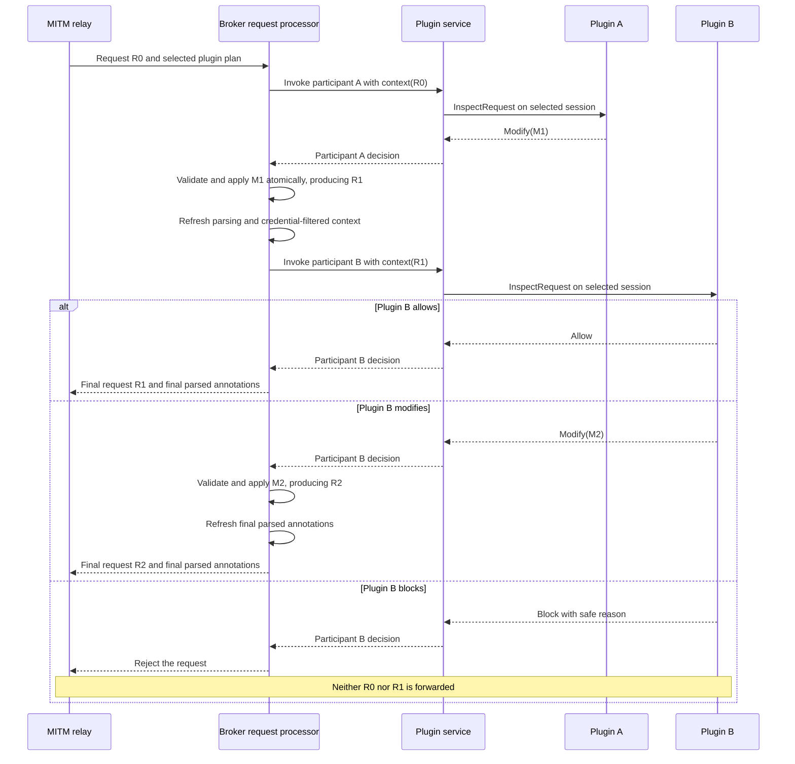
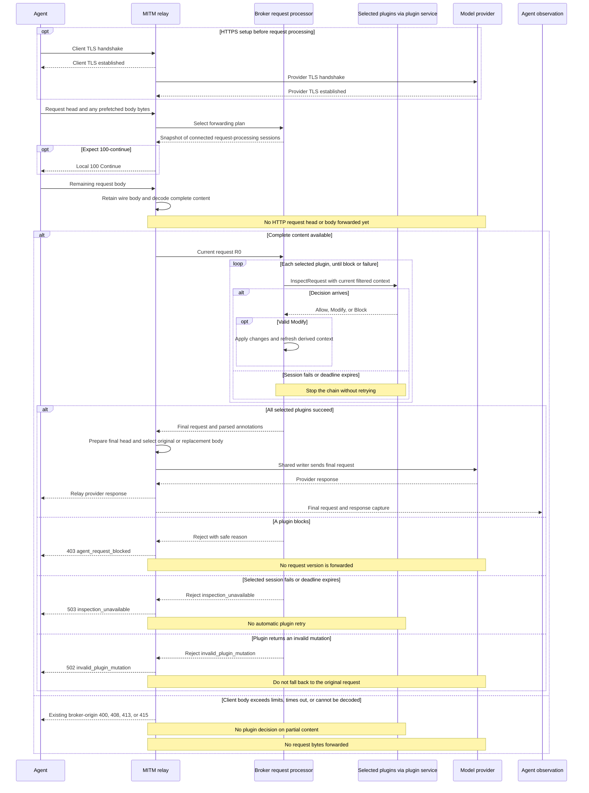
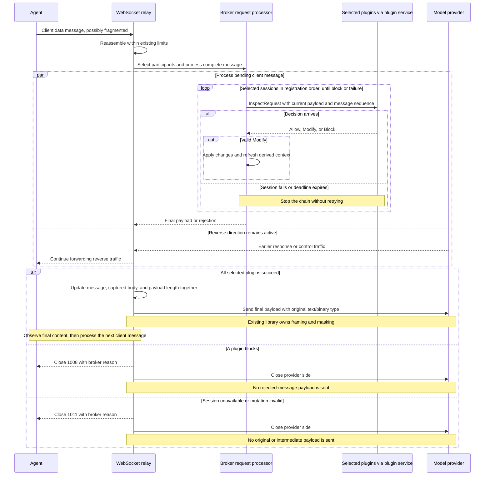

# Broker plugin request mutation

Status: proposed, not implemented. The source review is based on commit `2e1824a`.

Extend the existing before-forward request inspection boundary with mutation.
A plugin returns Allow, Modify, or Block. The broker applies each modification
to the current request, gives that updated request to the next plugin, and
forwards only after the entire selected chain succeeds. Automatic API key
allocation is one application implemented by a plugin; the broker supplies
general request mutation primitives.

This proposal builds on the connection lifecycle, deadlines, and network-policy
boundaries in the [request inspection design](request-blocking-design.md).
The [v1 plugin contract](../specs/broker-plugin-protocol/v1/README.md) continues
to describe the implemented behavior until this proposal is adopted.

## Scope and required behavior

The first release covers requests at these existing transport boundaries:

| Boundary | Mutable content | Processing unit |
| --- | --- | --- |
| Ordinary HTTP, including intercepted HTTPS | Set/remove request headers; replace the entire body | One complete request |
| WebSocket upgrade | Ordinary request headers, including Authorization | One HTTP handshake |
| Client WebSocket data messages | Replace the entire payload, retaining text/binary type | One reassembled message |

These operations support credential injection, model parameter changes, prompt
processing, and tool-definition filtering. Plugins own those decisions. The
broker does not acquire API key pools, provider allocation rules, or APIs for
editing particular model fields.

The following properties define the implementation:

1. No HTTP request head/body or client WebSocket data message is sent upstream
   until the selected plugin chain has completed successfully.
2. Each plugin sees the modifications accepted from earlier plugins, subject to
   the existing credential-header filtering. Modifications are applied in order.
3. Forwarding, request projections, and observation use the same final request.
   A modified capture must never accompany an unmodified upstream request.
4. Network Block/Passthrough/Intercept decisions retain their existing meaning.
   Connecting a plugin does not enable TLS decryption or reclassify opaque flows.
5. With no request-processing plugins connected, retain the ordinary streaming
   path without additional buffering or plugin RPC.
6. Reuse the existing plugin connection, shared request parser, and relay stages.
   Mutation must not create a separate HTTP or WebSocket relay implementation.

Keep the method, path/query, destination, Host, SNI, and outbound route unchanged
in this release. Upstream connections may already exist at this boundary;
destination rewriting would require separate connection and policy evaluation
semantics. Response bodies, incremental SSE rewriting, and raw TCP/TLS mutation
are outside this proposal.

There is no JSON Patch language, script engine, plugin dependency graph, generic
middleware framework, or new plugin endpoint. A plugin editing JSON produces
the complete replacement body itself. Define a response-side contract at the
response forwarding boundary when a concrete response mutation need arises.

## Current implementation and change points

The existing synchronous inspection path provides most of the required mechanism:

| Existing component | Current behavior | Required change |
| --- | --- | --- |
| [Forwarding control:39](../crates/abyss-mitm/src/transparent/forwarding.rs#L39) | `RequestForwardingControl` waits before forwarding and returns annotations. | Return the final forwardable request with its annotations. |
| [HTTP forwarding:636](../crates/abyss-mitm/src/transparent/relay.rs#L636) | Retains original wire bytes and decodes complete content when plugins are selected. | Select original or replacement body bytes and encode the final request head. |
| [Broker request control:31](../crates/abyss-broker/src/proxy/request_control.rs#L31) | Builds a projection and submits the request to the plugin service. | Own the current request, call plugins sequentially, apply changes, and refresh projections. |
| [Plugin inspection:235](../crates/abyss-broker/src/plugin/inspection.rs#L235) | Every selected plugin inspects the same immutable context. | Accept current context for each invocation and return that plugin's decision. |
| [Request parser:37](../crates/abyss-agent-hook/src/request.rs#L37) | Shares parsed request results between inspection and observation. | Refresh derived data after mutation and retain the final parsed result for observation. |
| [WebSocket forwarding:286](../crates/abyss-mitm/src/transparent/websocket.rs#L286) | Awaits a decision before sending a complete client message. | Send and observe the replacement message when one is supplied. |

Asynchronous `MitmHook` callbacks remain observers. The relay does not wait for
their results, and their queue may drop work under pressure, so they cannot
implement request mutation.

`abyss-mitm` owns a protocol-independent mutable request value and the operations
that validate and apply transport changes. The broker owns that value while
processing plugins and converts wire mutations into transport operations.
MITM must not depend on `abyss-plugin-protocol` or `abyss-agent-hook`.

## Plugin protocol and SDK contract

Retain the `agent_request` capability, `inspect_request` / `inspect_response`
messages, and existing SDK request callback. Add Modify to `RequestDecision`.
The existing capability name is retained; a recognized Agent or model protocol
is not required for invocation. Unknown protocols remain eligible for mutation.

The following types illustrate the proposed API, not an implemented interface:

```rust
enum RequestDecision {
    Allow,
    Modify(RequestMutation),
    Block { reason: String },
}

enum RequestMutation {
    Http {
        headers: Vec<HeaderMutation>,
        body: Option<DecodedContent>,
    },
    WebSocket {
        body: DecodedContent,
    },
}

enum HeaderMutation {
    Set { name: String, values: Vec<String> },
    Remove { name: String },
}
```

Modify permits the resulting request to continue through the remaining plugins;
it does not authorize immediate forwarding. Use a tagged decision object on the
wire so a reply cannot simultaneously block a request and request modifications:

```json
{
  "type": "inspect_response",
  "request_id": "request-123",
  "decision": {
    "action": "modify",
    "mutation": {
      "kind": "http",
      "headers": [
        {
          "op": "set",
          "name": "authorization",
          "values": ["Bearer <allocated-token>"]
        }
      ]
    }
  }
}
```

The mutation operations have these semantics:

- Header names are case-insensitive. Apply operations in array order.
- Set removes all existing values for that name and installs the supplied
  values in order. The values array must be nonempty; `[""]` sets an empty
  value. Remove deletes all matching values and has no effect if none exist.
- An absent or null HTTP `body` keeps the body unchanged.
  `{"encoding":"utf8","content":""}` replaces it with an empty body.
  Binary content uses the existing base64 representation.
- There is no replacement of the entire header collection. Plugin context has
  credential headers removed; rebuilding all headers from that view would
  unintentionally delete credentials retained inside the broker.
- HTTP mutations do not apply to WebSocket data messages, or vice versa. An
  upgrade accepts header changes only, without adding a body or changing the
  handshake type.
- `json`, `agent`, and `harness` are read-only derived views. Plugins modify the
  actual headers/body, and the broker rebuilds those views.

The reply shape changes a strictly decoded contract. Advance the plugin wire
version to `protocol_version = 2` and update the broker, official delivery plugin,
and Rust, TypeScript, and Python SDKs together. Keep one current runtime protocol
and explicitly reject older versions; do not add dual-version negotiation.
Publish v2 schemas and fixtures while retaining the v1 documentation as a
historical contract. `AgentEvent` needs no application-specific fields.

## Sequential plugin execution and ownership

Snapshot the participating sessions in registration order for each HTTP request
or client WebSocket data message. A newly connected plugin joins later requests.
A reconnect does not replace a disconnected participant in an existing plan.

The broker request processor owns one current request throughout the chain:

1. Build credential-filtered context from the current request and invoke the
   selected participant through `PluginClient`.
2. Allow preserves the current request. Modify validates and applies the entire
   mutation, then refreshes derived context.
3. The next participant receives the updated request. Later changes to the same
   header or body replace earlier changes according to execution order.
4. Block or a processing failure terminates the request. No intermediate request
   version is forwarded.
5. After all selected participants succeed, return the final request and parsed
   annotations to the relay.

Move the aggregation loop currently in `InspectionTask::decide` into the broker
request processor. `PluginClient` provides invocation of one participant from
the selected plan. Session objects remain private to `PluginServer`, which owns
membership snapshots, IPC, reply correlation, and deadlines. The plugin service
does not acquire model parsing or HTTP encoding logic.

The following sequence shows how two plugins share one evolving request without
exposing session objects to the request processor:



The Modify branches above assume valid changes. An invalid mutation ends the
chain before another participant is called or a request is forwarded.

Do not invoke modifying plugins concurrently, merge patches computed from stale
requests, or rerun earlier plugins after the chain finishes. Allow applies only
to the version that plugin inspected. A plugin that must validate final content
belongs at the end of the chain.

Registration order is not durable across restarts, and reconnecting changes the
order for subsequent requests. Do not add priority or ordering configuration in
this release. A deployment needing a fixed composition can implement that
composition inside one plugin, or start plugins in handshake-completion order.
Connection order alone is not a permanent policy guarantee.

Retain a five-second budget per plugin, including its invocation's queueing time.
Do not add a separate configurable chain deadline. Calls are not automatically
retried, because plugins may allocate resources or perform other side effects.
Rejecting network traffic does not roll back those effects; leases and resource
cleanup belong to the business plugin.

## HTTP and HTTPS forwarding

Keep the original wire body in the relay and maintain decoded content for plugin
processing and observation. The final writer selects its representation as follows:

| Mutation result | Request head | Request body |
| --- | --- | --- |
| No changes | Existing forwarding behavior | Original wire bytes |
| Ordinary headers changed only | Encode the final request head | Original wire bytes, content encoding, chunk framing, and trailers |
| Body replaced | Remove old Content-Encoding, Transfer-Encoding, and Trailer; set one Content-Length from the replacement byte length | Replacement decoded bytes, without recompression or old trailers |

Update encoding and length headers when applying a body replacement, before the
next plugin receives context. The plugin sets Content-Type when needed; the
broker does not infer it from JSON. Replacement body bytes are authoritative,
and must not be regenerated by serializing the read-only `json` projection.

Reconstruct `CapturedBody` when replacing content, updating raw/decoded bytes,
decoding status, and parsing caches together. New bytes must not inherit capture
state describing the old compressed body. Validate and commit each mutation as
a unit, without exposing a partially modified request.

The relay owns framing and must not emit both Content-Length and
Transfer-Encoding. See [RFC 9112 sections 6.2 and 6.3](https://www.rfc-editor.org/rfc/rfc9112.html#section-6.2).

Plugins cannot directly modify connection/framing fields: Host, Content-Length,
Transfer-Encoding, Content-Encoding, Trailer, Connection, Proxy-Connection, TE,
Expect, Upgrade, Sec-WebSocket-*, or hop-by-hop fields named by Connection.
Preserve existing Expect and upgrade handling. Ordinary application headers,
including Authorization, Cookie, x-api-key, and Content-Type, use the same Set
and Remove operations.

Validate the transport boundary: legal header names/values, matching mutation
type, reserved fields, and existing content limits. Client input errors retain
their existing handling. Do not add provider-specific defensive rules. The
mutating plugin updates or removes body signatures, digests, and application
integrity fields; the broker does not infer signing algorithms.

Update the request head retained in `DecodedClientFlow` as well as the head
written upstream. The current `request_head_for_relay` call prepares bytes before
inspection; a changed head must be encoded after plugin processing. Changing only
capture or annotations while sending the original head would violate the contract.

The following sequence covers a request with selected plugins. The plugin-chain
step follows the sequential invocation described above. HTTPS illustrates the
existing handshake order; mutation does not defer upstream connection setup.



No selected plugins means the existing streaming path remains active. Original
CONNECT handling and upstream TCP/TLS establishment order remain unchanged in
both modes. The gate controls application request writes, not connection setup.

## WebSocket forwarding

The HTTP upgrade passes through the same request processor and can receive
authentication headers. Its final request head becomes the connection's saved
upgrade context. Later data messages cannot change that completed handshake.

Process client data messages at the existing reassembly boundary. A plugin may
replace the complete payload while preserving its text/binary type. Text must
remain valid UTF-8; binary messages accept arbitrary bytes. Existing tungstenite
handling owns framing and upstream masking; plugins do not handle frames, masks,
or fragments. See [RFC 6455 section 5](https://www.rfc-editor.org/rfc/rfc6455.html#section-5).

Control frames and server messages do not acquire mutation callbacks. Retain the
current behavior that permits provider-to-Agent traffic while a client message
waits for a decision. Preserve client message order with one pending client data
message per connection.

The following sequence starts after a successful upgrade. Reverse traffic may
belong to an earlier allowed request; it does not release the pending message.



Replace `message`, `captured_body`, and payload length together. Forwarding,
observation, and counters must not refer to different payloads. Byte counters
retain their link-specific meaning: Agent bytes read may differ from upstream
bytes written. Do not overwrite measured ingress traffic with replacement size.
The stored upgrade request head must likewise reflect the final forwarded head.

## Shared parsing, observation, and credentials

After each mutation, headers/body, JSON, and Agent projection in the next context
must describe one current request. Start with a simple rule: rebuild derived
context after every successful Modify; consecutive Allow decisions can reuse it.
Store the final parsed request in body extensions for completed-exchange
observation. Never leave a pre-mutation `ParsedAgentRequest` attached to new content.

Flow ID, request ID, source process, and destination metadata remain unchanged.
Harness recognition and client declarations continue to derive from current
request content, so changing recognition headers can change their interpretation.
Those inferred fields are not authentication evidence.

Observation uses the final request handed to forwarding and the corresponding
response. If a plugin changes the requested model, the request content and model
projection reflect the new value. Preserve existing completion/failure handling;
Allow or Modify alone does not establish that the upstream received the request.

Do not add separate original/modified conversation events or persist body diffs
in this release. Runtime logs record request ID, plugin ID, decision, and mutation
categories/counts, without logging mutation values or raw IPC replies.

Preserve the existing credential boundary:

- The broker retains the complete request internally. Context sent to every
  plugin passes through the existing sensitive-header filter.
- A plugin may write Authorization or other sensitive headers, but this does not
  expose their values to subsequent plugins. Observation retains its redaction.
- Mutation values must not leak through derived Debug output or invalid-reply
  errors. Report error categories without echoing supplied values.
- Header filtering does not identify arbitrary secrets in bodies. Complete-body
  inspection and existing observation content policies continue to apply.

No new plugin permission system is introduced. In v2, a local plugin declaring
`agent_request` can modify requests, under the existing local endpoint permission
boundary.

## Failure behavior and resource limits

Reuse complete-request buffering and current limits: the default 16 MiB HTTP
body limit, request-body read deadline, WebSocket message limits, and IPC frame
limit. Replacement content is subject to the corresponding limits. Check that
updated context fits the frame budget before invoking the next plugin.

| Condition | Outcome |
| --- | --- |
| No request-processing plugins | Existing streaming path; no extra mutation buffering |
| Explicit Block | Existing HTTP 403 / WebSocket 1008 |
| Selected plugin times out, disconnects, or fails its handler | Existing HTTP 503 / WebSocket 1011 |
| Invalid mutation: illegal header, wrong transport type, oversized replacement, etc. | HTTP 502 `invalid_plugin_mutation` / WebSocket 1011; no forwarding or fallback to the original request |
| Original client body exceeds limits or has invalid encoding | Existing 413, 415, 400, and related handling |

Invalid plugin output is distinct from invalid client input; do not report it as
a client 400/413. A reply that cannot be decoded follows the existing plugin
session error path, ensuring that its pending request does not continue.

Even a header-only mutation uses complete-request processing in this release.
This reuses one callback, participant selection, and deadline model. The cost is
that header-only use cases also inherit full buffering limits. Add a separate
header stage only when concrete large-request or latency requirements justify
it, without introducing a capability-mode matrix in advance.

Normal forwarding with no plugins is existing behavior. This feature does not
guarantee that a credential plugin remains connected. A business deployment can
confirm plugin readiness before launching an Agent. Requiring a named plugin to
remain present would be a separate mandatory-plugin policy, not an implicit
property of mutation.

## Application example: API key allocation

A credential allocation plugin implements the following request handler:

1. Handle HTTP requests, including WebSocket upgrades; allow WebSocket data
   messages unchanged. Check the target authority and available context, and
   Allow requests outside the plugin's service scope.
2. Obtain or reuse a credential according to application policy.
3. Return an HTTP header Set operation replacing every Authorization value.
4. Explicitly block or fail the handler if allocation fails, allowing the broker
   to return an identifiable local error.

Key pools, allocation identity, authorization, quotas, caching, leases, rotation,
and authentication to remote allocation services all belong to the plugin.
The broker gains no credential database, allocation REST API, or provider-address
configuration. Explicit proxy ingress has no reliable source-process identity;
session IDs and inferred Harness identity are not authorization credentials.

Set deliberately replaces existing credentials on matching requests. A business
requirement to retain an existing user credential needs an explicit policy;
it should not be implemented by exposing original secrets to every plugin.

HTTP credentials can be injected per request. WebSocket handshake credentials
are fixed when the connection is established; later messages cannot rotate them
by editing Authorization. A broker also cannot make an Agent send a request if
the Agent refuses to start without a local key setting. Such clients may need
placeholder configuration supplied by their launcher. The broker replaces
credentials on requests that actually pass through it.

## Implementation and validation

Implement in this order:

1. **Protocol and SDKs:** define decision/mutation types and v2 schemas; update
   Rust, TypeScript, and Python callback results, delivery-plugin handshake, and
   fixtures. Preserve straightforward Allow/Block usage.
2. **HTTP processing:** introduce the transport request value, sequential broker
   invocation, and projection refresh. Implement header mutation, then body
   replacement and framing, reusing the existing writer and capture lifecycle.
3. **WebSocket and observation:** support upgrade headers and data-message
   replacement; update final captures, parsed annotations, and counters. Add a
   generic example plugin without an allocation service inside the broker.
4. **Black-box validation and documentation:** exercise a real broker, a separate
   plugin process, and a local upstream recording received requests. Update the
   current protocol entry points, SDK examples, and broker usage guide.

The acceptance checks are:

- Missing, existing, duplicate, or differently cased Authorization headers yield
  only the plugin's intended values upstream. Unmodified headers remain intact.
- Plugin A changes the body and plugin B reads the new version before modifying
  or blocking it. Forwarded content and observation agree; rejection sends none
  of that request's head/body upstream.
- For ordinary, compressed, and chunked bodies, header-only mutation preserves
  wire body bytes. Body replacement produces consistent length, encoding, and
  trailer handling.
- JSON/Agent projections and caches follow Modify. Unknown protocols can still
  have headers and body changed.
- WebSocket upgrade credential injection and text/binary message replacement
  work, while reverse traffic continues during a pending decision.
- Injected credentials do not appear in subsequent plugin context, events, or
  error logs.
- Invalid output, timeout, and disconnect prevent the pending request from
  being sent. No-plugin and opaque TLS passthrough behavior remains unchanged.
- A v1/v2 mismatch fails the handshake explicitly, and all three SDKs use the
  same contract fixtures.

Use unit tests for validation and mutation application, and black-box tests for
actual forwarded bytes and plugin lifecycle. Run formatting, lint, relevant
crate tests, SDK contract tests, and request-blocking black-box regressions.
This document is a proposal only; it does not change protocol, SDK, or runtime
implementation.
