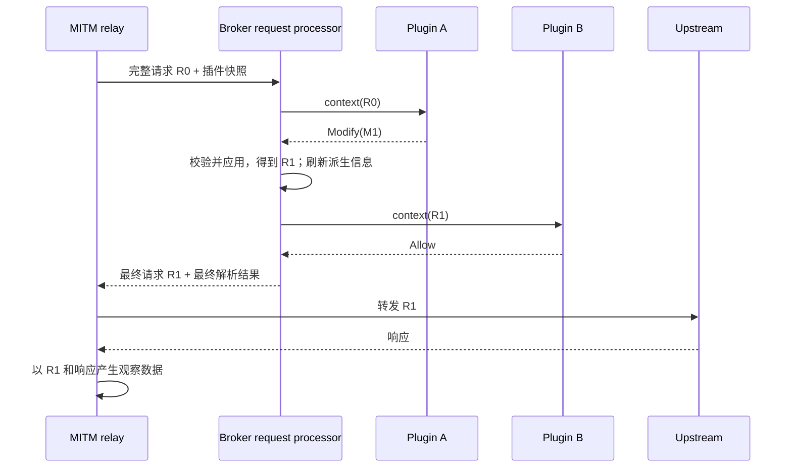

# Broker 插件请求修改方案

状态：提案，尚未实现。代码基线：`2e1824a`。

在现有转发前请求审查链路上增加修改能力：插件返回放行、修改或拒绝，broker 将修改应用到当前请求，后续插件处理修改后的请求，全部通过后再转发。API Key 自动分配是一个业务插件；broker 只提供通用的请求修改机制。

本方案延续 [请求审查设计](request-blocking-design.md) 的接入、超时和网络策略边界。现行行为仍以 [v1 插件协议](../specs/broker-plugin-protocol/v1/README.md) 为准。

## 1. 目标和首期范围

提供以下能力：

| 请求位置 | 可修改内容 | 处理单位 |
| --- | --- | --- |
| 普通 HTTP 请求，包括解密后的 HTTPS | 请求头设置/删除、body 整体替换 | 一个完整请求 |
| WebSocket upgrade 请求 | 普通请求头，例如 Authorization | 一次 HTTP 握手 |
| WebSocket 客户端数据消息 | payload 整体替换，保留 text/binary 类型 | 一个重组后的完整消息 |

这些原语可支持凭据注入、模型参数调整、提示词处理、工具定义过滤等用途。业务逻辑放在插件内，broker 不提供 API Key 池、供应商分配策略或模型字段专用接口。

首期保持 method、path/query、目标地址、Host、SNI、代理路由不变。上游连接可能在请求处理前已建立，目标重写需要单独处理连接与策略重新求值。响应 body、SSE 增量修改、原始 TCP/TLS 字节修改也不纳入本次实现。

不引入 JSON Patch、脚本执行器、插件依赖图、通用中间件框架或新的插件端点。修改 JSON 的插件自行生成完整的新 body。将来确有响应修改需求时，再在响应转发边界定义对应契约。

## 2. 复用现有同步边界

现有代码已经具备需要的主要机制：

| 位置 | 当前能力 | 本次改动 |
| --- | --- | --- |
| [forwarding.rs:39](../crates/abyss-mitm/src/transparent/forwarding.rs#L39) | `RequestForwardingControl` 在转发前等待裁决，只返回 annotations | 返回可转发的最终请求及其 annotations |
| [relay.rs:636](../crates/abyss-mitm/src/transparent/relay.rs#L636) | 有插件时保留原始 wire body，完整解码后审查 | 根据修改结果选择原始 body 或替换 body，并生成正确的请求头 |
| [request_control.rs:31](../crates/abyss-broker/src/proxy/request_control.rs#L31) | 构建请求投影并调用插件服务 | 持有当前请求，逐个调用插件、应用修改、更新投影 |
| [inspection.rs:235](../crates/abyss-broker/src/plugin/inspection.rs#L235) | 所有插件依次审查同一份不可变 context | 每次调用接收当前 context，返回单个插件的决策 |
| [request.rs:37](../crates/abyss-agent-hook/src/request.rs#L37) | 请求解析结果可供审查和观察复用 | 修改后重新生成派生信息，最终解析结果继续复用 |
| [websocket.rs:286](../crates/abyss-mitm/src/transparent/websocket.rs#L286) | 完整客户端消息发送前等待裁决 | 用替换后的消息发送并构建观察数据 |

异步 `MitmHook` 继续负责观察。relay 不等待其处理结果，并允许在拥塞时丢弃任务，因此它不承担流量修改。



网络 Block/Passthrough/Intercept 的优先级和含义保持现状。opaque TLS passthrough 不进入本处理链，连接插件不会自动开启解密。请求处理只控制应用请求写入，不调整显式 CONNECT、上游 TCP 或 TLS 握手的既有顺序。

## 3. 最小协议模型

沿用 `agent_request` capability、`inspect_request` / `inspect_response` 消息和 SDK 的请求回调，在原有 `RequestDecision` 中增加 `Modify`。这个名字沿用已有接口；调用仍不要求识别出某种 Agent，未知协议同样可以处理。

以下为拟定的类型形状，并非当前已存在的 API：

```rust
enum RequestDecision {
    Allow,
    Modify(RequestMutation),
    Block { reason: String },
}

enum RequestMutation {
    Http {
        headers: Vec<HeaderMutation>,
        body: Option<DecodedContent>,
    },
    WebSocket {
        body: DecodedContent,
    },
}

enum HeaderMutation {
    Set { name: String, values: Vec<String> },
    Remove { name: String },
}
```

`Modify` 表示允许当前修改结果继续经过后续插件，不表示直接转发。wire 使用带 discriminator 的 decision 对象，避免 `allow=false` 同时携带修改等矛盾状态：

```json
{
  "type": "inspect_response",
  "request_id": "request-123",
  "decision": {
    "action": "modify",
    "mutation": {
      "kind": "http",
      "headers": [
        {
          "op": "set",
          "name": "authorization",
          "values": ["Bearer <allocated-token>"]
        }
      ]
    }
  }
}
```

具体语义：

- Header 名称按 HTTP 的大小写不敏感语义处理；操作按数组顺序应用。
- `Set` 删除该名称的全部旧值，再按给定顺序写入一个或多个值。`values` 不能为空；设置空值使用 `[""]`。`Remove` 删除全部同名值，不存在时无效果。
- HTTP `body` 缺省或为 null 表示保留；`{"encoding":"utf8","content":""}` 表示替换为空 body。二进制沿用现有 base64 表达。
- 不提供整组 headers 替换。插件看到的是经过凭据过滤的 context，用它重建全部 headers 会误删 broker 内保存的原始凭据。
- HTTP 修改不能用于 WebSocket 数据消息，反之亦然。upgrade 阶段只允许 header 修改，不能增添 body 或改变握手类型。
- `json`、`agent` 和 `harness` 是请求派生信息，只读；插件通过 header/body 修改真实请求。

此变更改变了严格解码的回复结构，建议升级到 `protocol_version = 2`，同步更新 broker、官方 delivery plugin 和三个 SDK。保持一个当前运行协议，旧版本明确拒绝，不在本次增加双版本协商。新增 v2 规范和 fixtures，保留 v1 文档作为历史契约；`AgentEvent` 本身无需增加业务字段。

## 4. 多插件执行与状态所有权

每个 HTTP 请求或 WebSocket 数据消息开始处理时，固定当前参与插件列表，沿用注册顺序。处理过程中不加入新连接的插件，不将断开的参与者替换为重连 session。

broker 的请求处理器持有唯一的当前请求：

1. 从当前请求生成经过凭据过滤的 context，调用当前插件。
2. `Allow` 保留当前请求；`Modify` 校验整个修改并应用，再刷新派生信息。
3. 后一个插件读取更新后的请求。同一 header 或 body 再次被修改时，按执行顺序覆盖。
4. `Block` 或处理失败终止当前请求；此前的修改不会部分发送。
5. 所有参与者通过后，才将最终请求交还 relay 转发。

不并行运行修改插件，不收集一组基于旧请求的 patch 后统一合并，也不在链结束后重新调用之前的插件。某插件的 Allow 只针对它当时看到的版本；需要检查最终内容的插件应处于链末尾。

注册顺序不是跨重启的持久顺序，重连会改变后续请求的排列。首期不增加 priority 或排序配置；如果业务必须保证固定组合顺序，可在一个插件内组合这些处理，或由启动方按握手完成顺序启动插件。不能把现有连接顺序当成永久策略保证。

实现上，将当前 `InspectionTask::decide` 的聚合循环移入 broker 请求处理器。`PluginClient` 提供针对 plan 中一个参与者的调用，session 对象仍由 `PluginServer` 私有持有；它继续负责连接快照、RPC、回复关联和超时。插件服务不引入模型解析或 HTTP 编码逻辑。

保留每个插件五秒的预算，包含其调用的排队时间；不额外增加全链预算配置。插件调用不自动重试，避免重复执行分配等副作用。网络请求被拒绝不意味着插件内的分配动作回滚，资源租约和回收由业务插件处理。

## 5. HTTP 转发的一致性

MITM 提供一个与模型协议无关的可修改请求值，以及校验/应用修改的方法。broker 持有并操作该值；MITM 不依赖 `abyss-plugin-protocol` 或 `abyss-agent-hook`。wire mutation 在 broker 边界转换成传输层修改操作。

relay 保留原始 wire body，另行维护用于处理和观察的解码 body。最终发送规则固定为：

| 修改情况 | 请求头 | 请求体 |
| --- | --- | --- |
| 没有修改 | 沿用当前转发逻辑 | 保留原始 wire bytes |
| 仅修改普通 header | 从最终请求头重新编码 | 保留原始 wire bytes、content encoding、chunk framing 和 trailers |
| 替换 body | 清除旧 `Content-Encoding`、`Transfer-Encoding`、`Trailer`，按新字节数设置唯一 `Content-Length` | 发送替换后的解码字节，不重新压缩，不带旧 trailers |

body 替换后的编码及长度 header 在应用该次修改时就更新，使后续插件看到一致的请求。`Content-Type` 由插件按需设置；broker 不根据 JSON 内容自动猜测。body 的替换内容就是要发送的字节，不从只读 `json` 字段再次序列化。

替换 body 时重新构造对应的 `CapturedBody`，一起更新 raw/decoded bytes、解码状态和解析缓存，不能将新字节放进仍描述旧压缩内容的 capture 中。每次修改作为整体校验并提交，不留下只改了 header 或只改了 body 的中间状态。

长度和传输编码由 relay 统一生成，不能同时发出冲突的 `Content-Length` 与 `Transfer-Encoding`。对应规则见 [RFC 9112 §6.2–6.3](https://www.rfc-editor.org/rfc/rfc9112.html#section-6.2)。

插件不能直接修改由连接和 framing 管理的字段：`Host`、`Content-Length`、`Transfer-Encoding`、`Content-Encoding`、`Trailer`、`Connection`、`Proxy-Connection`、`TE`、`Expect`、`Upgrade`、`Sec-WebSocket-*`，以及 Connection 指定的逐跳字段。沿用现有 Expect/upgrade 转发处理。普通业务 header，包括 Authorization、Cookie、x-api-key、Content-Type，可通过统一操作修改。

只做边界必需的校验：header 名称和值合法、传输类型匹配、未修改保留字段、替换内容未超过现有限制。客户端格式问题继续使用现有错误；不增加每种供应商的专用防御规则。body 签名、摘要或应用层校验值由修改插件更新或删除，broker 不猜测业务签名算法。

必须同步更新 `DecodedClientFlow` 内用于转发和观察的 request head。当前 `request_head_for_relay` 在审查前取出待发送头的方式需要调整：有修改时在处理完成后构造发送头，不能仅替换 capture 或 annotations 而仍发送原始头。

## 6. WebSocket 处理

upgrade 仍作为 HTTP 请求经过同一处理器，可用于注入握手认证。握手结果固定连接的 headers；后续数据消息不能回头修改它们。

客户端数据消息在现有重组边界处理，插件可替换完整 payload。text 消息替换结果必须是有效 UTF-8；binary 消息接受任意字节，两者都保持原消息类型。由现有 tungstenite 负责重新编码和向上游发送时的 masking，插件不处理帧、mask 或分片。协议依据见 [RFC 6455 §5](https://www.rfc-editor.org/rfc/rfc6455.html#section-5)。

控制帧和服务端消息不增加修改回调。等待客户端消息裁决时，保留当前允许反向流量继续转发的行为。

更新时应一起替换 `message`、`captured_body` 和 payload 长度，避免实际发送、Hook 观察、流量计数各自使用不同内容。upgrade 保存的请求头也必须采用最终版本。字节计数保留所在链路的含义：Agent 侧读入量可以与上游写出量不同，不用修改后长度覆盖已经测得的入口字节数。

## 7. 解析、观察与凭据

每次修改后，后续 context 的 header/body、JSON 和 Agent 投影必须对应同一份当前请求。首期采用简单规则：成功应用 Modify 后重新构建派生 context；连续 Allow 可复用。最后一次解析结果写入 body extensions，供完成交换后的观察复用，不能留下修改前的 `ParsedAgentRequest`。

flow_id、request_id、来源进程和目标等传输元数据保持不变。Harness 和客户端声明仍按当前请求内容解析，所以修改识别 header 可能改变识别结果；这些推断字段本身不是身份认证依据。

事件观察使用最终交给转发层的请求及其响应。例如插件将 model 改为另一个模型，事件中的请求内容和模型投影应对应新值。完成/失败的判定沿用现有观察行为，不把插件 Allow 或 Modify 当成上游已经收到请求。

首期不新增原始/修改后双份会话事件，也不保存 body diff。运行日志只记录 request_id、plugin_id、决策和修改类别/数量，不输出修改值或原始 IPC 回复。

凭据规则沿用当前边界：

- broker 内保存完整请求；发送给每个插件的 context 都重新经过现有敏感 header 过滤。
- 插件可以写入 Authorization 等敏感字段，但后续插件不能因此读取它们；事件仍按现有规则脱敏。
- 不能对 mutation 结构自动派生并输出包含凭据的 Debug；无效回复的错误也只报告原因类别。
- header 过滤不承诺识别 body 中的任意秘密。body 处理沿用完整请求视图和已有事件内容策略。

这不增加新的插件权限系统。声明 `agent_request` 的本地插件在 v2 中具备修改请求的能力；插件连接仍使用当前本地端点权限边界。

## 8. 失败与资源行为

沿用当前完整请求缓冲方式，包括 HTTP 默认 16 MiB 上限、请求体读取期限、WebSocket 消息限制和 IPC 帧限制。修改后的内容也受相同限制；每次发送给下一个插件前检查可编码的 context 大小。

| 情况 | 行为 |
| --- | --- |
| 没有请求插件 | 保留当前流式路径，不为修改功能额外缓冲 |
| 插件显式 Block | 沿用 HTTP 403 / WebSocket 1008 |
| 已选插件超时、断开、handler 失败 | 沿用 HTTP 503 / WebSocket 1011 |
| 插件返回非法 header、错误修改类型、过大替换内容等 | HTTP 502 `invalid_plugin_mutation` / WebSocket 1011；不转发当前请求，不回退到原请求 |
| 客户端原始 body 过大或编码错误 | 沿用现有 413、415、400 等处理 |

插件产生的非法输出应与客户端输入错误区分，不把它报告成客户端的 400/413。回复不能完整解码时，通过当前插件会话错误路径终止，保证没有待修改请求继续转发。

首期即使只设置一个 header，也复用完整请求处理路径。这避免新增 header/body 两套回调、两份插件选择与超时语义；代价是只改 header 的请求同样受完整缓冲限制。后续有明确的大请求或延迟需求时，再评估单独的 header 阶段，不预先加入 capability 模式矩阵。

没有插件连接时仍正常转发，这是现有插件机制的语义。因此本能力本身不保证“凭据插件始终在线”；业务部署需要在启动 Agent 前确认插件就绪。如需无插件时强制阻断，那是单独的必需插件策略，不作为此次修改能力的隐含行为。

## 9. API Key 分配插件示例

插件在请求回调中执行：

1. 仅处理 HTTP 请求（含 WebSocket upgrade）；WebSocket 数据消息返回 Allow。检查目标 authority 等已有上下文，未匹配自身服务范围就 Allow。
2. 按业务策略获取或复用凭据。
3. 返回 HTTP header Set 操作，替换 Authorization 的全部旧值。
4. 分配失败时明确拒绝或使 handler 失败，由 broker 返回可识别错误。

API Key 池、分配身份、权限、配额、缓存、租约、轮换和远端服务认证都由插件实现。broker 不新增凭据数据库、token 分配 REST API 或供应商地址配置。显式代理没有可靠的 source_process；session_id、Harness 推断也不能直接当作授权身份。

采用 Set 意味着匹配请求的旧凭据会被覆盖；如果业务要求“已有用户凭据则保留”，应另行明确这种策略，不通过暴露原始凭据给所有插件来实现。

HTTP 请求可逐次注入；WebSocket 的握手凭据在连接建立时确定，后续消息不能靠修改 Authorization 轮换认证。插件也不能让一个在本地就拒绝无 Key 启动的 Agent 发出请求；这种客户端可能需要由启动集成提供占位配置。broker 负责替换经过它的请求中的凭据。

## 10. 实施顺序与验证

1. **协议与 SDK**：定义 decision/mutation 类型和 v2 schema，更新 Rust、TypeScript、Python 回调结果、delivery 握手及 fixtures。保留既有 Allow/Block 使用体验。
2. **HTTP 处理链**：引入传输层可修改请求值，调整 broker 顺序调用和投影更新，完成 header 修改，再完成 body 替换及 framing。复用原 relay 的发送和捕获逻辑。
3. **WebSocket 与观察**：接入 upgrade header、数据消息替换，更新最终 capture、解析 annotations 和计数。添加通用示例插件，凭据分配服务不进入 broker。
4. **黑盒验证和文档**：真实 broker、独立插件进程、可记录输入的本地上游组成测试边界；同步更新当前协议入口、SDK 示例和 broker 使用说明。

核心验收场景：

- Authorization 原本缺失、存在、重复或大小写不同时，最终上游只收到插件设置的值；其他未修改 header 保留。
- A 修改 body，B 根据新 body 再次修改或拒绝；上游最终内容和观察事件一致，拒绝时没有该请求头/body 写入。
- 普通 body、压缩 body、chunked body：仅改 header 时保留原 wire body；替换 body 时长度、编码和 trailers 与发送内容一致。
- Modify 后的 JSON/Agent 投影及缓存正确；未知协议的 header/body 也可修改。
- WebSocket upgrade 注入认证成功；text/binary 消息替换正确；等待裁决时反向消息继续到达。
- 注入的凭据不出现在后续插件 context、事件或错误日志中。
- 插件非法输出、超时、断连均不发送当前请求；无插件和 TLS passthrough 保持原行为。
- v1/v2 不匹配得到明确握手错误，三个 SDK 的契约测试使用一致 fixtures。

类型校验和应用语义使用单元测试，实际转发内容与插件生命周期使用黑盒测试；运行现有 fmt、lint、相关 crate 测试、SDK 契约和 request-blocking 黑盒回归。本文仅提出方案，本次不修改协议、SDK 或运行时代码。
