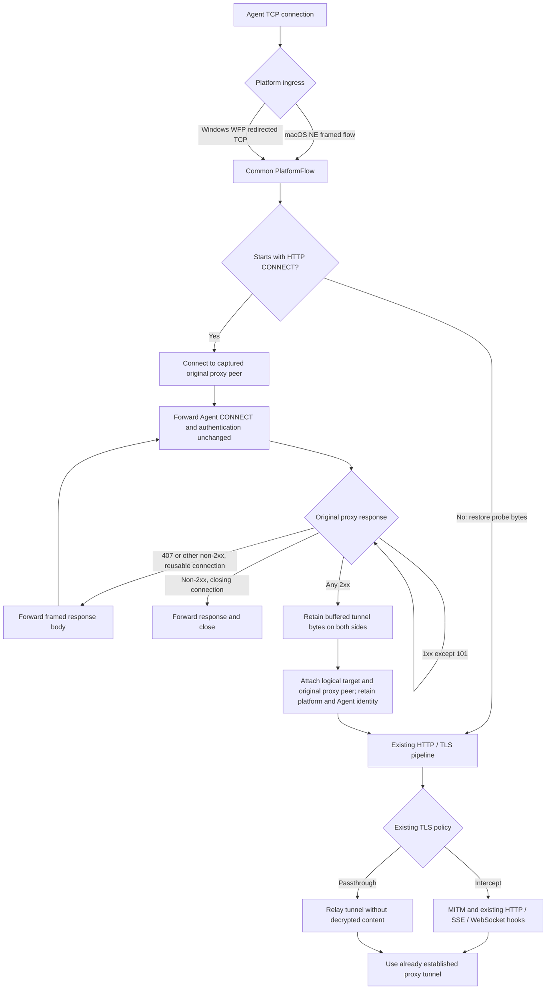

# Preserving an Agent's explicit proxy through transparent ingress

Transparent interception can receive a connection whose original TCP peer is an
HTTP proxy. The Agent then sends `CONNECT target:port`, negotiates authentication
with that proxy, and sends application traffic inside the resulting tunnel.
Abyss now forwards that negotiation and supplies the established tunnel to the
existing MITM engine. It does not resolve the target locally, recreate the Agent's
authentication, or replace the Agent's chosen route.

## Two separate route owners

| Mode | Proxy selection | CONNECT / authentication | Input to existing MITM |
| --- | --- | --- | --- |
| Configured upstream, explicit Abyss listener | Abyss `proxy.upstream` | Abyss originates CONNECT; existing configuration validation applies | Connected target tunnel |
| Preserve original proxy, transparent ingress | Agent's captured TCP peer | Agent request and proxy responses are relayed, including authentication | The same socket pair after successful CONNECT |

No new configuration is needed for the second mode. `proxy.upstream` remains
unsupported on transparent ingress. This change neither interprets proxy product
names nor adds client-specific environment, PAC, or configuration discovery.

## Flow

The Agent receives the original proxy's success response, only after that proxy
has accepted CONNECT. For intercepted TLS, the client-side certificate remains
issued by the existing Abyss CA. The upstream TLS handshake still validates the
**target** certificate using the existing trust policy, through the retained
proxy socket. SNI and HTTP authority checks use the CONNECT target. Decryption
continues to require the Agent's existing trust of the Abyss CA.

## Component boundaries

- `abyss-mitm::connect_relay` owns non-destructive method probing and bounded
  HTTP/1 negotiation over supplied duplex streams. It opens no sockets, resolves
  no DNS, and emits no content hooks. Authentication headers, challenges and
  response bodies stay outside the application capture pipeline.
- `abyss-broker::ingress::preparation` connects to the captured peer, calls the
  relay, and normalizes the resulting flow. Configured explicit ingress bypasses
  this preparation. The original peer is retained in `TransparentProxyContext`;
  the target IP is unknown for a DNS authority, or the literal IP when supplied.
- `FlowIngress::Transparent` retains its platform source and optionally carries
  the observed proxy context. Existing target checks, TLS policies and prepared
  upstream support are reused. Flow metadata and Agent process identity survive
  preparation.
- `sys::redirect_records` is the Windows-only IOCTL adapter. It captures the
  opaque WFP redirect records on the accepted socket and applies them to the
  outgoing proxy socket **before connecting**. Capture failures fail the new
  CONNECT route, without changing the pre-existing direct-flow path.

WFP records are OS redirection history, not HTTP proxy authentication. Their
transfer follows Microsoft's [redirect-record contract](https://learn.microsoft.com/en-us/windows/win32/winsock/sio-set-wfp-connection-redirect-records).
The protocol relay has no dependency on WFP, Network Extension, or a proxy brand.

## Protocol and failure contract

Supported here: HTTP/1.1 CONNECT over plain TCP, followed by traffic already
supported by the MITM engine. HTTP/1.0 and HTTP/1.1 responses are accepted.
Successful 2xx responses switch immediately to tunnel semantics, ignoring HTTP
body framing. Informational responses are forwarded; 101 is invalid for this
CONNECT negotiation. The entire request and response heads are retained on the
wire, including nonstandard success reason phrases.

Authentication retries use the same connected socket pair, supporting protocols
whose negotiation is connection-bound. Abyss does not cache credentials, retry
on the Agent's behalf, or reconnect under an existing authentication exchange.
If a proxy closes the connection, the Agent must open another connection as it
normally would. Content-Length, chunked and close-delimited rejection/challenge
bodies are streamed with backpressure. Ambiguous framing fails closed.

Both client and proxy read-ahead buffers are restored on the successful handoff.
No target connection is opened directly after a proxy rejection, malformed
response, I/O error, timeout, or failed WFP record transfer.

Bounds are 16 KiB per head/trailer section, 64 headers, eight negotiation rounds,
and eight informational responses per round. Detection, peer connection and
complete negotiation each have a 30-second budget. Error cleanup has a one-second
budget. An established stream uses the existing pipeline timeouts, not the
negotiation deadline. Windows redirect records are capped at 64 KiB.

SOCKS, TLS to the proxy, absolute-form HTTP forwarding, HTTP/2 CONNECT, CONNECT-UDP
and recursive nested CONNECT interpretation are outside this adapter. They are
not advertised as newly supported by this change. Proxy routes behind the
original proxy remain that proxy's responsibility. Normal non-CONNECT flows
continue through the existing protocol path.

## Platform integration and verification

The macOS and Windows native adapters must actually deliver the Agent-to-proxy
connection, including its original destination and Agent identity. A broker
cannot inspect a connection excluded by platform rules. In particular, a
product NE rule excluding loopback must be changed separately before local
loopback proxies can be covered. Broker-originated outgoing connections must
remain excluded from interception; Windows additionally carries redirect
records. The protocol guarantee is preservation of the selected proxy peer, CONNECT
request and authentication. The outgoing socket is owned by the broker; a proxy
that routes according to the connecting OS process rather than the protocol may
need additional platform cooperation to preserve that policy. No private driver,
Swift, C# or product packaging changes belong here.

Verification added here:

- Duplex protocol tests: fragmented probing, original authentication, 407 retry,
  chunked and close-delimited bodies, informational / non-200 success, both
  read-ahead buffers, malformed framing, header/round/time bounds.
- Shared broker preparation tests: both platform identities, target metadata,
  Agent identity, original proxy route, unchanged direct/configured flows.
- TLS socket integration: configured upstream and preserved Agent proxy routes,
  each platform identity, decrypted HTTP capture and TLS passthrough. Private
  target trust is injected only inside the test; production trust is unchanged.
- `make test-blackbox-broker-transparent-connect`: a real macOS broker receives
  public NE flow frames, performs Agent-owned authentication, relays HTTP/SSE/
  WebSocket, and exposes target/peer/process diagnostics. Rejection cannot cause
  direct fallback. This is a framing-boundary test, not a running NE provider.
- Existing configured-upstream and explicit-listener black-box suites remain
  regression gates.

Native WFP driver and installed NE provider validation must run in the product
repository on their respective OSes. A shared Rust test carrying a Windows source
label is not evidence of native WFP execution.
