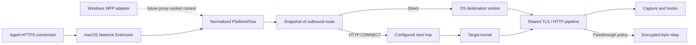
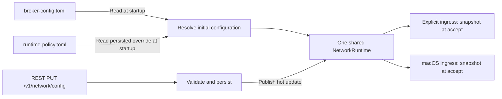
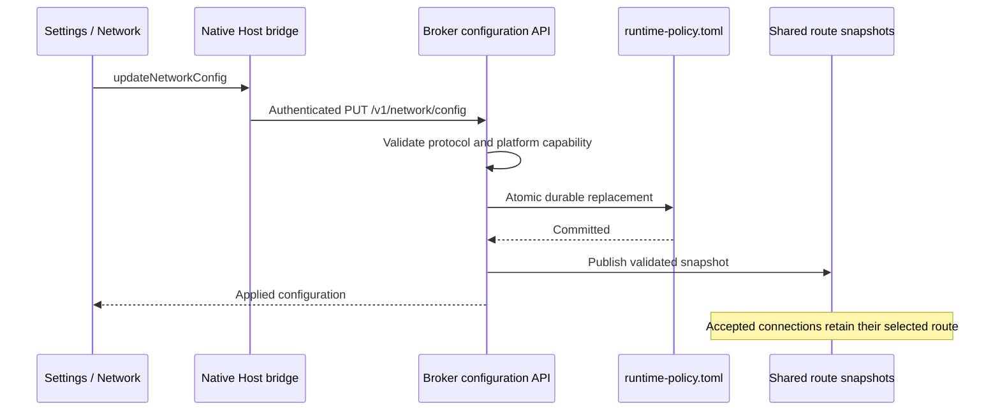

# Configured upstream routing for transparent ingress

The broker owns the CONNECT exchange and its proxy configuration. This extends
configured-upstream mode; it does not relay an Agent's own proxy authentication
or intercept loopback connections to an Agent-configured proxy.

Both HTTP CONNECT clients of the explicit listener and macOS transparent flows
require the broker's shared `NetworkRuntime` and use `HttpConnectProxy`.
Listener plans contain only their binding endpoints. There is no optional
runtime, private ingress runtime, or static next-hop fallback.
The native extension remains a framing and metadata
adapter. Platform support is checked by `NetworkRuntime`: explicit ingress and
macOS support configured routing; Windows WFP currently permits direct routing
only. Enabling WFP later requires a socket transport that associates redirect
context before connecting to the next hop. The WFP implementation is unchanged.

For configured routes, a native hostname is preferred. If native metadata has
only an IP, TLS SNI (or an HTTP Host hostname) supplies the logical target.
The original destination port is retained. DNS-only destinations remain
unresolved locally. With no logical hostname, CONNECT uses the original IP,
including bracketed IPv6. Direct mode continues using the OS destination, and
TLS server identity remains the ClientHello SNI. Upstream TLS trust is unchanged.

The protocol is currently HTTP/1.1 CONNECT over TCP, with a configured HTTP URL
and bounded connection/handshake timeouts. A single next hop is configured;
additional hops belong to that proxy. There are no assumptions about proxy
software, vendor configuration files, or process names. Authentication, SOCKS,
and TLS to the proxy are outside the supported contract.

Configuration files are startup inputs, not a watched source or a per-connection
fallback. Every supported proxy-chain field uses the same REST update path.

The broker serializes network, capture, and hook updates in the same transaction.
An absent network table inherits startup settings. An empty `[network]` table
explicitly selects direct routing, preventing a cleared startup proxy from
returning on restart. Persistence failure leaves the active route unchanged.
A committed update completes even if the HTTP request is cancelled. Old brokers
with strict policy decoding cannot read the new table; rollback requires backing
up the policy file and removing that table before starting the older binary.

CONNECT failure never falls back to direct routing. Proxy 407/403 diagnostics
remain separate from provider HTTP statuses and do not retain proxy response
bodies or authentication challenges. Existing SSE/WebSocket/TLS streams are not
migrated when settings change. Plugin delivery is outside this routing policy.

Validation includes MITM unit tests with a configured next hop and captured TLS
response bodies, durable configuration tests, and the real broker black-box
scripts `scripts/blackbox_abyss_broker_upstream.py` and
`scripts/blackbox_abyss_broker_transparent_upstream.py` using the explicit proxy
and published macOS framed-flow boundaries. They cover startup-only file reads,
hot route updates, stream continuity, direct mode, and restart persistence.
Live Network Extension activation still requires a
signed product build on macOS.
