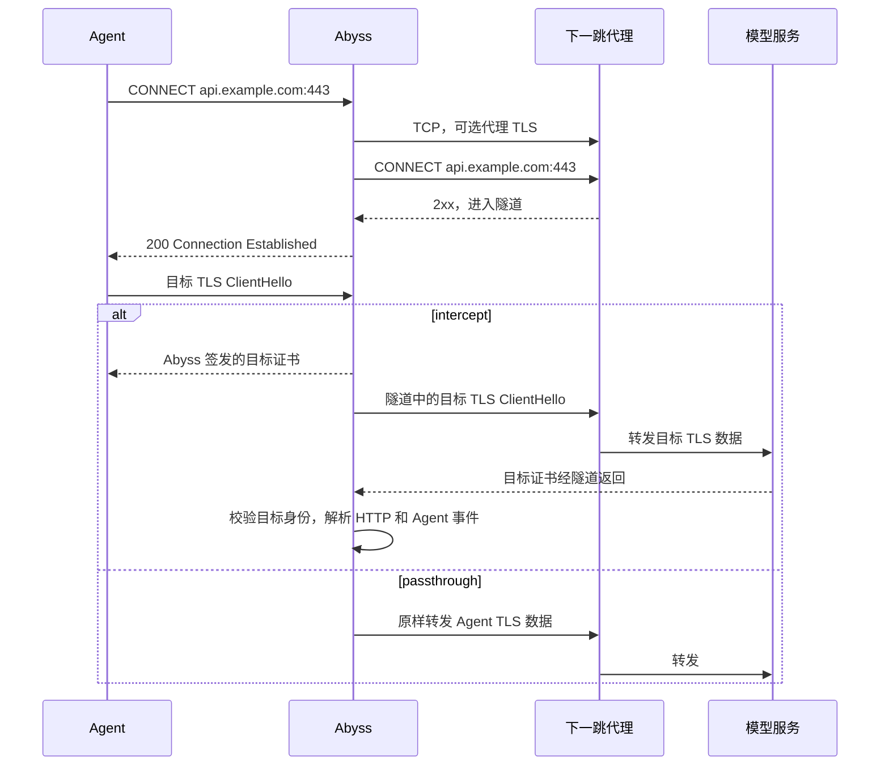

# Abyss Broker 上游代理链技术方案

状态：设计草案。调研日期：2026-10-26。配置和类型示例均为拟议接口。

建议为 broker 增加面向协议的上游连接器：Agent 仍连接 Abyss，由 Abyss 按配置的代理协议建立到逻辑目标的双向字节流。下一跳的兼容性由协议、传输和认证能力定义，与代理软件名称无关。首版建议实现 HTTP/1.1 CONNECT，可通过 TCP 或 TLS 连接代理。代理模式下，Abyss 只解析下一跳地址，将目标域名原样交给下一跳；TLS 解密、Harness 识别和事件投递继续使用现有管线。

首版覆盖显式 ingress。下一跳可以在本机、局域网或远端，只需满足下文定义的协议能力。Abyss 不假定下一跳还会经过其他代理，也不感知其内部路由。配置缺省时保持直连；配置了代理后，代理失败不得自动降级为直连。Clash/Mihomo 仅作为实现调研和互操作样本，不构成接口契约。

## 问题和目标

当前用户需要的路径是：

```text
Codex / Claude Code
    → Abyss 显式代理与 MITM
    → 配置的标准代理端点
    → 目标服务（或下一跳管理的后续代理链）
```

目前 `ExplicitConnection::into_flow()` 在确认 CONNECT 前，调用本机 DNS 并直接连接目标地址。即使 Harness 的 `HTTPS_PROXY` 指向 Abyss，broker 自己仍使用 `TcpStream::connect()` 直连。修改环境变量无法改变这条原始 socket 路径。见 [explicit.rs:128](../crates/abyss-broker/src/ingress/explicit.rs#L128)、[explicit.rs:200](../crates/abyss-broker/src/ingress/explicit.rs#L200)。

目标是让经过 broker 的这些连接使用用户已有的可用出口，同时保留 MITM 和事件语义。可用性仍取决于下一跳的 DNS、路由、出口及目标服务政策；收到连接失败不能直接归因为 GFW。

## 代理链的连接语义

代理链是逐跳建立到后续节点或最终目标的连接。对于本需求，Abyss 只需要知道一个下一跳，无需实现整个节点图。

HTTP 显式代理有两种常见形式：普通 HTTP 请求以 absolute-form 请求目标转发；CONNECT 则先协商一个字节隧道，成功后 HTTP 头结束位置之后的数据属于隧道。HTTPS 目标通常在这个隧道中运行 TLS。CONNECT 的目标是 `host:port`，不是完整 URL。见 [RFC 9110 CONNECT](https://www.rfc-editor.org/rfc/rfc9110.html#section-9.3.6) 和 [RFC 9112 消息定界](https://www.rfc-editor.org/rfc/rfc9112.html#section-6.3)。

必须区分三个对象：

| 对象 | 示例 | 用途 |
| --- | --- | --- |
| 逻辑目标 | `api.anthropic.com:443` | CONNECT authority、目标 Host、provider 身份 |
| 下一跳 | `proxy.example.com:3128` | Abyss 真正建立的 TCP 连接 |
| TLS 身份 | 目标域名；HTTPS 代理另有自己的域名 | 两条 TLS 会话各自校验证书 |

`http://proxy.example.com:3128` 可以承载 HTTPS 目标，表示到代理本身使用明文 HTTP CONNECT。`https://proxy.example.com:8443` 表示先对代理建立 TLS，再在其中发送 CONNECT。它们都与 Agent 是否信任 Abyss MITM CA 无关。

在 intercept 模式中，存在 Agent→Abyss TLS 和 Abyss→目标 TLS；后者运行在下一跳隧道里。在 passthrough 模式中，Agent→目标 TLS 原样通过隧道。下一跳不需要信任 Abyss 的 MITM CA，也不应替代对目标证书的校验。

SOCKS5 也能作为下一跳，其请求地址类型可直接携带域名，从而把目标解析交给代理。这是独立的代理协议，不应把 `socks5://` 当成 HTTP CONNECT URL。见 [RFC 1928](https://www.rfc-editor.org/rfc/rfc1928.html)。

## 下一跳协议契约

连接器对上层的承诺是：接收逻辑目标，按配置建立可双向读写的隧道，返回实际传输对端和类型化错误。其内部按协议分派，MITM、Agent Hook 和 ingress 不依赖代理产品。

| 维度 | 首版契约 |
| --- | --- |
| 协商协议 | HTTP/1.1 CONNECT，authority 为目标域名或 IP 加端口 |
| 到代理的传输 | TCP；或经过证书验证的 TLS，其内部仍为 HTTP/1.1 CONNECT |
| 认证 | 无认证或 Basic；其他认证机制超出首版支持范围，明确失败 |
| 名称解析 | 目标域名作为 authority 交给代理，Abyss 仅解析代理端点 |
| 目标权限 | 下一跳必须允许所请求的 CONNECT 目标及端口；按响应处理拒绝 |
| 建立成功 | 按 HTTP 标准处理成功响应及隧道边界，不依赖特定 reason phrase、响应头顺序或产品标识 |
| 建立之后 | 双向字节流；目标 TLS、HTTP、SSE、WebSocket 继续由现有管线处理 |

支持范围应表述为“满足上述能力的 HTTP CONNECT 代理”，不能泛称支持所有 HTTP 代理。例如，只支持普通 HTTP 转发、要求其他认证机制或仅支持 HTTP/2 CONNECT 的端点，不在首版范围内。`mixed` 是部分产品对监听端口的命名；Abyss 始终使用配置的协议，不识别端口名称，也不自动探测或降级协议。

后续增加 SOCKS5 时，通过独立协议实现完成握手和地址编码，并返回同一种隧道结果。无需更改 MITM 或 Agent Hook 的职责；首版协议范围和后续扩展都按需求与协议复杂度决定，不以某个代理产品支持什么为依据。

## 实现调研：Clash 和 Mihomo

本节只用于参考连接层拆分及识别互操作边界；RFC 定义的协议语义优先于产品实现。这里区分 Clash 系列历史设计与当前 Mihomo 行为。Dreamacro 原仓库在本次调研时返回 404；历史实现采用 MetaCubeX 仓库保留的版本作为代码依据，不将第三方旧教程当成现行行为。

| 机制 | 核心做法 | 对 Abyss 的启示 |
| --- | --- | --- |
| 历史 `relay` group | 将有序节点列表组合成逐层 dialer，再由最后一个代理连接目标 | 链路组合发生在连接层 |
| 现行 `dialer-proxy` | 指定当前出站通过另一个代理或策略组建立连接 | 出站协议与底层拨号方式分离 |
| HTTP outbound | 连接代理地址，可选 TLS，然后发送 CONNECT | 产物应是可读写的目标隧道 |
| DNS 配置 | 区分代理节点解析和目标/直连解析 | 避免代理引导解析与目标解析混在一起 |
| HTTP / mixed inbound | mixed 端口接受 HTTP 和 SOCKS | 端口可接受多种协议，但 Abyss 只按所配置协议进行协商 |

历史 relay 的实现可见 [Relay.DialContext](https://github.com/MetaCubeX/mihomo/blob/5998956a7287ed4a55d1f97cccbc8c69e651bbbc/adapter/outboundgroup/relay.go#L22)。Mihomo 的 [移除提交](https://github.com/MetaCubeX/mihomo/commit/4d3167ff2fc05a2e8568d0a871a2c3a11cc5dc3e) 已删除 relay 配置支持，当前 [relay 文档](https://wiki.metacubex.one/config/proxy-groups/relay/) 指向 `dialer-proxy`。

以现行文档中的概念为例，给节点 B 设置 `dialer-proxy: A`，表示先通过 A 连接 B，再由 B 访问最终目标；不是先经过 B 再经过 A。配置可以引用策略组，但订阅下载和 DNS 是否走代理仍有各自的配置。见 [dialer-proxy 文档](https://wiki.metacubex.one/config/proxies/dialer-proxy/)。

本次检查的 Mihomo 快照为 `3f27ef39f8c96bbfbc8b0b9bb10f5c9ef60149d8`。其 [BasicOption.NewDialer](https://github.com/MetaCubeX/mihomo/blob/3f27ef39f8c96bbfbc8b0b9bb10f5c9ef60149d8/adapter/outbound/base.go#L209) 选择普通 dialer 或具名代理 dialer；[HTTP outbound](https://github.com/MetaCubeX/mihomo/blob/3f27ef39f8c96bbfbc8b0b9bb10f5c9ef60149d8/adapter/outbound/http.go#L63) 负责代理连接、可选 TLS、CONNECT 和认证。这支持 Abyss 使用独立连接器的设计，但不应照搬其所有解析细节。

Mihomo 的 [DNS 文档](https://wiki.metacubex.one/config/dns/#proxy-server-nameserver) 专门区分代理节点域名解析。Abyss 首版不引入 DNS 路由系统：下一跳用系统解析器，目标域名交给下一跳；本机代理推荐配置 loopback IP。[端口文档](https://wiki.metacubex.one/config/inbound/port/) 中的 HTTP 或 mixed 端口均可作为接入点，具体端口以用户实际配置为准。

一个实现差异是：所检查的 Mihomo [HTTP listener](https://github.com/MetaCubeX/mihomo/blob/3f27ef39f8c96bbfbc8b0b9bb10f5c9ef60149d8/listener/http/proxy.go#L67) 会先回复 CONNECT 成功，再把连接交给内部 tunnel。Abyss 不为此加入产品检测或特殊分支，统一处理隧道建立后的 EOF、TLS 和应用层错误。

## 首版范围和替代方案

| 能力 | 首版决策 |
| --- | --- |
| ingress | Linux、macOS、Windows broker 的 explicit 模式 |
| 下一跳 | 符合上述协议契约的任意实现；HTTP/1.1 CONNECT over TCP/TLS |
| 认证 | 无认证或 Basic，凭据使用独立文件 |
| 目标 | 域名、IPv4、IPv6；HTTPS、HTTP、SSE、WebSocket 复用现有管线 |
| DNS | 代理模式不在 Abyss 解析目标域名 |
| 生效时机 | 静态启动配置，重启 broker 生效 |
| 故障 | 返回明确错误，禁止自动直连回退 |
| 多跳和分流 | Abyss 只管理一个下一跳；其内部行为对 Abyss 透明 |
| 暂不实现 | SOCKS5 出站、透明入口代理链、热更新、PAC、UDP、HTTP/3、HTTP/2 CONNECT 多路复用 |

首版统一用 CONNECT 建立目标隧道，包括明文 HTTP 的目标端口。这样可以复用现有 HTTP relay 和 WebSocket 路径，而不另建一套向代理转发 absolute-form 请求、逐请求注入认证的逻辑。兼容条件是下一跳允许 CONNECT 到所需端口；有些代理只开放 443，访问 HTTP 的 80 端口会被拒绝，届时明确报错，不自动改换直连。

透明模式目前强调保留操作系统捕获的原目标 IP。如何使用 adapter host hint、Fake-IP、SNI，以及如何排除代理进程回流，都需要单独的路由契约。首版若同时配置透明 ingress 和上游代理，应在启动时拒绝，避免出现只对部分流量生效的隐式行为。后续复用连接器，但不自动把 SNI 当成透明连接的新路由目标。见 [transparent/upstream.rs:61](../crates/abyss-mitm/src/transparent/upstream.rs#L61)。

其他方案的取舍：

- 依赖系统 TUN 可以由用户在部署端解决，但不能作为 broker 的可移植显式配置能力。
- 自动读取 `HTTP_PROXY`、`HTTPS_PROXY`、`ALL_PROXY` 会引入服务进程环境差异和指回 Abyss 的风险，首版不使用这些变量选择出口；`NO_PROXY` 也不作为 broker 隐式绕过规则。
- 使用普通 reqwest 请求客户端不能直接代替现有双向字节流和 MITM 转发边界；连接器应返回通用异步流。
- 在 Abyss 内复制节点订阅、测速、分流及多跳图，会扩展到独立代理产品的职责；本需求通过单下一跳即可解决。

## 配置契约

上游属于开放运行时的静态网络配置，放在 `broker-config.toml`，不放在动态内容策略或部署专属 `product-config.json`。

`protocol` 标识代理握手协议，endpoint scheme 标识到该代理的传输。配置不包含产品类型、策略组名、控制 API 或进程发现。示例地址和端口均为占位值，不作为内置默认值。

```toml
schema_version = 1

[proxy]
mode = "explicit"
listen_addr = "127.0.0.1:8080"

[proxy.upstream]
protocol = "http_connect"
endpoint = "http://proxy.example.com:3128"
connect_timeout_ms = 10000
handshake_timeout_ms = 10000
# credentials_file = "secrets/upstream-proxy.toml"
# ca_file = "certificates/proxy-ca.pem"
```

远程 HTTPS 代理使用 `endpoint = "https://proxy.example.com:8443"`。`ca_file` 仅为代理 TLS 增加受信 CA，不改变目标服务 TLS 或 MITM CA。

凭据文件示意：

```toml
username = "example-user"
password = "example-password"
```

具体规则：

1. 缺少 `proxy.upstream` 表示直连。出现该表后，`protocol` 和 `endpoint` 必填，未知字段、不支持的协议或协议与 scheme 组合启动失败。
2. endpoint 必须有合法主机和非零端口，允许空路径或 `/`；拒绝 userinfo、query、fragment 和其他路径。凭据不放入 URL。
3. timeout 必须为正整数，建议范围 1–120000 ms。connect 预算覆盖下一跳 DNS 和 TCP；handshake 预算覆盖代理 TLS 与整个 CONNECT 协商，碎片读取或 1xx 响应不得重置预算。
4. 凭据和 CA 路径相对配置文件目录解析；配置只保存路径，broker 启动时读取。凭据文件限制大小并检查访问权限，禁止把文件内容写入日志、Debug、错误或 support bundle。
5. Basic 用户名不得包含冒号；字段不允许控制字符。无凭据时不发送 `Proxy-Authorization`。提供凭据时仅在本次 CONNECT 中发送。
6. HTTPS 代理必须校验证书，使用 endpoint 主机作为 TLS 身份；IP endpoint 必须匹配 IP SAN。代理侧 ALPN 限制为 HTTP/1.1。首版不提供跳过证书验证开关。
7. 当前客户端模型和配置解析器均有 `deny_unknown_fields`。broker 与 CLI 必须一起升级；旧配置可继续读取，新配置不承诺可被旧版本读取。

Basic 在明文远程 HTTP 连接上不提供凭据机密性；该方式适合可信本机代理，跨不可信网络使用 HTTPS 代理。

## 连接建立与数据转发



下一跳 CONNECT 返回成功后，Abyss 才向 Agent 确认。按协议语义，此时进入隧道状态；这不表示 Abyss 已完成目标 TLS 校验或收到目标应用响应。诊断记录“代理报告隧道建立”，后续 EOF、TLS 和应用错误按实际发生阶段记录，不推断下一跳内部如何建连。

明文 HTTP 请求仍由入口将 absolute-form 规范化为现有 relay 使用的形式，然后在 CONNECT 隧道中转发。SSE 和 WebSocket 使用同一隧道，保留原有流式转发、捕获预算和背压；不因引入代理链而等待缓存完整响应后再转发。

代理路由与 TLS 解密策略必须独立。`passthrough` 只表示不解密，不能解释为绕过上游代理。未被 Harness 识别的流量同样遵循出口配置。

## 连接器和数据模型

建议在 `abyss-mitm` 新建独立的 `outbound/` 模块，包含配置类型、目标类型、直连和 HTTP CONNECT 实现，以及类型化错误。broker 负责读取配置、凭据、检查监听地址及注入连接器；MITM 库负责协议和流处理，不读取产品配置。

模块按协议组织，例如 `http_connect.rs` 处理 CONNECT，独立传输代码处理代理 TCP/TLS；未来 SOCKS5 在独立模块完成握手。禁止按代理软件名称分派，也不根据 `Server` 响应头改变协议行为。

```text
UpstreamConnector::connect(target, deadline)
    Direct       → 本机解析目标并连接
    HttpConnect  → 解析并连接代理 → 可选 TLS → CONNECT 目标
    返回 ConnectedUpstream

ConnectedUpstream
    stream: BoxedDuplexStream
    route: Direct | HttpConnect
    transport_peer: SocketAddr
    resolved_target: Option<SocketAddr>
```

代理模式中 `transport_peer` 是代理地址，`resolved_target` 通常未知。不能把代理的 `peer_addr()` 写成模型服务 IP，也不能填 `0.0.0.0` 或虚构地址。

现有 `TargetAuthority` 已区分 DNS 和 IP，适合继续承载逻辑目标。见 [explicit_http.rs:39](../crates/abyss-mitm/src/explicit_http.rs#L39)。但 `PlatformFlowMetadata`、`AcceptedTcpFlow` 和 `FlowContext` 都要求一个必填 `OriginalDestination`，需要将目标模型扩展为能表达域名尚未解析的状态，例如：

```text
FlowDestination
    Explicit { target: TargetAuthority, resolved_addr: Option<SocketAddr> }
    Transparent { original: OriginalDestination, host_hint: Option<String> }
```

目标信息只能有一个权威来源；应调整现有 `FlowIngress::ExplicitProxy` 中的 target 存放位置或由 accessor 派生，避免保留两份可独立变化的 authority。原有透明构造接口可转换到 Transparent 分支，但公开字段和返回类型的变化仍需逐项评估。

另一个必须修改的限制是 prepared upstream。目前 broker 的 `PlatformFlow` 保存 `Option<TcpStream>`，MITM 的 `UpstreamConnection::Prepared` 也只接收 `TcpStream`。HTTPS 代理 TLS 流和含预读数据的 CONNECT 隧道都无法放入其中。应统一为通用异步流及路由元数据，复用现有 [BoxedDuplexStream 和 PrefixedDuplexStream](../crates/abyss-mitm/src/transparent/io.rs#L106)。

显式入口通过注入的连接器完成准备，随后 MITM 必须消费这一个已建立的隧道。禁止在 TLS、passthrough 或重试路径中重新直连目标。原有 `with_prepared_upstream(TcpStream)` 可保留为包装方法，新增通用流接口。

建议连接器使用结构体与 `impl`，固定路径用 enum；首版不建立节点注册表、全局可变状态或递归代理图。依赖优先复用现有 Tokio、rustls、httparse、http、base64；只有实际缺口才增加依赖。

## CONNECT 协议处理和错误边界

CONNECT 实现是专用握手状态机，不能套用一般 HTTP 响应 body 读取逻辑。

- 请求只包含规范化 authority、Host 和必要的代理认证；不携带 Agent 的模型 Authorization、Cookie、请求体或客户端代理凭据。
- 使用完整写入语义；响应头最大 16 KiB、最多 64 个字段；允许有界数量的非 101 信息响应，例如最多 8 个，总预算不重置。
- 任意合法 2xx 都表示隧道成功；按 RFC 忽略成功 CONNECT 响应中的 Content-Length 和 Transfer-Encoding。101、非 2xx、畸形响应和提前 EOF 均不能当成隧道。
- 解析器可能一次读到响应头和隧道首批字节，后者必须作为 prefix 留给后续读取。不能丢弃 BufReader 内的数据。
- 非 2xx 不跟随重定向、不执行认证机制自动协商、不转发代理 HTML body；关闭连接，保留经过筛选的状态码和失败阶段。
- 隧道建立后不重放 Agent 请求。代理 TCP 多地址尝试可在有限预算内进行，已进入应用数据传输后不自动重试，避免重复模型调用。
- 超时、取消和 broker 关闭时清理下一跳 socket；代理握手预算只覆盖建立阶段，不把十秒握手超时变成 SSE 的总时限。

这些隧道定界要求依据 [RFC 9112 §6.3](https://www.rfc-editor.org/rfc/rfc9112.html#section-6.3)。代理认证必须限定在对应跳，参见 [RFC 9110 §11.7.2](https://www.rfc-editor.org/rfc/rfc9110.html#section-11.7.2)。具体 header 上限、信息响应数量和重试限制是本方案的实现选择。

| 失败 | 对 Agent 的响应或行为 | 本地诊断 |
| --- | --- | --- |
| 配置、凭据或 CA 无效 | broker 启动失败 | 稳定配置错误，不回显秘密 |
| 代理 DNS/TCP/握手超时 | CONNECT 确认前返回 504 | 标明 proxy 阶段 |
| 代理拒绝连接、非法响应、TLS 证书失败 | CONNECT 确认前返回 502 | 标明 DNS、TCP、TLS 或协议失败 |
| 上游 407 | 返回 502 | `upstream_proxy_auth_required`，提示修复 broker 凭据 |
| 上游 403/405/其他拒绝 | 返回 502 | 记录代理状态，不等同于目标服务状态 |
| 已向 Agent 返回 200 后失败 | 按现有流协议关闭或处理错误 | 不再发送第二个 CONNECT HTTP 状态 |

不向 Agent 透传上游 407，因为下一跳认证由 broker 配置负责；否则客户端可能误以为需要给 Abyss 提供该凭据。代理错误正文、认证头和敏感 URL 均不进入 AgentEvent。

## DNS 和回环处理

代理模式下，目标域名必须一直保留到 CONNECT 请求，不为了日志、自连检查或填充结构而偷偷解析一次。IP literal 目标按 IP 发送；无法从 IP 恢复的域名不猜测。

下一跳域名需要独立的引导解析。首版使用系统解析器；若代理部署在本机，使用 loopback IP 可避免这一步 DNS 依赖。把目标域名交给下一跳不等于保证其使用远端 DNS；具体解析位置、方式和后续路由由下一跳决定，Abyss 不作产品相关假设。

配置校验和连接建立都检查下一跳是否指向 broker 的实际监听地址，覆盖动态端口、域名解析结果和 IPv4-mapped IPv6 等等价形式。检查已知本地目标时保留现有安全边界，但不以解析任意目标域名为代价。

单个 broker 无法完整检测外部代理之间的间接环。部署文档必须说明下一跳的后续路径不能重新进入同一 Abyss 代理链；握手超时和并发上限限制失败消耗，但不声称能够识别任意外部循环。透明模式后续还需处理 WFP/Network Extension 对代理进程及 broker 自身流量的排除。

## 诊断和兼容性

当前入口准备失败只调用 `record_accept_error()`，还未进入带目标上下文的 observation 路径。代理不可达恰好发生在这里，因此不能只增加日志字符串。见 [proxy.rs:549](../crates/abyss-broker/src/proxy.rs#L549)。

应在解码出目标后建立准备阶段上下文，让结构化失败携带 flow id、目标 authority、脱敏后的代理 endpoint、阶段和耗时，由 broker 写入网络诊断。代理握手不进入 Agent Hook，不产生 token 或 conversation 事件。

建议增补 `abyss_to_upstream_proxy` hop，以及 `resolve_proxy`、`connect_proxy_tcp`、`connect_proxy_tls`、`proxy_connect_handshake` 操作；目标 TLS 失败仍属于目标 TLS。下一跳报告的拒绝与目标可达性是不同事实，诊断界面应保留该区别。

诊断输出需要表达逻辑目标、已知目标 IP、实际下一跳和路由模式；未知目标 IP 使用 absent/null。新的字段应通过 migration 持久化，并同步 CLI 诊断、REST schema 和相关 SDK。原有模型不存目标 IP，不能宣称仅替换一列即可完成。见 [network_diagnostics/store.rs:31](../crates/abyss-broker/src/network_diagnostics/store.rs#L31)。

代理状态详情放入受认证保护的诊断接口；不把凭据或完整配置加入现有无认证 `/v1/proxy/status`。业务流量计数保持目标隧道口径，CONNECT 握手和代理外层 TLS 开销单独记录或不计入，不污染模型 usage。

配置兼容性必须覆盖 CLI。`LocalConfig` 也使用严格反序列化，而且修改代理端口会重写配置；broker 和 CLI 应复用同一份上游配置类型，并验证读写后字段不丢失。support bundle 当前会序列化 LocalConfig，新凭据必须独立加载，输出使用显式脱敏投影。见 [local_config.rs:24](../crates/abyss-cli/src/local_config.rs#L24)、[support_bundle.rs:328](../crates/abyss-cli/src/support_bundle.rs#L328)。

Rust API 兼容性需要作为发布事项明确处理。`FlowContext`、`OriginalDestination`、`FlowIngress` 和流构造接口是公开库边界；把必填 IP 改成域名可表达模型可能构成破坏性改动。能保留的构造方法保留包装，但不能用假 IP 或 panic accessor 维持表面兼容。若公开字段或方法签名必须变化，应按各 crate 当前版本及兼容承诺安排破坏性版本升级，或先完成真正保持旧调用语义的新增接口设计；这一点必须在实现接口提交前定案。

AgentEvent 的 provider、session、event id 和内容策略不应因下一跳改变，通常不需要修改插件事件协议。Delivery plugin、终端登录、查询 CLI 和制品下载的自身 HTTP 请求不属于该配置作用域；它们需要代理时使用各自明确的网络配置。

## 修改范围

| 模块 | 预计修改 |
| --- | --- |
| `abyss-mitm/src/outbound/` 新模块 | 连接器、代理 TLS、CONNECT、类型化错误、通用配置 |
| `abyss-mitm/src/transparent/accepted_flow.rs` | prepared upstream 通用流与元数据 |
| `abyss-mitm/src/transparent/types.rs`、`hook.rs` | 能表达未解析域名的流目标模型 |
| `abyss-mitm/src/transparent/upstream.rs` | 消费准备好的隧道，不重新直连；保持目标 TLS 校验 |
| `abyss-broker/src/config.rs`、`main.rs`、`proxy.rs` | 静态配置校验、注入连接器、准备阶段诊断 |
| `abyss-broker/src/ingress/explicit.rs`、`ingress/mod.rs` | 按逻辑目标拨号、延后确认 CONNECT、传递通用流 |
| `abyss-broker/src/network_diagnostics/`、migration、`traffic.rs` | 目标和代理分离、失败归因、持久化 |
| `abyss-cli/src/local_config.rs`、`support_bundle.rs`、诊断模块 | 配置读写保留、脱敏、可用错误提示 |
| REST schema、SDK、文档与黑盒脚本 | 新诊断字段、配置说明、真实端口兼容测试 |

`abyss-agent-hook` 不增加代理专用 parser；仅在公共 flow 类型改变时调整消费接口和测试构造器。默认配置不预设下一跳地址、端口或代理软件。

## 验证方案

验收重点是证明目标只经配置的下一跳访问，并且事件观测与原路径等价。连接成功一次不足以证明这些条件。

| 层级 | 必测场景和断言 |
| --- | --- |
| 配置单测 | 旧配置默认直连；新字段 round-trip；未知字段、错误 scheme、userinfo、非法端口、凭据权限、CA 和超时边界 |
| CONNECT 单测 | 请求 authority/Host、IPv6 方括号、无凭据/Basic、分片头、所有合法 2xx、1xx 上限、101 拒绝、畸形头、16 KiB 上限、EOF、超时 |
| 字节保持 | 响应头和隧道数据同包；成功 2xx 带误导性 CL/TE；prefix 不丢失、不重复 |
| 路由单测 | 代理模式不调用目标 resolver；只解析代理；Prepared 只消费一次；无 fallback 分支 |
| 原生黑盒 | 真实 broker + 本地测试代理 + HTTP/TLS origin，经 HTTP 和 HTTPS 下一跳完成请求 |
| DNS 黑盒 | 使用只有测试代理知道映射的 `.invalid` 目标；broker 无法本地解析，仍可通过代理连接 |
| 禁止直连 | 上游拒绝而目标直连可达时，请求必须失败且目标 listener 接受计数为零；Linux 隔离网络进一步只允许 broker 连接代理 |
| MITM | intercept 产生既有事件；passthrough 保持 Agent 原始 TLS 且不产生内容事件；二者都经过下一跳 |
| 身份校验 | 代理证书错误与目标证书错误分别失败；目标 SNI/Host 不被代理地址替换 |
| 业务回归 | Codex Responses HTTP/SSE/WebSocket、Claude Messages、压缩响应、长 SSE、tool/image 内容与稳定事件字段 |
| 故障恢复 | 407、403、502、504、连接拒绝、慢响应、半关闭、断线、取消、broker shutdown；无泄漏和应用请求重放 |
| 凭据隔离 | origin、Agent、Hook 事件、普通日志、错误、support bundle 均看不到上游凭据；模型 Authorization 不出现在 CONNECT 请求中，HTTPS 目标的应用数据保持在目标 TLS 内 |
| 诊断 | CONNECT 确认前失败也写入 observation；目标域名与代理 peer 分离；代理状态码不冒充模型 HTTP 状态 |
| 实现互操作 | 至少两个独立的 HTTP CONNECT 实现，固定版本及校验值；Mihomo 可作为其中一个样本，不能作为唯一兼容性依据 |
| 平台兼容 | Windows/macOS/Linux explicit broker，执行相同协议契约测试 |

协议验收以 RFC 和上述明确的能力范围为依据。测试代理使用真实网络 listener 和确定性响应，不复制某个产品的响应格式；覆盖可变 reason phrase、大小写无关的字段名、额外头字段、非 200 的合法 2xx 等协议允许的差异。测试不依赖公网、商业节点或模型 API，HTTPS origin 使用测试 CA。

真实实现互操作作为额外验证，各测试明确声明覆盖的传输、认证与目标端口能力；所有首版能力均须由协议测试覆盖，不要求每个样本实现具备全部可选能力。互操作在隔离配置下运行，不修改用户正在使用的代理。真实 Codex/Claude Code 冒烟不能替代这些无外部依赖的黑盒。

明文 HTTP 目标的应用数据在 CONNECT 隧道内仍然是明文，下一跳能够读取；代理外层 TLS 只保护 Abyss 到代理这一段。凭据隔离不能被描述为对明文目标的端到端保密。

实现阶段的回归门槛包括 `cargo +nightly fmt --all -- --check`、workspace build、`make lint`、`make test`、`make test-blackbox-broker-explicit`、`make test-sdks`，以及新增的代理链黑盒。加入平台 CI，确认通用流和 TLS 包装没有引入目标平台差异。

## 实施顺序

1. 确认目标模型、公开 Rust API 的兼容策略和首版能力范围，先锁定接口契约与失败语义。
2. 实现通用 prepared stream 和目标模型，保留现有 direct 行为，通过原有显式和透明路径回归。
3. 增加连接器、HTTP/HTTPS CONNECT、凭据隔离及完整协议测试。
4. 接入 broker 与 CLI 配置，完善准备阶段诊断、持久化、schema 和脱敏。
5. 完成断网条件下的协议黑盒、至少两个独立实现的互操作，再验证 Harness 事件等价性。
6. 发布配置示例和迁移说明；评估 SOCKS5 与透明入口作为后续独立扩展。

建议采用的设计决策是：协议定义兼容性、单下一跳、目标域名由下一跳处理、路由与解密分离、通用流接口、静态配置、失败不直连。实现前最需要定案的事项是公开 Rust flow 类型如何发布；不能通过伪造目标 IP 回避这个模型问题。
