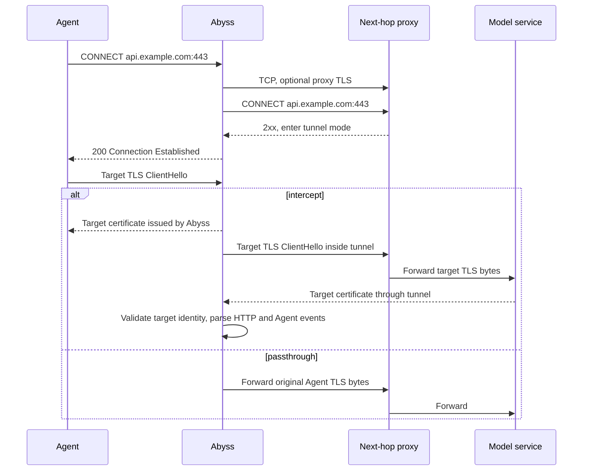

# Abyss Broker Upstream Proxy Chain Design

Status: design draft. Research date: 2026-10-26. All configuration and type
examples describe proposed interfaces.

Add a protocol-oriented upstream connector to the broker. Agents continue to
connect to Abyss, which establishes a bidirectional byte stream to the logical
target using the configured proxy protocol. Compatibility with the next hop is
defined by protocol, transport, and authentication capabilities, independent of
the proxy software. The proposed first release implements HTTP/1.1 CONNECT over
TCP or TLS. In proxy mode, Abyss resolves only the next hop and passes the target
hostname unchanged to that hop. TLS interception, harness identification, and
event delivery continue through the existing pipeline.

The first release covers explicit ingress. The next hop may run locally, on a
LAN, or remotely, provided it meets the protocol contract below. Abyss makes no
assumption about additional proxies or internal routing beyond that hop. An
absent upstream configuration preserves direct connections. Once a proxy is
configured, failures must never trigger an automatic fallback to direct access.
Clash/Mihomo serves only as implementation research and an interoperability
sample, not as the interface contract.

## Problem and objective

The required path is:

```text
Codex / Claude Code
    -> Abyss explicit proxy and MITM
    -> Configured standard proxy endpoint
    -> Target service, optionally through further hops managed by the next proxy
```

Currently, `ExplicitConnection::into_flow()` resolves the target locally and
connects directly before acknowledging CONNECT. Even when a harness sets
`HTTPS_PROXY` to Abyss, the broker uses `TcpStream::connect()` for its own direct
connection. Changing environment variables does not alter this raw socket path.
See [explicit.rs:128](../crates/abyss-broker/src/ingress/explicit.rs#L128) and
[explicit.rs:200](../crates/abyss-broker/src/ingress/explicit.rs#L200).

The objective is to route these broker connections through an existing usable
exit while preserving MITM and event semantics. Availability still depends on
the next hop's DNS, routing, exit, and target service policies. A connection
failure alone cannot establish that the GFW caused it.

## Proxy chain connection semantics

A proxy chain establishes connections hop by hop to subsequent nodes or the
final target. For this requirement, Abyss needs to know only one next hop; it
does not need to model the complete node graph.

HTTP explicit proxies commonly support two forms. Ordinary HTTP forwarding uses
an absolute-form request target. CONNECT negotiates a byte tunnel; after a
successful response, bytes following the response header section belong to that
tunnel. HTTPS targets typically run TLS inside it. The CONNECT target is
`host:port`, not a complete URL. See
[RFC 9110 CONNECT](https://www.rfc-editor.org/rfc/rfc9110.html#section-9.3.6) and
[RFC 9112 message framing](https://www.rfc-editor.org/rfc/rfc9112.html#section-6.3).

Three identities must remain distinct:

| Identity | Example | Purpose |
| --- | --- | --- |
| Logical target | `api.anthropic.com:443` | CONNECT authority, target Host, provider identity |
| Next hop | `proxy.example.com:3128` | Actual TCP peer connected by Abyss |
| TLS identity | Target hostname; a separate proxy hostname for an HTTPS proxy | Independent certificate validation for each TLS connection |

`http://proxy.example.com:3128` can carry HTTPS target traffic; it specifies
plaintext HTTP CONNECT to the proxy itself. `https://proxy.example.com:8443`
specifies TLS to the proxy, followed by CONNECT inside that TLS connection.
Neither choice determines whether the agent trusts the Abyss MITM CA.

In intercept mode, the agent-to-Abyss and Abyss-to-target TLS connections are
separate; the latter runs inside the upstream tunnel. In passthrough mode, the
agent-to-target TLS connection passes through the tunnel unchanged. The next hop
does not need to trust the Abyss MITM CA and must not replace target certificate
validation.

SOCKS5 can also serve as a next-hop protocol. Its request address types can carry
a hostname, delegating target resolution to the proxy. It is a separate protocol;
a `socks5://` endpoint must not be interpreted as an HTTP CONNECT URL. See
[RFC 1928](https://www.rfc-editor.org/rfc/rfc1928.html).

## Next-hop protocol contract

The connector accepts a logical target, establishes a bidirectional tunnel using
the configured protocol, and returns the actual transport peer or a typed error.
It dispatches internally by protocol. MITM, Agent Hook, and ingress do not depend
on a proxy product.

| Dimension | First-release contract |
| --- | --- |
| Negotiation | HTTP/1.1 CONNECT with a target hostname or IP address and port as the authority |
| Transport to the proxy | TCP, or certificate-validated TLS carrying HTTP/1.1 CONNECT |
| Authentication | None or Basic; other mechanisms are outside the initial scope and fail explicitly |
| Name resolution | Pass the target hostname in the authority; Abyss resolves only the proxy endpoint |
| Target permissions | The next hop must permit CONNECT to the requested target and port; handle rejection from its response |
| Successful establishment | Follow HTTP response and tunnel framing rules without depending on a particular reason phrase, header order, or product identifier |
| Established connection | Bidirectional bytes; the existing pipeline handles target TLS, HTTP, SSE, and WebSocket |

Describe compatibility as support for HTTP CONNECT proxies meeting these
capabilities, not all HTTP proxies. Endpoints that support only ordinary HTTP
forwarding, require other authentication mechanisms, or support only HTTP/2
CONNECT are outside the first release. Some products call a listener `mixed`;
Abyss always speaks the configured protocol, without interpreting listener names,
automatically detecting protocols, or downgrading them.

A future SOCKS5 implementation would perform its own handshake and address
encoding, returning the same tunnel result. MITM and Agent Hook responsibilities
would remain unchanged. Protocol scope and extensions should follow requirements
and protocol complexity, rather than the capabilities of a particular product.

## Implementation research: Clash and Mihomo

This section informs connection-layer decomposition and interoperability
boundaries. RFC-defined semantics take precedence over product behavior. It
distinguishes historical Clash designs from current Mihomo behavior. The original
Dreamacro repository returned 404 during this research, so historical code
references use versions retained in the MetaCubeX repository. Old third-party
tutorials are not evidence of current behavior.

| Mechanism | Approach | Implication for Abyss |
| --- | --- | --- |
| Historical `relay` group | Compose an ordered node list into nested dialers, with the final proxy connecting to the target | Compose chains at the connection layer |
| Current `dialer-proxy` | Establish an outbound connection through another proxy or policy group | Separate the outbound protocol from its underlying dialer |
| HTTP outbound | Connect to the proxy, optionally negotiate TLS, then send CONNECT | Return a readable and writable target tunnel |
| DNS configuration | Separate proxy-node resolution from target/direct resolution | Keep proxy bootstrap DNS distinct from target DNS |
| HTTP / mixed inbound | A mixed listener accepts HTTP and SOCKS | A listener may support multiple protocols, but Abyss negotiates only the configured one |

The historical implementation is available in
[Relay.DialContext](https://github.com/MetaCubeX/mihomo/blob/5998956a7287ed4a55d1f97cccbc8c69e651bbbc/adapter/outboundgroup/relay.go#L22).
Mihomo's
[removal commit](https://github.com/MetaCubeX/mihomo/commit/4d3167ff2fc05a2e8568d0a871a2c3a11cc5dc3e)
removed relay configuration support; the current
[relay documentation](https://wiki.metacubex.one/config/proxy-groups/relay/)
points to `dialer-proxy`.

Setting `dialer-proxy: A` on node B means connecting to B through A, then letting
B access the final target. The order is A, then B, then the target. The reference
may name a policy group, while subscription downloads and DNS retain their own
routing configuration. See the
[dialer-proxy documentation](https://wiki.metacubex.one/config/proxies/dialer-proxy/).

The inspected Mihomo snapshot is
`3f27ef39f8c96bbfbc8b0b9bb10f5c9ef60149d8`.
[BasicOption.NewDialer](https://github.com/MetaCubeX/mihomo/blob/3f27ef39f8c96bbfbc8b0b9bb10f5c9ef60149d8/adapter/outbound/base.go#L209)
selects a direct or named proxy dialer. The
[HTTP outbound](https://github.com/MetaCubeX/mihomo/blob/3f27ef39f8c96bbfbc8b0b9bb10f5c9ef60149d8/adapter/outbound/http.go#L63)
handles the proxy connection, optional TLS, CONNECT, and authentication. This
supports using a separate connector in Abyss without copying every parsing
detail of that implementation.

Mihomo's
[DNS documentation](https://wiki.metacubex.one/config/dns/#proxy-server-nameserver)
explicitly distinguishes proxy-node hostname resolution. Abyss does not introduce
a DNS routing system in the first release: it uses the system resolver for the
next hop and delegates the target hostname to that hop. A loopback IP avoids
bootstrap DNS for a local proxy. HTTP or mixed listeners described in the
[port documentation](https://wiki.metacubex.one/config/inbound/port/)
can be used, with the actual port taken from the user's configuration.

One implementation detail is that the inspected Mihomo
[HTTP listener](https://github.com/MetaCubeX/mihomo/blob/3f27ef39f8c96bbfbc8b0b9bb10f5c9ef60149d8/listener/http/proxy.go#L67)
sends CONNECT success before handing the connection to its internal tunnel.
Abyss should handle subsequent EOF, TLS, and application errors uniformly,
without product detection or special branches.

## First-release scope and alternatives

| Capability | First-release decision |
| --- | --- |
| Ingress | Explicit mode in the Linux, macOS, and Windows broker |
| Next hop | Any implementation meeting the contract above; HTTP/1.1 CONNECT over TCP/TLS |
| Authentication | None or Basic, with credentials in a separate file |
| Targets | Hostnames, IPv4, and IPv6; reuse existing HTTPS, HTTP, SSE, and WebSocket handling |
| DNS | Abyss does not resolve target hostnames in proxy mode |
| Activation | Static startup configuration; restart the broker to apply changes |
| Failure | Explicit errors; no automatic direct fallback |
| Further hops and routing | Abyss manages one next hop; its internal behavior is opaque to Abyss |
| Deferred | SOCKS5 outbound, proxy chains for transparent ingress, hot reload, PAC, UDP, HTTP/3, and HTTP/2 CONNECT multiplexing |

Use CONNECT for every target tunnel, including plaintext HTTP ports. This reuses
the existing HTTP relay and WebSocket paths without a second implementation for
absolute-form forwarding and per-request proxy authentication. The next hop must
allow CONNECT to the required ports. Some proxies allow only port 443 and reject
port 80; report that rejection explicitly without switching to direct access.

Transparent mode currently preserves the original destination IP captured by
the operating system. Adapter host hints, Fake-IP, SNI, and proxy-process loop
exclusion require a separate routing contract. Reject configurations combining
transparent ingress and an upstream proxy in the first release, rather than
silently applying the proxy to only some flows. A later implementation can reuse
the connector, but must not automatically substitute SNI as the transparent
flow's routing destination. See
[transparent/upstream.rs:61](../crates/abyss-mitm/src/transparent/upstream.rs#L61).

Alternative approaches have these tradeoffs:

- A system TUN can solve routing at deployment time, but is not a portable,
  explicit broker configuration capability.
- Automatically reading `HTTP_PROXY`, `HTTPS_PROXY`, or `ALL_PROXY` introduces
  service-environment differences and risks routing back to Abyss. The first
  release does not use these variables to select its outbound route, or
  `NO_PROXY` as an implicit bypass rule.
- An ordinary reqwest request client cannot directly replace the existing
  bidirectional stream and MITM boundary. The connector must return a general
  asynchronous stream.
- Implementing subscriptions, latency tests, routing rules, and proxy graphs in
  Abyss would expand its responsibilities into those of a standalone proxy
  product. A single configured next hop addresses this requirement.

## Configuration contract

Upstream routing is static network configuration for the open runtime. Store it
in `broker-config.toml`, not in dynamic content policy or deployment-specific
`product-config.json`.

`protocol` identifies the proxy handshake protocol; the endpoint scheme
identifies transport to that proxy. Configuration does not include product
types, policy-group names, control APIs, or process discovery. Example addresses
and ports are placeholders, not built-in defaults.

```toml
schema_version = 1

[proxy]
mode = "explicit"
listen_addr = "127.0.0.1:8080"

[proxy.upstream]
protocol = "http_connect"
endpoint = "http://proxy.example.com:3128"
connect_timeout_ms = 10000
handshake_timeout_ms = 10000
# credentials_file = "secrets/upstream-proxy.toml"
# ca_file = "certificates/proxy-ca.pem"
```

For an HTTPS proxy, use `endpoint = "https://proxy.example.com:8443"`. `ca_file`
adds trust only for proxy TLS; it does not change target TLS trust or the MITM CA.

Example credentials file:

```toml
username = "example-user"
password = "example-password"
```

Configuration rules:

1. An absent `proxy.upstream` means direct access. When present, `protocol` and
   `endpoint` are required. Unknown fields, unsupported protocols, or unsupported
   protocol/scheme combinations fail at startup.
2. The endpoint must contain a valid host and a nonzero port. An empty path or
   `/` is allowed; reject userinfo, query, fragment, and other paths. Credentials
   must not appear in the URL.
3. Timeouts must be positive integers, with a proposed range of 1-120000 ms. The
   connect budget covers next-hop DNS and TCP. The handshake budget covers proxy
   TLS and the entire CONNECT negotiation. Fragmented reads and 1xx responses
   must not reset that budget.
4. Resolve credential and CA paths relative to the configuration directory.
   Configuration stores paths only; the broker loads the files at startup.
   Limit credential-file size and check access permissions. Never include its
   contents in logs, Debug output, errors, or support bundles.
5. Basic usernames must not contain a colon; credential fields must not contain
   control characters. Omit `Proxy-Authorization` when credentials are absent.
   When configured, send it only in this CONNECT request.
6. Validate HTTPS proxy certificates against the endpoint host. An IP endpoint
   must match an IP SAN. Limit proxy-side ALPN to HTTP/1.1. The first release
   provides no option to skip certificate validation.
7. The current CLI configuration model and broker parser use
   `deny_unknown_fields`. Upgrade the broker and CLI together. Old configuration
   remains readable; older binaries are not guaranteed to read new configuration.

Basic authentication over a plaintext remote HTTP connection does not protect
credential confidentiality. Plaintext HTTP is suitable for a trusted local
proxy; use HTTPS to a proxy across an untrusted network.

## Connection establishment and forwarding



Abyss acknowledges the agent's CONNECT only after the next hop returns success.
At that point, the protocol enters tunnel mode; Abyss has not necessarily
validated target TLS or received a target application response. Diagnostics
record that the proxy reported tunnel establishment. Subsequent EOF, TLS, and
application failures retain their actual stage, without inferring how the next
hop established its internal connections.

For plaintext HTTP, ingress continues to normalize absolute-form requests into
the existing relay format before forwarding them through the CONNECT tunnel.
SSE and WebSocket use the same tunnel and retain streaming, capture budgets, and
backpressure. Adding a proxy chain must not make forwarding wait for a complete
response to be buffered.

Proxy routing and TLS interception policy remain independent. `passthrough`
means no decryption; it must not bypass the upstream proxy. Traffic not
identified as a harness also follows the configured outbound route.

## Connector and flow model

Add an independent `outbound/` module to `abyss-mitm` for configuration and target
types, direct and HTTP CONNECT implementations, and typed errors. The broker
loads configuration and credentials, checks listener addresses, and injects the
connector. The MITM library handles protocols and streams without reading
product configuration.

Organize modules by protocol: for example, `http_connect.rs` handles CONNECT,
while separate transport code handles proxy TCP/TLS. A future SOCKS5 module
performs its own handshake. Do not dispatch by proxy software name or alter
protocol behavior based on a `Server` response header.

```text
UpstreamConnector::connect(target, deadline)
    Direct       -> Resolve target locally and connect
    HttpConnect  -> Resolve/connect proxy -> Optional TLS -> CONNECT target
    Returns ConnectedUpstream

ConnectedUpstream
    stream: BoxedDuplexStream
    route: Direct | HttpConnect
    transport_peer: SocketAddr
    resolved_target: Option<SocketAddr>
```

In proxy mode, `transport_peer` identifies the proxy and `resolved_target` is
usually unknown. Never report the proxy's `peer_addr()` as the model service IP
or fill an unknown target with `0.0.0.0` or another fabricated address.

`TargetAuthority` already distinguishes hostnames from IP addresses and can
continue to represent the logical target. See
[explicit_http.rs:39](../crates/abyss-mitm/src/explicit_http.rs#L39).
However, `PlatformFlowMetadata`, `AcceptedTcpFlow`, and `FlowContext` all require
an `OriginalDestination`. Extend the model to represent unresolved hostnames,
for example:

```text
FlowDestination
    Explicit { target: TargetAuthority, resolved_addr: Option<SocketAddr> }
    Transparent { original: OriginalDestination, host_hint: Option<String> }
```

Target information must have one authoritative source. Move the target currently
stored in `FlowIngress::ExplicitProxy`, or derive it through an accessor, to
avoid two independently mutable authorities. Existing transparent constructors
can map to the Transparent variant, but changes to public fields and return
types still require individual compatibility review.

Prepared upstream connections are another required change. The broker's
`PlatformFlow` stores `Option<TcpStream>`, and MITM's
`UpstreamConnection::Prepared` accepts only `TcpStream`. Neither can hold HTTPS
proxy TLS streams or CONNECT tunnels with bytes already read beyond the header.
Use a general asynchronous stream with routing metadata, reusing
[BoxedDuplexStream and PrefixedDuplexStream](../crates/abyss-mitm/src/transparent/io.rs#L106).

Explicit ingress prepares the connection through the injected connector. MITM
must then consume that exact tunnel. TLS, passthrough, and retry paths must not
reconnect directly to the target. Keep `with_prepared_upstream(TcpStream)` as a
wrapper where possible and add a general stream interface.

Use structs with `impl` blocks and enums for fixed routing variants. The first
release needs no node registry, global mutable state, or recursive proxy graph.
Prefer existing Tokio, rustls, httparse, http, and base64 dependencies; add a
dependency only for an actual gap.

## CONNECT handling and error boundaries

Implement CONNECT as a dedicated handshake state machine, separate from ordinary
HTTP response-body handling.

- Include only normalized authority, Host, and required proxy authentication in
  the request. Do not include the agent's model Authorization, Cookie, request
  body, or client-to-Abyss proxy credentials.
- Write the complete request. Limit response headers to 16 KiB and 64 fields.
  Allow a bounded number of informational responses other than 101, for example
  eight, without resetting the total handshake budget.
- Any valid 2xx establishes the tunnel. Ignore Content-Length and
  Transfer-Encoding on successful CONNECT responses as required by the RFC.
  Do not accept 101, a final non-2xx response, a malformed response, or premature
  EOF as tunnel establishment.
- A read may contain both headers and initial tunnel bytes. Preserve the latter
  as a prefix for subsequent reads; never discard bytes buffered by a BufReader.
- For non-2xx failures, do not follow redirects, automatically negotiate other
  authentication mechanisms, or forward proxy HTML bodies. Close the connection
  and retain only screened status and failure-stage information.
- Do not replay agent requests after establishing a tunnel. Attempts against
  multiple proxy TCP addresses may share a bounded budget, but once application
  data transfer begins, do not automatically retry and risk duplicate model
  calls.
- Clean up next-hop sockets on timeout, cancellation, and broker shutdown. The
  handshake budget applies only to establishment; a ten-second handshake timeout
  must not become a total SSE lifetime limit.

Tunnel framing follows
[RFC 9112 Section 6.3](https://www.rfc-editor.org/rfc/rfc9112.html#section-6.3).
Proxy authentication is scoped to its hop; see
[RFC 9110 Section 11.7.2](https://www.rfc-editor.org/rfc/rfc9110.html#section-11.7.2).
Header limits, informational-response counts, and retry limits are design
choices in this proposal.

| Failure | Agent response or behavior | Local diagnostic |
| --- | --- | --- |
| Invalid configuration, credentials, or CA | Fail broker startup | Stable configuration error without secrets |
| Proxy DNS/TCP/handshake timeout | Return 504 before CONNECT acknowledgment | Identify the proxy stage |
| Proxy connection failure, invalid response, or certificate failure | Return 502 before CONNECT acknowledgment | Identify DNS, TCP, TLS, or protocol failure |
| Upstream 407 | Return 502 | `upstream_proxy_auth_required`; direct the user to broker credentials |
| Upstream 403/405/other rejection | Return 502 | Record proxy status separately from target service status |
| Failure after returning 200 to the agent | Close or handle the error under the established flow protocol | Never send a second CONNECT HTTP status |

Do not forward upstream 407 to the agent: the broker owns next-hop
authentication, and forwarding it could make the client interpret the challenge
as an Abyss credential request. Proxy error bodies, authentication headers, and
sensitive URLs must not enter AgentEvent.

## DNS and loop handling

In proxy mode, preserve the target hostname through CONNECT. Do not resolve it
for logging, self-connection checks, or filling mandatory fields. Send IP literal
targets as IP addresses; do not guess a hostname from an IP.

Next-hop hostnames require independent bootstrap resolution. The first release
uses the system resolver. For a local proxy, a loopback IP avoids this DNS
dependency. Delegating a target hostname does not guarantee that the next hop
uses remote DNS. Resolution location, mechanism, and subsequent routing remain
the next hop's responsibility, with no product-specific assumptions in Abyss.

At configuration validation and connection establishment, check whether the
next hop points to an actual broker listener. Cover dynamic ports, resolved
endpoint addresses, and equivalent forms such as IPv4-mapped IPv6. Preserve
existing safety boundaries when checking known local targets, without resolving
arbitrary target hostnames to do so.

A broker cannot fully detect indirect loops among external proxies. Deployment
documentation must state that downstream routing must not re-enter the same
Abyss proxy chain. Handshake deadlines and concurrency limits bound failure
costs but do not detect every external cycle. Future transparent-mode support
must also exclude proxy-process and broker traffic from WFP/Network Extension
capture where required.

## Diagnostics and compatibility

Ingress preparation failures currently call only `record_accept_error()`, before
entering the observation path with target context. An unreachable proxy fails
at this stage, so adding a log string is insufficient. See
[proxy.rs:549](../crates/abyss-broker/src/proxy.rs#L549).

Create preparation context after decoding the target. Structured failures should
carry the flow ID, target authority, redacted proxy endpoint, stage, and elapsed
time into broker network diagnostics. Proxy handshakes must not enter Agent
Hook or produce token or conversation events.

Add an `abyss_to_upstream_proxy` hop and operations such as `resolve_proxy`,
`connect_proxy_tcp`, `connect_proxy_tls`, and `proxy_connect_handshake`. Target
TLS failures remain target TLS failures. A proxy-reported rejection and target
reachability are separate facts and should remain distinct in diagnostics.

Diagnostics need the logical target, target IP when known, actual next hop, and
route mode. Unknown target IPs remain absent/null. Persist new fields through a
migration and update CLI diagnostics, REST schemas, and relevant SDKs. The
existing model does not store a target IP, so this is not simply replacing a
column. See
[network_diagnostics/store.rs:31](../crates/abyss-broker/src/network_diagnostics/store.rs#L31).

Expose detailed proxy status through authenticated diagnostic interfaces. Do not
add credentials or complete configuration to the unauthenticated
`/v1/proxy/status`. Count application traffic at the target-tunnel boundary.
Record CONNECT and outer proxy TLS overhead separately or exclude it; it must
not affect model usage.

Configuration compatibility includes the CLI. `LocalConfig` uses strict
deserialization, and changing the proxy port rewrites the file. Share upstream
configuration types between broker and CLI and verify that fields survive
round trips. Support bundles currently serialize LocalConfig, so load new
credentials separately and use an explicitly redacted output projection. See
[local_config.rs:24](../crates/abyss-cli/src/local_config.rs#L24) and
[support_bundle.rs:328](../crates/abyss-cli/src/support_bundle.rs#L328).

Public Rust API compatibility is a release decision. `FlowContext`,
`OriginalDestination`, `FlowIngress`, and flow constructors are public library
boundaries. Replacing a mandatory IP with a model that accepts unresolved
hostnames may be breaking. Preserve wrapper constructors where possible, but
never simulate compatibility with fabricated IPs or accessors that panic. If
public fields or method signatures must change, plan a breaking version update
consistent with each crate's current version and compatibility commitments, or
first design additive interfaces that preserve existing semantics.
Resolve this before committing implementation interfaces.

AgentEvent provider, session, event ID, and content policy must not change with
the next hop; the plugin event protocol should normally remain unchanged. HTTP
requests made by the delivery plugin, terminal authentication, query CLI, or
artifact downloads are outside this configuration's scope. They use their own
explicit network configuration when they need a proxy.

## Expected changes

| Module | Expected changes |
| --- | --- |
| New `abyss-mitm/src/outbound/` | Connector, proxy TLS, CONNECT, typed errors, shared configuration |
| `abyss-mitm/src/transparent/accepted_flow.rs` | General prepared stream and metadata |
| `abyss-mitm/src/transparent/types.rs`, `hook.rs` | Flow targets that can represent unresolved hostnames |
| `abyss-mitm/src/transparent/upstream.rs` | Consume the prepared tunnel without reconnecting directly; preserve target TLS validation |
| `abyss-broker/src/config.rs`, `main.rs`, `proxy.rs` | Static configuration validation, connector injection, preparation diagnostics |
| `abyss-broker/src/ingress/explicit.rs`, `ingress/mod.rs` | Dial logical targets, defer CONNECT acknowledgment, pass general streams |
| `abyss-broker/src/network_diagnostics/`, migrations, `traffic.rs` | Separate target and proxy, attribute failures, persist diagnostics |
| `abyss-cli/src/local_config.rs`, `support_bundle.rs`, diagnostic modules | Preserve configuration across reads/writes, redact secrets, provide actionable errors |
| REST schemas, SDKs, documentation, blackbox scripts | New diagnostic fields, configuration guidance, real-listener compatibility tests |

Do not add a proxy-specific parser to `abyss-agent-hook`. Adjust its consumers
and test constructors only where public flow types change. Default configuration
must not assume a next-hop address, port, or proxy product.

## Validation plan

Acceptance must establish that targets are accessed only through the configured
next hop and that event observation remains equivalent to the existing path.
One successful connection does not prove either property.

| Layer | Required scenarios and assertions |
| --- | --- |
| Configuration unit tests | Old configuration defaults to direct; new fields round-trip; unknown fields, incorrect schemes, userinfo, invalid ports, credential permissions, CA, and timeout boundaries |
| CONNECT unit tests | Authority/Host, bracketed IPv6, no credentials/Basic, fragmented headers, all valid 2xx, bounded 1xx, rejected 101, malformed headers, 16 KiB limit, EOF, timeout |
| Byte preservation | Headers and tunnel data in the same read; successful 2xx with misleading CL/TE; no lost or duplicated prefix |
| Routing unit tests | Proxy mode never calls the target resolver; only proxy resolution; Prepared consumed once; no fallback branch |
| Native blackbox | Real broker, local test proxy, and HTTP/TLS origin; requests through HTTP and HTTPS proxy transports |
| DNS blackbox | A `.invalid` target mapped only by the test proxy; broker cannot resolve it locally but connects through the proxy |
| No direct fallback | Proxy rejects while the target is directly reachable: request fails and target listener accepts zero connections; a Linux isolated network further restricts the broker to connecting only to the proxy |
| MITM | Intercept produces existing events; passthrough preserves original agent TLS without content events; both use the next hop |
| Identity validation | Proxy and target certificate errors fail independently; target SNI/Host never becomes the proxy address |
| Application regression | Codex Responses HTTP/SSE/WebSocket, Claude Messages, compressed responses, long SSE, tool/image content, and stable event fields |
| Failure recovery | 407, 403, 502, 504, connection refusal, slow responses, half-close, disconnect, cancellation, broker shutdown; no resource leaks or application request replay |
| Credential isolation | Origin, agent, Hook events, ordinary logs, errors, and support bundles never receive upstream credentials; model Authorization is absent from CONNECT; HTTPS application data stays inside target TLS |
| Diagnostics | Failures before CONNECT acknowledgment still create observations; target hostname and proxy peer remain separate; proxy status is not presented as model HTTP status |
| Implementation interoperability | At least two independent HTTP CONNECT implementations, with pinned versions and checksums; Mihomo may be one sample but cannot be the sole compatibility reference |
| Platform compatibility | Windows/macOS/Linux explicit broker running the same protocol contract tests |

Protocol acceptance follows the RFCs and the declared capability scope. Test
proxies use real network listeners and deterministic responses without copying
a product's response format. Cover permitted variations in reason phrases,
case-insensitive field names, extra headers, and valid non-200 2xx responses.
Tests do not depend on public networks, commercial proxy nodes, or model APIs.
HTTPS origins use test CAs.

Interoperability with real implementations is additional validation. Each test
declares its transport, authentication, and target-port coverage. Protocol tests
must cover every first-release capability; each sample implementation need not
support every optional capability. Run interoperability tests in isolated
configurations without changing the user's active proxy. These blackbox tests
remain required even when real Codex/Claude Code smoke tests pass.

Plaintext HTTP application data remains plaintext inside CONNECT and is readable
by the next hop. Outer proxy TLS protects only the Abyss-to-proxy segment.
Credential isolation must not be described as end-to-end confidentiality for
plaintext targets.

Implementation regression gates include `cargo +nightly fmt --all -- --check`,
a workspace build, `make lint`, `make test`,
`make test-blackbox-broker-explicit`, `make test-sdks`, and the new proxy-chain
blackbox suite. Add platform CI coverage to verify that general streams and TLS
wrappers do not introduce platform differences.

## Implementation sequence

1. Settle the target model, public Rust API compatibility strategy, and initial
   capability scope. Define interface contracts and failure semantics first.
2. Implement general prepared streams and the target model while preserving
   direct behavior. Pass existing explicit and transparent regression tests.
3. Add the connector, HTTP CONNECT over TCP/TLS, credential isolation, and
   complete protocol tests.
4. Integrate broker and CLI configuration, preparation diagnostics, persistence,
   schemas, and redaction.
5. Complete protocol blackbox tests without external network access and
   interoperability with at least two independent implementations, then verify
   harness event equivalence.
6. Publish configuration examples and migration guidance. Evaluate SOCKS5 and
   transparent ingress as separate extensions.

The proposed decisions are protocol-defined compatibility, a single next hop,
target hostname handling by that hop, independent routing and decryption,
general stream interfaces, static configuration, and no direct fallback. The
main decision before implementation is how to release changes to public Rust
flow types. Fabricated target IPs cannot substitute for resolving that model.
